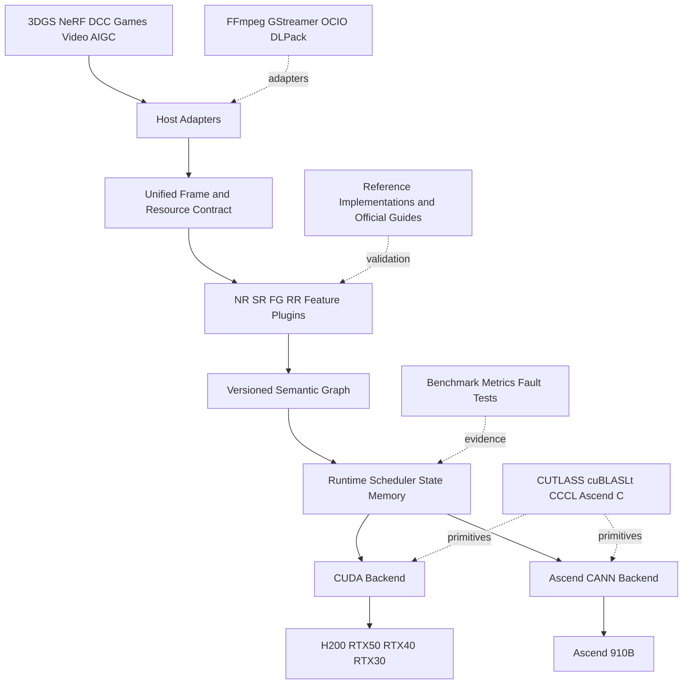
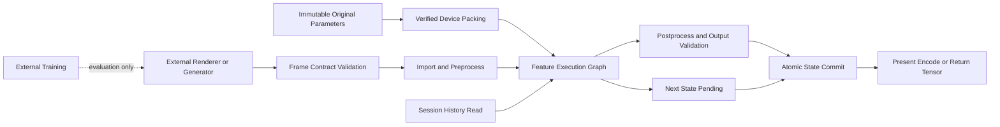
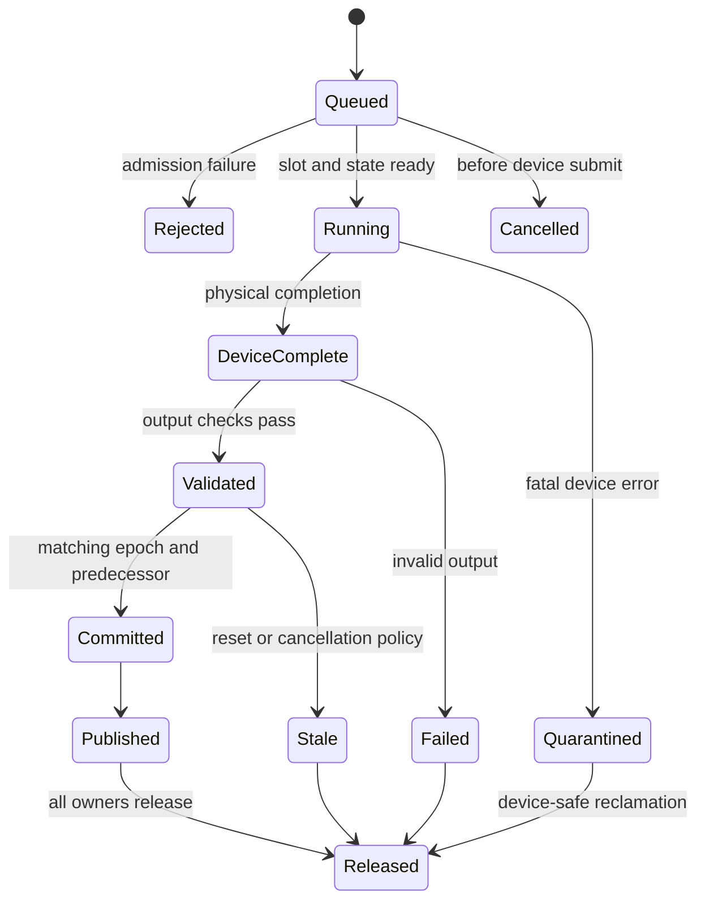

# RenderWeave：原生 DLSS 异构执行后端与统一渲染 SDK

## 完整设计与落地执行方案 V3.0

**方案日期：2026-11-01。项目代号：RenderWeave；底层命名空间：`rw`；核心库：`librw_core`。**原来的 RenderWeave-NR 名称保留为 NR 特性包名称，根项目不再用 NR 限定，因为本版统一覆盖 Neural Rendering、Super Resolution、Frame Generation、Ray Reconstruction 四类能力。以下接口、目录、配置、指标阈值与阶段规划均为拟议设计，不是已发布 SDK 或已经完成的硬件测试报告。

本项目的交付物是可嵌入工业应用的执行后端、插件、SDK、适配器和验证工具。其核心不变：原生模型语义及原始权重保持不变，执行图、设备算子、内存与调度由项目自主实现；不开展训练、微调、蒸馏，不建立独立图形引擎，不建设企业业务平台。只发布执行代码这一边界在此确定，后文不再重复展开。仓库许可分析仅用于判断具体开源代码能否作为依赖或参考。

### 阅读与证据约定

本文将四种内容分开表述：**来源事实**指官方文档、代码或 README 明确写出的内容；**社区报告**指作者尚未被本项目独立复现的结果；**设计决策**指本方案选择的接口与机制；**验收目标**指未来必须通过实测形成证据的阈值。仓库根页面、许可证文件、具体源码路径和官方文档均在文末列出。仓库调查不是对全部历史提交的安全审计，未取得锁定提交的许可或源文件内容时明确标注，不能把“公开可读”写成“已具备可直接复用条件”。正式执行先补齐 commit SHA、子模块 SHA、文件哈希与构建环境，主分支 URL 仅作为本次调研入口。

本设计的核心技术事实来自 DLSS 5 官方研究页面、Streamline 四类接口指南、公开 NR 重实现、CUDA Graph 文档和 CANN 文档。[D01] [D02] [D03] [D04] [D05] [D06] 官方接口公开程度和社区重实现成熟程度并不相同：NR 已有可读的独立网络实现；SR、FG、RR 的完整原始计算图、预后处理与内部状态不能由 NR 的成功自动推导。因此，四类能力全部纳入架构、研发和最终验收，但各自通过模型完整性门槛后才允许进入生产支持矩阵。


## 文档导航

第一部分：定位、四类能力、生态地图、仓库对比和逐项尽调。第二部分：模块、张量与参数流、模型图、精度、显存、时序、调度、设备、容错、SDK和下游。第三部分：192项开关式指标。第四部分：目录、三阶段执行、Gate、实验与架构成图。第五部分：来源、版本和复核要求。配套Agent Goal是独立的单段约千字任务约束；机器可读目录位于catalogs，示例配置位于configs。

## 1. 项目裁决：保留完整能力，压缩无关复杂度

### 1.1 最终目标

让 3DGS/NeRF 渲染器、图像处理程序、视频流水线、AIGC 工作流和游戏引擎通过同一 API 提交帧与导向信号，在 H200、RTX50/40/30、昇腾 910B 等设备上调用经过验证的原生 DLSS 功能，获得可测量的图像质量、时序稳定性、吞吐效率和生产可靠性。第一阶段聚焦 Linux H200、多会话高并发、3DGS 与视频闭环；第二阶段扩大宿主和 RTX40/30 覆盖；第三阶段完成既定设备与功能矩阵的认证、回归和发布收尾。V100 的接口和构建分支保留，但不是本版首批生产声明的阻塞项。

项目必须同时解决两个问题：第一，不同硬件的指令、精度、布局、可用算子和运行时不同，如何不改变网络含义而获得受控数值误差；第二，在固定质量门槛下，如何通过有界排队、共享权重、独立会话状态、执行槽与显存预算取得可预测的延迟和吞吐。真实性在本项目中的定义是“没有因适配、同步、精度或组合错误额外改变原生算法行为”，不是保证生成模型永不产生不真实内容，也不是新增一套几何生成学术研究。

### 1.2 包含与排除

| 事项 | 本版裁决 | 工程含义 |
|---|---|---|
| NR/SR/FG/RR | 全部包含，独立特性插件 | 各自模型图、输入、状态、参考与指标 |
| 原始权重及网络语义 | 固定，不训练 | 只能做被证明等价或误差受控的执行优化 |
| 自研后端 | 必须 | 不以调用原厂 DLL 或替代算法作为成果 |
| CUDA/CANN | 首批原生设备家族 | 自有执行图，复用成熟基础数学库 |
| 高并发、内存、故障隔离 | 必须 | 共享不可变资源，隔离可变状态 |
| C/C++ 与 Python/Conda | 必须 | 稳定 C ABI，Python 不承担算子调度 |
| 私有模型兼容层 | 包含 | 明确实现身份、状态协议和可支持算子集合 |
| 训练和梯度优化 | 不包含 | 仅允许外部宿主把增强作为推理评估 |
| 图形引擎、编解码器、通用编译器 | 不自建 | 通过现有生态和适配器复用 |
| 微服务集群、账号/计费/企业运营平台 | 不包含 | 可被宿主封装，不进入项目主线 |
| 通用游戏破解或绕过防作弊 | 不包含 | 仅正式插件、允许的接入和可控测试宿主 |

“精巧”不等于删除显存隔离、错误处理和可观测性；“生产级”也不等于增加数据库、消息中间件和管理门户。核心边界是一个库、两个首批设备后端家族、四个特性插件、一组宿主适配器及两类执行模式。资源复杂度必须可以用会话数、执行槽数、缓存预算和帧尺寸解释，不允许增加无人能够量化收益的调度层。

### 1.3 支持声明不能只用一个布尔值

支持条目必须是五元组：`(feature, model_fingerprint, device_profile, input_profile, implementation_kind)`。例如某个 H200 NR 模型通过 1080p SDR 单帧测试，不自动意味着该模型的 4K HDR、连续时序或 FG 组合也通过。状态分为 `discovered`、`graph_complete`、`numerically_validated`、`integration_validated`、`production_qualified`，另有 `unsupported`、`blocked` 和 `deprecated`。每次升档附带证据包 ID，失败不能通过更改文案消除。

实现身份分为 `native_self`、`reference_vendor`、`external_provider`、`alternative_algorithm` 和 `passthrough`。生产后端主线只能使用 `native_self`。参考采集器可以使用原生运行时生成对照，但必须在构建和指标中隔离；私有模型可以走外部执行提供者，不过不能计入本项目的原生 DLSS 重实现覆盖率。回退到原图必须标记，绝不能统计为增强成功。

## 2. 四类能力的边界与组合规则

NR 负责原生生成式外观重渲染，官方研究以当前帧、运动信息、历史和控制量作为关键条件；其内部上下采样不等于对外提供任意倍率超分。[D01] SR 面向低分辨率输入的时序重建，输入分辨率、输出分辨率、抖动、曝光和运动坐标都具有独立意义。RR 处理低采样光追信号的重建，其导向输入不能由普通 RGB 自动补成真实 G-buffer。FG 生成时间上的中间帧，其显示帧率不能当成引擎模拟帧率或输入响应率。[D02] [D03] [D04]

| 特性 | 输入能力要求 | 输出与状态 | 主要验收风险 |
|---|---|---|---|
| NR | 合法颜色代理、控制量；时序模式需要合法历史及运动 | 同分辨率增强，独立历史 | 原生预处理、填充与量化行为失配 |
| SR | 低分辨率颜色、抖动/运动/曝光，具体模型要求的附加数据 | 目标分辨率重建与历史 | 双重缩放、错误 jitter、拖影与细节损失 |
| RR | 噪声辐射信号及模型要求的法线/材质/深度等 | 重建结果及信号历史 | guides 缺失、重复降噪、信号混合错误 |
| FG | 时间相邻或模型指定帧、运动/光流信息、UI 与呈现信息 | 中间时刻帧和明确时间戳 | 假 FPS、额外等待、HUD 重影、节奏抖动 |

最终 pipeline 不是固定 `RR→SR→NR→FG`。部分 RR 路径自身执行重建，不能盲目再接 SR；不同 FG 模型可能要求增强前或增强后的帧以及对应的运动尺度。组合合法性必须写入模型 manifest 和特性插件，编译器只接受经过测试的 DAG。默认设计为三条经认证的模板：普通图形 `SR→可选 NR→可选 FG`；光追 `RR/其规定重建路径→可选 NR→可选 FG`；现成图片/视频 `NR 或合法 SR 路径`。没有原生输入依据的特性不得被模板自动启用。

对普通图片，单帧 NR 可从重置状态运行；对没有引擎运动的压缩视频，必须区分经过认证的无历史模式与代理运动兼容模式。代理模式用已有估计工具也不能改变其来源标签，更不能把缺失数据填零后声称原生时序等价。对纯 RGB AIGC，RR 通常没有可用的原始光追信号，这一组合应返回具体缺项，而不是调用一个功能名相近的算法。

## 3. 开源生态地图与复用策略



生态分为四圈。第一圈是必要核心：C/C++、设备运行库、数学原语、配置解析和 SDK 绑定。第二圈是特性语义与参考：官方指南、独立 NR 网络与原始结果采集器；它们提供证据，而不是自动成为生产依赖。第三圈是宿主：gsplat、视频框架、AIGC 与引擎插件。第四圈是开发工具：几何重建、训练框架、数据集、质量指标和压力测试。圈层之间通过帧、张量、文件和明确 ABI 连接，不通过共享 Python 全局环境或复制上游私有结构连接。

选型不是“所有优秀项目都加入 requirements”。对于用户指定的每个领域，本方案都说明与项目的关系，但在线依赖只保留必要组件。DDP、DeepSpeed、场景训练器等即使工程优秀，也不应进入此插件的正常推理路径；FAISS/cuVS 适合测试集去重，不应为了使用它们而引入向量服务。优先级依次为：准确理解输入和模型语义、复用标准基础设施、测出真实瓶颈、最后才实现针对性的优化内核。

### 3.1 复用决策总表

| 能力 | 推荐复用 | 不建议复制 | 项目必须自研 |
|---|---|---|---|
| 高斯/神经场渲染 | gsplat、宿主 renderer | 训练器、致密化、完整 UI | 帧与 guide 适配、状态事件 |
| 图像/视频 IO | FFmpeg、GStreamer、OpenEXR/OIIO | codec、封装、媒体时钟 | 帧生命周期、异步背压和颜色映射 |
| 色彩管理 | OCIO、宿主既有色彩链 | 新色彩空间标准 | 模型前处理与业务色彩链的边界 |
| 数学基础 | cuBLASLt、CUTLASS、CCCL、CANN | 全套 GEMM、排序/扫描重写 | 原生量化、融合边界、特殊采样 |
| 设备基础 | CUDA/ACL 官方 API | 设备驱动与通用编译器 | 设备画像、执行图与资源隔离 |
| SDK | DLPack、pybind11、CMake | Python 内核调度器 | 稳定 C ABI、Job/Session 生命周期 |
| 模型存储 | safetensors、成熟解析器 | 未验证私有容器 | 模型指纹、语义图、受限私有导入 |
| 测试 | GoogleTest/Benchmark、成熟质量指标 | 用单元测试代替 E2E | 对照矩阵、压力发生器、证据账本 |
| 监控 | 可选 OTel/DCGM/日志库 | 独立企业观测平台 | 指标定义、开关、预算和故障策略 |

### 3.2 许可与来源风险处理

低风险通常意味着许可形式宽松且已看到对应声明，不意味着可以忽略 NOTICE、依赖或数据来源。中风险包括自定义许可、多个组件不同许可、宿主 copyleft 与二进制边界。高风险包括非商业限制、research-only 附加说明以及没有完成锁定版本许可核验。对高风险仓库，默认采用公开接口、文献方法、外部样例和独立实现，不把代码复制进主库。仓库卡片同时保留功能价值与复用限制，不能因为一个项目不适合作为依赖就抹去其参考意义。

核心代码拟采用 Apache-2.0；第三方依赖保持各自许可。所有分发产物生成 SBOM 和 THIRD_PARTY_NOTICES，记录依赖版本、链接方式、来源 URL 与构建开关。具体许可风险表在仓库总表和每个仓库条目中给出；未核实项是必须关闭的工程任务，不会在文档中被伪装成已通过的审核结果。

## 3.3 Repo 对比总表

本表的“风险”是代码集成决策，不是对项目质量的评价。未核验许可证的项目保留研究价值，但不作为默认可分发依赖。详细来源、最小路径和自研边界见逐项卡片。

| 编号/仓库 | 生态分组 | License | 许可风险 | 集成难度 |
|---|---|---|---|---|
| [R001](https://github.com/NVIDIA/DLSS) NVIDIA/DLSS | 原生能力与接口 | NVIDIA RTX SDK 自定义许可 | 中：按文件与组件记录，不与独立代码混为同一许可证 | 中，参考侧容易；重建四类网络属于高难度独立任务 |
| [R002](https://github.com/NVIDIA-RTX/Streamline) NVIDIA-RTX/Streamline | 原生能力与接口 | 仓库代码与插件/SDK 分项许可 | 中：代码框架、插件二进制与第三方组件分别登记 | 中，图形端可选适配器；核心后端不强依赖 |
| [R003](https://github.com/mauri870/dlssnr-pytorch) mauri870/dlssnr-pytorch | NR 重实现参考 | MIT | 低：保留声明；图像样本和模型资源另行登记 | 参考验证低，移植生产中高 |
| [R004](https://github.com/aloshdenny/open-dlss) aloshdenny/open-dlss | NR 重实现参考 | MIT | 低：按锁定提交保留版权和依赖清单 | 中高，但结构最接近自研原生执行器 |
| [R005](https://github.com/Overclockers/DLSSNR-AMD) Overclockers/DLSSNR-AMD | NR 重实现参考 | MIT | 低：仓库许可证已核查；依赖和示例单独记录 | 中高，复用思想优于直接复用后端 |
| [R006](https://github.com/lmxxf/DLSS5-RTX-3080-laptop) lmxxf/DLSS5-RTX-3080-laptop | 设备兼容参考 | MIT | 低：保留声明，锁定实际复用分支与依赖 | 高，需要拆分补丁路线和独立执行路线 |
| [R007](https://github.com/lmxxf/dlss5-on-amd-9070xt-porting) lmxxf/dlss5-on-amd-9070xt-porting | NR 重实现参考 | MIT | 低：保留声明，各模型版本与依赖分别登记 | 高，算子语义参考价值大于二进制复用 |
| [R008](https://github.com/dev-camo/dlssnr-patcher) dev-camo/dlssnr-patcher | 设备兼容参考 | GPL-2.0；only/or-later 以具体文件声明确认 | 高：直接链接或复制需按GPL范围评估；本项目仅参考机制 | 中，研究用途；直接集成不推荐 |
| [R009](https://github.com/clshortfuse/openNR) clshortfuse/openNR | 设备兼容参考 | MIT | 低：保留声明，区分版本识别工具与专有资源 | 中，版本管理参考 |
| [R010](https://github.com/rodjunger/opendlssgenabler) rodjunger/opendlssgenabler | FG 接口参考 | GPL-3.0；only/or-later 以具体文件声明确认 | 高：本项目参考架构，不将其原始运行时桥接纳入核心 | 高，FG 重实现仍独立受图完整性约束 |
| [R011](https://github.com/bmitch87/DLSS5VKLayer) bmitch87/DLSS5VKLayer | 图形接入参考 | AGPL-3.0；具体文件声明随提交核对 | 高：网络交互与衍生集成范围须按组件判断；默认独立参考 | 高，互操作边界多 |
| [R012](https://github.com/jlrouzies-fr/DLSS5-Feeder) jlrouzies-fr/DLSS5-Feeder | 图形接入参考 | MIT，包含需保留的桥接组件声明 | 低到中：保留全部版权声明并核对各接入组件 | 高，应用差异显著 |
| [R013](https://github.com/Dagherbou/OptiScaler_DLSSNR) Dagherbou/OptiScaler_DLSSNR | 图形接入参考 | GPL-3.0；具体文件声明随提交核对 | 高：宿主适配包与核心执行库分项管理，不默认直接链接 | 高，宿主耦合强 |
| [R014](https://github.com/NVIDIA-RTX/NRD) NVIDIA-RTX/NRD | 重建对照与回退 | NVIDIA RTX SDKs LICENSE 自定义许可 | 中：按实际SDK条款和组件管理，不能标为MIT | 中，作为可选应用侧基线 |
| [R015](https://github.com/GPUOpen-LibrariesAndSDKs/FidelityFX-SDK) GPUOpen-LibrariesAndSDKs/FidelityFX-SDK | 图形接入与回退参考 | 按组件版本核验，不能对全部内容统一标 MIT | 中高：组件与模型发布可能不同 | 中，适配器独立 |
| [R016](https://github.com/graphdeco-inria/gaussian-splatting) graphdeco-inria/gaussian-splatting | 三维输入生态 | Inria/MPII 自定义非商业研究许可 | 高：不直接作为可自由复用的核心库 | 中，通过进程或公开数据格式接入更清晰 |
| [R017](https://github.com/bmild/nerf) bmild/nerf | 三维输入生态 | MIT | 低：保留声明；数据集条件另记 | 低到中，离线帧入口即可 |
| [R018](https://github.com/NVlabs/instant-ngp) NVlabs/instant-ngp | 三维输入生态 | NVIDIA Source Code License-NC | 高：非商业限制，不能作为默认生产依赖 | 中，通过导出图像或宿主回调适配 |
| [R019](https://github.com/sxyu/svox2) sxyu/svox2 | 三维输入生态 | BSD-2-Clause | 低：检查依赖声明 | 中，PyTorch CUDA 扩展 ABI 需隔离 |
| [R020](https://github.com/sunset1995/DirectVoxGO) sunset1995/DirectVoxGO | 三维输入生态 | GPL-3.0 文本并附 research-only 声明 | 高：混合限制，不能简化为普通宽松许可 | 中，外部离线接口优先 |
| [R021](https://github.com/apchenstu/TensoRF) apchenstu/TensoRF | 三维输入生态 | MIT | 低：保留声明与第三方清单 | 中，依赖 Python 侧输入适配即可 |
| [R022](https://github.com/nerfstudio-project/gsplat) nerfstudio-project/gsplat | 首选三维输入依赖 | Apache-2.0 | 低：保留 NOTICE，核查 CUDA 子组件 | 中，优先零复制同设备张量接入 |
| [R023](https://github.com/nerfstudio-project/nerfstudio) nerfstudio-project/nerfstudio | 三维应用接入 | Apache-2.0 | 低：外部模型和资产分别记录 | 中，插件化入口适合二次开发 |
| [R024](https://github.com/graphdeco-inria/diff-gaussian-rasterization) graphdeco-inria/diff-gaussian-rasterization | 三维低层参考 | 原始 3DGS 自定义许可 | 高：不可直接当宽松 CUDA 基础库 | 中高，ABI、构建和许可均需隔离 |
| [R025](https://github.com/NVlabs/nvdiffrast) NVlabs/nvdiffrast | 几何导向信号工具 | NVIDIA Source Code License，1-Way Commercial | 中：自定义条款，不能误标 MIT 或 NC | 中，作为离线验证依赖 |
| [R026](https://github.com/facebookresearch/pytorch3d) facebookresearch/pytorch3d | 几何验证工具 | BSD-3-Clause | 低：注意第三方算子和数据 | 中，开发工具优先 |
| [R027](https://github.com/isl-org/Open3D) isl-org/Open3D | 几何资产工具 | MIT | 低：版权与依赖记录 | 低到中，离线工具接入清晰 |
| [R028](https://github.com/colmap/colmap) colmap/colmap | 相机与场景输入 | BSD-3-Clause；第三方组件另行登记 | 低到中：保留声明，核对可选求解器和依赖 | 中，直接文件或 pycolmap 接入 |
| [R029](https://github.com/cdcseacave/openMVS) cdcseacave/openMVS | 三维资产生产工具 | AGPL-3.0 | 高：分发/修改/集成方式逐项评估 | 中，外部离线作业即可 |
| [R030](https://github.com/NVlabs/tiny-cuda-nn) NVlabs/tiny-cuda-nn | GPU 内核设计参考 | BSD-3-Clause | 低：保留版权和组件清单 | 中高，数学算子不匹配时不强行套用 |
| [R031](https://github.com/NVIDIAGameWorks/kaolin) NVIDIAGameWorks/kaolin | 三维验证与数据工具 | Apache-2.0 | 低到中：子模块和外部资产另核验 | 中，工具依赖可选 |
| [R032](https://github.com/facebookresearch/faiss) facebookresearch/faiss | 资产检索与测试抽样 | MIT | 低：CPU/GPU 依赖分开记录 | 低，离线工具即用 |
| [R033](https://github.com/NVIDIA/cuvs) NVIDIA/cuvs | GPU 数据检索工具 | Apache-2.0 | 低：CUDA/RAPIDS 组件分开锁定 | 中，版本和 CUDA 依赖较强 |
| [R034](https://github.com/Linketic/CityGaussian) Linketic/CityGaussian | 大规模三维场景 | CC-BY-NC-SA-4.0 | 高：非商业与相同方式共享，依赖另核验 | 中，渲染输出层接入 |
| [R035](https://github.com/graphdeco-inria/hierarchical-3d-gaussians) graphdeco-inria/hierarchical-3d-gaussians | 大规模三维场景 | 自定义非商业研究/评估许可，涉及原始3DGS条款 | 高：只研究接口与分块经验，不复制为默认可分发核心 | 中，外部渲染协议足够 |
| [R036](https://github.com/nyu-systems/Grendel-GS) nyu-systems/Grendel-GS | 多 GPU 工程参考 | Apache-2.0 主仓库；上游组件单独审核 | 中：主许可证不能覆盖所有子模块 | 高，研究价值与直接依赖价值分离 |
| [R037](https://github.com/SunshineWYC/BlockGaussian) SunshineWYC/BlockGaussian | 大规模三维场景 | 未完成锁定提交的许可核验 | 高：只用公开思想和已有样例 | 中，以导出帧为集成边界 |
| [R038](https://github.com/AkierRaee/BlitzGS) AkierRaee/BlitzGS | 大规模三维场景 | 原始 GS 生态研究型限制 | 高：非默认生产依赖 | 中，固定渲染视频导出 |
| [R039](https://github.com/pytorch/pytorch) pytorch/pytorch | 参考算术与开发环境 | BSD 风格许可及第三方分项 | 低到中：二进制依赖和 CUDA ABI 需锁定 | 中，Python 生态兼容复杂 |
| [R040](https://github.com/deepspeedai/DeepSpeed) deepspeedai/DeepSpeed | 多 GPU 框架调研 | Apache-2.0 | 低到中：具体扩展和依赖另查 | 高，直接使用会增加无关系统负担 |
| [R041](https://github.com/huggingface/accelerate) huggingface/accelerate | 测试任务编排 | Apache-2.0 | 低：配置和环境仍需版本化 | 低，可选测试入口 |
| [R042](https://github.com/NVIDIA/nccl) NVIDIA/nccl | 设备通信工具 | BSD-3-Clause，需随发布包核对 | 低到中：系统依赖与插件分别登记 | 中，多卡系统需要拓扑与故障测试 |
| [R043](https://github.com/webdataset/webdataset) webdataset/webdataset | 数据与基准缓存 | BSD-3-Clause | 低：样本内容来源另记 | 低，离线数据路径优先 |
| [R044](https://github.com/LMDB/lmdb) LMDB/lmdb | 数据索引与缓存 | OpenLDAP Public License | 中：保留完整声明，注意包装库许可 | 低到中，操作系统文件映射需管理 |
| [R045](https://github.com/safetensors/safetensors) safetensors/safetensors | 模型与张量容器 | Apache-2.0 | 低：模型内容与代码许可分离记录 | 中，C++ 可用受审计读取器或轻量格式实现 |
| [R046](https://github.com/NVIDIA/cutlass) NVIDIA/cutlass | CUDA 数学内核 | BSD-3-Clause | 低：保留声明，架构相关依赖核验 | 高，需要逐目标架构调优 |
| [R047](https://github.com/NVIDIA/cccl) NVIDIA/cccl | CUDA 基础组件 | 分组件：Apache-2.0/LLVM exception 等 | 中：Thrust、CUB、libcu++ 按实际版本登记 | 中，CUDA 编译器版本绑定 |
| [R048](https://github.com/NVIDIA/cuda-samples) NVIDIA/cuda-samples | CUDA 互操作样例 | BSD-3-Clause，按具体样例核对 | 低：样例不代表生产支持保证 | 低，适合最小验证 |
| [R049](https://github.com/Dao-AILab/flash-attention) Dao-AILab/flash-attention | 注意力优化参考 | BSD-3-Clause | 低到中：编译依赖和不同子实现需核验 | 高，原模型归约和量化可能限制复用 |
| [R050](https://github.com/triton-lang/triton) triton-lang/triton | 编译与研究工具 | MIT | 低：具体后端与编译依赖另记 | 中高，研究方便但生产依赖面大 |
| [R051](https://github.com/onnx/onnx) onnx/onnx | 私有模型兼容格式 | Apache-2.0 | 低：自定义域的实现另核验 | 中，支持严格子集更可控 |
| [R052](https://github.com/microsoft/onnxruntime) microsoft/onnxruntime | 私有模型对照执行 | MIT | 低到中：Execution Provider 与系统库分别记录 | 中，插件边界清晰即可 |
| [R053](https://github.com/Ascend/pytorch) Ascend/pytorch | 昇腾开发对照 | BSD 风格，继承 PyTorch 许可结构 | 低到中：CANN 和其他组件单独锁定 | 高，芯片/驱动/固件/CANN/torch_npu 组合需要实机认证 |
| [R054](https://github.com/Ascend/samples) Ascend/samples | 昇腾运行时基础 | Apache-2.0 | 低到中：样例依赖与设备环境另核验 | 中，必须在真实 910B 上验证 |
| [R055](https://github.com/FFmpeg/FFmpeg) FFmpeg/FFmpeg | 视频输入输出 | LGPL-2.1-or-later 默认；GPL/nonfree 配置改变分发条件 | 中高：必须保存真实 configure 参数及组件清单 | 中，独立 filter/adapter 比修改核心更稳妥 |
| [R056](https://github.com/GStreamer/gstreamer) GStreamer/gstreamer | 实时媒体接入 | LGPL-2.1-or-later 为主；插件逐项核验 | 中：第三方 codec 与插件许可分开记录 | 中，编写独立元素即可 |
| [R057](https://github.com/opencv/opencv) opencv/opencv | 图像预处理与测试 | Apache-2.0，旧版本与第三方组件另核验 | 低到中：可选模块不默认启用 | 低，工具优先 |
| [R058](https://github.com/AcademySoftwareFoundation/OpenColorIO) AcademySoftwareFoundation/OpenColorIO | 色彩管理 | BSD-3-Clause | 低：配置文件和 LUT 来源单独记录 | 中，正确配置比链接本身更重要 |
| [R059](https://github.com/AcademySoftwareFoundation/OpenImageIO) AcademySoftwareFoundation/OpenImageIO | 图像文件与元数据 | Apache-2.0 | 低：插件和外部格式库独立核验 | 低到中，工具环境优先 |
| [R060](https://github.com/AcademySoftwareFoundation/openexr) AcademySoftwareFoundation/openexr | HDR 与 guide 容器 | BSD-3-Clause | 低：依赖与压缩设置记录 | 低，离线验证非常适合 |
| [R061](https://github.com/dmlc/dlpack) dmlc/dlpack | 张量互操作 | Apache-2.0 | 低：消费方实现仍需测试 | 中，零复制安全比封装代码更难 |
| [R062](https://github.com/pybind/pybind11) pybind/pybind11 | Python SDK | BSD-3-Clause | 低：构建链和 Python ABI 锁定 | 中，多线程析构需仔细测试 |
| [R063](https://github.com/Kitware/CMake) Kitware/CMake | 构建与打包 | BSD-3-Clause | 低：打包工具和外部依赖单独列明 | 中，跨工具链矩阵需持续维护 |
| [R064](https://github.com/google/benchmark) google/benchmark | 微基准工具 | Apache-2.0 | 低：保持测量配置可追溯 | 低，作为开发依赖 |
| [R065](https://github.com/google/googletest) google/googletest | 单元与契约测试 | BSD-3-Clause | 低：测试数据独立记录 | 低，适合所有组件 |
| [R066](https://github.com/Netflix/vmaf) Netflix/vmaf | 视频质量指标 | BSD-2-Clause-Patent | 低到中：模型版本与适用范围另锁定 | 中，离线计算可控 |
| [R067](https://github.com/richzhang/PerceptualSimilarity) richzhang/PerceptualSimilarity | 感知质量指标 | BSD-2-Clause，具体模型资源另核验 | 低到中：指标网络与配置需版本化 | 低，独立工具环境即可 |
| [R068](https://github.com/NVlabs/flip) NVlabs/flip | 感知误差可视化 | BSD-3-Clause | 低：保留声明；显示参数与版本另锁定 | 低到中，离线使用 |
| [R069](https://github.com/doitsujin/dxvk) doitsujin/dxvk | Linux 游戏兼容 | Zlib | 低到中：依赖与发行包分别核验 | 高，游戏资源与呈现交互复杂 |
| [R070](https://github.com/HansKristian-Work/vkd3d-proton) HansKristian-Work/vkd3d-proton | Linux 游戏兼容 | LGPL-2.1-or-later 为主，组件核验 | 中：修改和分发方式需留记录 | 高，D3D12 明确同步需要完整上下文 |
| [R071](https://github.com/jp7677/dxvk-nvapi) jp7677/dxvk-nvapi | Linux NVIDIA 接口桥接 | MIT | 低到中：系统接口行为需版本化 | 中，作为宿主侧可选依赖 |
| [R072](https://github.com/Comfy-Org/ComfyUI) Comfy-Org/ComfyUI | AIGC 应用接入 | GPL-3.0 | 中高：节点、主程序与二进制 SDK 边界需登记 | 中，独立节点包即可 |
| [R073](https://github.com/huggingface/diffusers) huggingface/diffusers | AIGC 应用接入 | Apache-2.0 | 低：所用模型和资源单独记录 | 低到中，可选 Python 集成 |
| [R074](https://github.com/godotengine/godot) godotengine/godot | 游戏引擎示例 | MIT | 低：项目资产和第三方模块另外核验 | 中高，正式渲染 hook 需按版本确认 |
| [R075](https://github.com/blender/blender) blender/blender | DCC 与离线渲染接入 | GPL-2.0-or-later，组件逐项记录 | 中高：插件和分发边界核验 | 中，先文件入口再插件 |
| [R076](https://github.com/playcanvas/engine) playcanvas/engine | Web 三维接入 | MIT | 低：浏览器部署依赖另核验 | 高，跨进程/网络为主 |
| [R077](https://github.com/playcanvas/supersplat) playcanvas/supersplat | 高斯编辑器接入 | MIT | 低：插件资源和打包清单单列 | 中到高，依赖 Web/桌面宿主方式 |
| [R078](https://github.com/google/filament) google/filament | 受控图形验证应用 | Apache-2.0 | 低到中：第三方工具与资源需记录 | 中高，需要实际导出能力核查 |
| [R079](https://github.com/NVIDIA/DCGM) NVIDIA/DCGM | 设备健康与性能观测 | Apache-2.0，按锁定包核查 | 低到中：驱动服务与可选库独立管理 | 中，可选运行工具 |
| [R080](https://github.com/open-telemetry/opentelemetry-cpp) open-telemetry/opentelemetry-cpp | 可选遥测出口 | Apache-2.0 | 低：导出器依赖与安全配置分离 | 中，离线/关闭模式必须可用 |
| [R081](https://github.com/gabime/spdlog) gabime/spdlog | 日志基础组件 | MIT | 低：fmt 等依赖版本保持一致 | 低，核心可选依赖 |
| [R082](https://github.com/nlohmann/json) nlohmann/json | 配置与模型描述 | MIT | 低：解析器版本与扩展选项锁定 | 低，适合控制面 |
| [R083](https://github.com/gl-ungus/dlss5-launcher) gl-ungus/dlss5-launcher | 社区部署与兼容 | Unlicense | 低到中：启动器代码与外部下载组件分别登记 | 中 |
| [R084](https://github.com/kamalzakaria/dlss5-on-linux) kamalzakaria/dlss5-on-linux | 社区部署与兼容 | 未完成锁定提交的许可核验 | 高：仅阅读文档 | 低到中 |
| [R085](https://github.com/pantsoftime/dlss5-linux) pantsoftime/dlss5-linux | 社区部署与兼容 | MIT，内置core/shader组件声明分别保留 | 低到中：代码与依赖逐组件登记 | 中 |
| [R086](https://github.com/malik05051/DLSS5-NeuralScreen-Linux) malik05051/DLSS5-NeuralScreen-Linux | 桌面视频接入 | MIT代码；附带专有组件不属于MIT | 中高：代码与发行包的组件边界必须分开核对 | 中高 |
| [R087](https://github.com/Mhsbrian/DLSS5oneclick-forlinux) Mhsbrian/DLSS5oneclick-forlinux | 社区部署与兼容 | MIT | 低到中：配置代码与其安装的外部工具分别登记 | 中 |
| [R088](https://github.com/maohgad-web/Neural-coprocessor) maohgad-web/Neural-coprocessor | 多 GPU 接入参考 | MIT | 低：保留声明，图形SDK依赖独立登记 | 高 |
| [R089](https://github.com/guentra/dlss5-amd-hip-linux) guentra/dlss5-amd-hip-linux | NR 重实现参考 | MIT | 低：保留声明，ROCm依赖与各文件声明另锁定 | 高 |
| [R090](https://github.com/xdzleo/dlss5-launcher) xdzleo/dlss5-launcher | Windows 游戏接入参考 | 未完成锁定提交的许可核验 | 高：仅研究部署关系 | 中高 |
| [R091](https://github.com/ShyVortex/dlss-unlocked) ShyVortex/dlss-unlocked | 特性组合参考 | MIT | 低到中：主项目与组合的外部特性实现分开登记 | 中高 |

## 3.4 重点 License 风险表

| 仓库 | 已识别约束 | 本项目裁决 |
|---|---|---|
| R001 NVIDIA/DLSS | NVIDIA RTX SDK 自定义许可；中：按文件与组件记录，不与独立代码混为同一许可证 | 按真实链接与组件范围登记许可，保留声明并隔离可选依赖 |
| R008 dev-camo/dlssnr-patcher | GPL-2.0；only/or-later 以具体文件声明确认；高：直接链接或复制需按GPL范围评估；本项目仅参考机制 | 仅作接口/文档/外部样例参考；锁定文件核验前不直接复制代码 |
| R010 rodjunger/opendlssgenabler | GPL-3.0；only/or-later 以具体文件声明确认；高：本项目参考架构，不将其原始运行时桥接纳入核心 | 仅作接口/文档/外部样例参考；锁定文件核验前不直接复制代码 |
| R011 bmitch87/DLSS5VKLayer | AGPL-3.0；具体文件声明随提交核对；高：网络交互与衍生集成范围须按组件判断；默认独立参考 | 仅作接口/文档/外部样例参考；锁定文件核验前不直接复制代码 |
| R013 Dagherbou/OptiScaler_DLSSNR | GPL-3.0；具体文件声明随提交核对；高：宿主适配包与核心执行库分项管理，不默认直接链接 | 仅作接口/文档/外部样例参考；锁定文件核验前不直接复制代码 |
| R014 NVIDIA-RTX/NRD | NVIDIA RTX SDKs LICENSE 自定义许可；中：按实际SDK条款和组件管理，不能标为MIT | 按真实链接与组件范围登记许可，保留声明并隔离可选依赖 |
| R015 GPUOpen-LibrariesAndSDKs/FidelityFX-SDK | 按组件版本核验，不能对全部内容统一标 MIT；中高：组件与模型发布可能不同 | 按真实链接与组件范围登记许可，保留声明并隔离可选依赖 |
| R016 graphdeco-inria/gaussian-splatting | Inria/MPII 自定义非商业研究许可；高：不直接作为可自由复用的核心库 | 仅作接口/文档/外部样例参考；锁定文件核验前不直接复制代码 |
| R018 NVlabs/instant-ngp | NVIDIA Source Code License-NC；高：非商业限制，不能作为默认生产依赖 | 仅作接口/文档/外部样例参考；锁定文件核验前不直接复制代码 |
| R020 sunset1995/DirectVoxGO | GPL-3.0 文本并附 research-only 声明；高：混合限制，不能简化为普通宽松许可 | 仅作接口/文档/外部样例参考；锁定文件核验前不直接复制代码 |
| R024 graphdeco-inria/diff-gaussian-rasterization | 原始 3DGS 自定义许可；高：不可直接当宽松 CUDA 基础库 | 仅作接口/文档/外部样例参考；锁定文件核验前不直接复制代码 |
| R025 NVlabs/nvdiffrast | NVIDIA Source Code License，1-Way Commercial；中：自定义条款，不能误标 MIT 或 NC | 按真实链接与组件范围登记许可，保留声明并隔离可选依赖 |
| R029 cdcseacave/openMVS | AGPL-3.0；高：分发/修改/集成方式逐项评估 | 仅作接口/文档/外部样例参考；锁定文件核验前不直接复制代码 |
| R034 Linketic/CityGaussian | CC-BY-NC-SA-4.0；高：非商业与相同方式共享，依赖另核验 | 仅作接口/文档/外部样例参考；锁定文件核验前不直接复制代码 |
| R035 graphdeco-inria/hierarchical-3d-gaussians | 自定义非商业研究/评估许可，涉及原始3DGS条款；高：只研究接口与分块经验，不复制为默认可分发核心 | 仅作接口/文档/外部样例参考；锁定文件核验前不直接复制代码 |
| R037 SunshineWYC/BlockGaussian | 未完成锁定提交的许可核验；高：只用公开思想和已有样例 | 仅作接口/文档/外部样例参考；锁定文件核验前不直接复制代码 |
| R038 AkierRaee/BlitzGS | 原始 GS 生态研究型限制；高：非默认生产依赖 | 仅作接口/文档/外部样例参考；锁定文件核验前不直接复制代码 |
| R047 NVIDIA/cccl | 分组件：Apache-2.0/LLVM exception 等；中：Thrust、CUB、libcu++ 按实际版本登记 | 按真实链接与组件范围登记许可，保留声明并隔离可选依赖 |
| R055 FFmpeg/FFmpeg | LGPL-2.1-or-later 默认；GPL/nonfree 配置改变分发条件；中高：必须保存真实 configure 参数及组件清单 | 按真实链接与组件范围登记许可，保留声明并隔离可选依赖 |
| R056 GStreamer/gstreamer | LGPL-2.1-or-later 为主；插件逐项核验；中：第三方 codec 与插件许可分开记录 | 按真实链接与组件范围登记许可，保留声明并隔离可选依赖 |
| R070 HansKristian-Work/vkd3d-proton | LGPL-2.1-or-later 为主，组件核验；中：修改和分发方式需留记录 | 按真实链接与组件范围登记许可，保留声明并隔离可选依赖 |
| R072 Comfy-Org/ComfyUI | GPL-3.0；中高：节点、主程序与二进制 SDK 边界需登记 | 按真实链接与组件范围登记许可，保留声明并隔离可选依赖 |
| R075 blender/blender | GPL-2.0-or-later，组件逐项记录；中高：插件和分发边界核验 | 按真实链接与组件范围登记许可，保留声明并隔离可选依赖 |
| R084 kamalzakaria/dlss5-on-linux | 未完成锁定提交的许可核验；高：仅阅读文档 | 仅作接口/文档/外部样例参考；锁定文件核验前不直接复制代码 |
| R090 xdzleo/dlss5-launcher | 未完成锁定提交的许可核验；高：仅研究部署关系 | 仅作接口/文档/外部样例参考；锁定文件核验前不直接复制代码 |

## 3.5 自研模块与禁止重复造轮子清单

| 必须自研模块 | 核心原因 | 可复用基础 | 明确不得扩张的范围 |
|---|---|---|---|
| 原生Feature Graph与manifest | 原始模型和状态的真实语义归属项目 | 官方接口/社区参考 | 不开发通用训练框架 |
| 精度合同与节点验证 | 各硬件算术行为不一致 | CPU参考、成熟矩阵库 | 不重写全部GEMM/编译器 |
| Shape与状态规划 | 填充、时间依赖影响结果 | 基础容器和内存API | 不用任意分块冒充等价 |
| CUDA/CANN lowering | 掌握完整执行路径 | CUTLASS/cuBLASLt/Ascend C | 不调用原始DLL作为生产主体 |
| 多会话调度与准入 | 质量固定下的吞吐/尾延迟冲突 | 线程/事件/队列基础 | 不引入分布式业务平台 |
| 内存台账与资源生命周期 | 超时/取消/并发的安全性 | 设备allocator与DLPack | 不把零复制当无成本万能桥 |
| 原生特性组合校验 | RR/SR与FG/NR顺序不能假定 | 宿主接口规范 | 不将四特性盲目串联 |
| 统一SDK与模型插件ABI | 可二次开发且不泄漏内部结构 | pybind11/CMake | 不重造语言绑定或媒体引擎 |
| 端到端证据与容量认证 | 运行成功不是工业效果证明 | 成熟指标/测试库 | 不用内部自评分替代原生对照 |

## 3.6 逐仓库工程尽调与最小代码路径

各条目的“主要功能/核心模块/API”来自所列一手入口；“复用方式/风险/路径/自研”是本方案的工程判断。具体源码已阅读的条目在证据层级注明，其他条目不冒充逐行审计。

### R001 — NVIDIA/DLSS

**来源：** [NVIDIA/DLSS](https://github.com/NVIDIA/DLSS)；访问日期 2026-11-01；证据层级：官方头文件/发布页。

| 尽调项 | 结论 |
|---|---|
| 主要功能与本项目关系 | 官方 DLSS SDK 的接口、示例及发布入口；公开接口不等于四类模型的完整开放计算图。 本项目位置：原生能力与接口。 |
| License 与许可风险 | NVIDIA RTX SDK 自定义许可；中：按文件与组件记录，不与独立代码混为同一许可证。 |
| 核心模块 | include 中的 NGX 类型和功能定义、样例、发布记录 |
| API / 数据结构特点 | 特性创建、参数集合、资源描述、Evaluate 生命周期；版本变化必须入注册表 |
| 可复用模块 / 禁止重复造轮子 | 接口语义、输入资源清单、原生结果采集规范 |
| 不建议复用模块 | 不得把调用 SDK 二进制当作自研执行器交付，也不将特性编号写死到业务层 |
| 集成难度 | 中，参考侧容易；重建四类网络属于高难度独立任务 |
| 工程风险 | 接口能调用不代表权重、拓扑和时序机制已全部识别；不能从 NR 推导 SR、FG、RR 完整性 |
| 推荐复用方式与最小可行代码路径 | 构建隔离的参考输出采集程序，逐类保存输入、控制参数、输出及版本 |
| 终态工程路径 | 将官方参考测试作为差分验证源，生产依赖自己的特性插件和设备后端 |
| 替代方案 | Streamline 的较高层资源接口；已有录制样本可作为离线参考 |
| 必须自研模块 | 四类模型清单、原生语义指纹和逐层执行计划 |

### R002 — NVIDIA-RTX/Streamline

**来源：** [NVIDIA-RTX/Streamline](https://github.com/NVIDIA-RTX/Streamline)；访问日期 2026-11-01；证据层级：官方集成指南。

| 尽调项 | 结论 |
|---|---|
| 主要功能与本项目关系 | 图形特性集成框架，提供 SR、FG、RR 等调用与资源标记指南。 本项目位置：原生能力与接口。 |
| License 与许可风险 | 仓库代码与插件/SDK 分项许可；中：代码框架、插件二进制与第三方组件分别登记。 |
| 核心模块 | include、source、插件结构、ProgrammingGuideDLSS 与 DLSS_G、DLSS_RR 指南 |
| API / 数据结构特点 | 资源标签、帧标识、视口、特性选项、生命周期及交换链交互 |
| 可复用模块 / 禁止重复造轮子 | 资源语义和跨引擎集成检查单；不重复定义已有坐标字段含义 |
| 不建议复用模块 | 不要把完整框架嵌入 H200 无显示计算核心，不依赖驱动拦截构建所有上游 |
| 集成难度 | 中，图形端可选适配器；核心后端不强依赖 |
| 工程风险 | 资源状态、抖动、曝光、运动向量尺度遗漏，会造成看似模型错误的输入偏差 |
| 推荐复用方式与最小可行代码路径 | 逐项将官方资源标签映射到 RWFrame，并录制一套完整测试帧 |
| 终态工程路径 | 实现可独立装卸的 Streamline 适配器，保持自己的稳定 C ABI |
| 替代方案 | 直接原生引擎插件；Vulkan/D3D12 显式资源接口 |
| 必须自研模块 | 资源契约映射、帧完成协议和特性组合验证 |

### R003 — mauri870/dlssnr-pytorch

**来源：** [mauri870/dlssnr-pytorch](https://github.com/mauri870/dlssnr-pytorch)；访问日期 2026-11-01；证据层级：README 与公开算子路径。

| 尽调项 | 结论 |
|---|---|
| 主要功能与本项目关系 | NR 的 PyTorch 数值参考实现；公开报告以单帧比较为主，CUDA 路径未被作者在 NVIDIA 卡上实测。 本项目位置：NR 重实现参考。 |
| License 与许可风险 | MIT；低：保留声明；图像样本和模型资源另行登记。 |
| 核心模块 | dlssnr/gemm.py、attention.py、swin_fused.py、权重读取与 verify 工具 |
| API / 数据结构特点 | 张量级网络定义、FP8 量化边界、图像输入与控制参数；历史接口并不等于完整时序实现 |
| 可复用模块 / 禁止重复造轮子 | 逐算子数学语义、参考张量和差分测试方法 |
| 不建议复用模块 | 不将 Python/Triton 整体作为 C++ 生产执行器，不把其单帧结果当完整时序证明 |
| 集成难度 | 参考验证低，移植生产中高 |
| 工程风险 | 浮点归约顺序和量化边界会放大误差；社区少量图像得分不能外推到全部场景 |
| 推荐复用方式与最小可行代码路径 | 先在 CPU/小张量下固定每个算子的输入输出，再对照 CUDA 实现 |
| 终态工程路径 | 保留独立参考测试环境，生产路径完全由自己的 C++/CUDA/CANN 执行 |
| 替代方案 | open-dlss 与 DLSSNR-AMD 的独立交叉参照 |
| 必须自研模块 | 模型版本适配、精度契约和完整会话状态机 |

### R004 — aloshdenny/open-dlss

**来源：** [aloshdenny/open-dlss](https://github.com/aloshdenny/open-dlss)；访问日期 2026-11-01；证据层级：网络文档与核心源文件定位。

| 尽调项 | 结论 |
|---|---|
| 主要功能与本项目关系 | 提供 C++/Vulkan NR 重实现和网络解释文档；所述模型为固定版本，不代表所有 DLSS 功能。 本项目位置：NR 重实现参考。 |
| License 与许可风险 | MIT；低：按锁定提交保留版权和依赖清单。 |
| 核心模块 | src/nr_model.cpp、src/nr_graph.cpp、shaders/preprocess.comp、docs/network.md |
| API / 数据结构特点 | 显式张量形状、四通道输出头、条件输入和模型特定填充几何 |
| 可复用模块 / 禁止重复造轮子 | 固定图编排、阶段张量追踪、输入预处理语义 |
| 不建议复用模块 | 不照搬 Vulkan 管线成为 CUDA/NPU 核心；不可把其固定版本布局泛化到新模型 |
| 集成难度 | 中高，但结构最接近自研原生执行器 |
| 工程风险 | 额外填充改变窗口网格与噪声坐标，任意分辨率桶化可能直接改变有效区域输出 |
| 推荐复用方式与最小可行代码路径 | 对照 network.md 录入版本化算子表与填充函数，建立边界尺寸测试 |
| 终态工程路径 | 采用自己的后端降低接口执行同一语义图，保留可比的阶段摘要 |
| 替代方案 | dlssnr-pytorch 的参考算术；DLSSNR-AMD 的性能路径 |
| 必须自研模块 | 精确几何规划、跨后端图实例和原生预后处理 |

### R005 — Overclockers/DLSSNR-AMD

**来源：** [Overclockers/DLSSNR-AMD](https://github.com/Overclockers/DLSSNR-AMD)；访问日期 2026-11-01；证据层级：README 与 LICENSE。

| 尽调项 | 结论 |
|---|---|
| 主要功能与本项目关系 | 基于 Vulkan Compute 的独立 NR 执行实现，作者主要在 RDNA4 上验证。 本项目位置：NR 重实现参考。 |
| License 与许可风险 | MIT；低：仓库许可证已核查；依赖和示例单独记录。 |
| 核心模块 | 网络调度、FP8 计算着色器、模型数据读取、时序对比与运行说明 |
| API / 数据结构特点 | 显式 GPU 缓冲、计算阶段与资源屏障；设备路线不同于 CUDA/CANN |
| 可复用模块 / 禁止重复造轮子 | 算子分解、显存复用策略和短序列验证样例 |
| 不建议复用模块 | 不把 RDNA4 性能换算为 H200 性能；不将可选 INT4 等改动作为原生一致性默认路径 |
| 集成难度 | 中高，复用思想优于直接复用后端 |
| 工程风险 | 社区序列覆盖有限；融合路径、可选模型变体和基线可能具有不同误差 |
| 推荐复用方式与最小可行代码路径 | 选定原始模型配置，记录单帧和连续帧的输入输出供交叉验证 |
| 终态工程路径 | 形成第三方参考适配器与独立回归材料，不增加线上 Vulkan 必选依赖 |
| 替代方案 | open-dlss；自己的 CUDA 数值基线 |
| 必须自研模块 | CUDA/CANN 算子、状态提交和高并发内存规划 |

### R006 — lmxxf/DLSS5-RTX-3080-laptop

**来源：** [lmxxf/DLSS5-RTX-3080-laptop](https://github.com/lmxxf/DLSS5-RTX-3080-laptop)；访问日期 2026-11-01；证据层级：README 与公开开发目录；已读取LICENSE原文。

| 尽调项 | 结论 |
|---|---|
| 主要功能与本项目关系 | 围绕 RTX 3080 Laptop 的 NR 兼容工程，包含原始模块修补及实验性的 HIP/CUDA 执行探索。 本项目位置：设备兼容参考。 |
| License 与许可风险 | MIT；低：保留声明，锁定实际复用分支与依赖。 |
| 核心模块 | Development/hip-port、sm86_compat.h、模块构建脚本、历史记录 |
| API / 数据结构特点 | 面向 sm_86 的 FP8 转换、矩阵计算和运行模块边界 |
| 可复用模块 / 禁止重复造轮子 | 适配失败案例、精度转换测试及 Ampere 热点分析 |
| 不建议复用模块 | 不发布原始二进制修补器作为本项目主要实现，不采用未经核查的历史性能数值 |
| 集成难度 | 高，需要拆分补丁路线和独立执行路线 |
| 工程风险 | 同一仓库不同分支的架构与测试条件可能完全不同，必须固定代码和模型组合 |
| 推荐复用方式与最小可行代码路径 | 抽取公开的数值问题描述，编写自己的 FP8 舍入和矩阵微测试 |
| 终态工程路径 | 将经过验证的兼容算子纳入统一 CUDA 后端并形成 RTX30 设备画像 |
| 替代方案 | open-dlss 的数学分解；CUTLASS FP16 路线 |
| 必须自研模块 | Ampere 精度保持、布局转换和端到端原生一致性 |

### R007 — lmxxf/dlss5-on-amd-9070xt-porting

**来源：** [lmxxf/dlss5-on-amd-9070xt-porting](https://github.com/lmxxf/dlss5-on-amd-9070xt-porting)；访问日期 2026-11-01；证据层级：README/开发记录；已读取LICENSE原文。

| 尽调项 | 结论 |
|---|---|
| 主要功能与本项目关系 | 面向 RX 9070 XT 的 NR 移植与 HIP 推理探索，公开开发记录提供算子重构线索。 本项目位置：NR 重实现参考。 |
| License 与许可风险 | MIT；低：保留声明，各模型版本与依赖分别登记。 |
| 核心模块 | HIP 网络块、权重布局、版本化运行脚本与性能记录 |
| API / 数据结构特点 | 网络层与硬件矩阵操作映射；与原始运行时对照的记录 |
| 可复用模块 / 禁止重复造轮子 | 网络块边界和性能瓶颈分类方法 |
| 不建议复用模块 | 不把作者纯推理耗时当本项目端到端延迟，不复制特定显卡汇编到其他架构 |
| 集成难度 | 高，算子语义参考价值大于二进制复用 |
| 工程风险 | 模型配置、降采样和输出尺寸改变会使不同报告不可比较 |
| 推荐复用方式与最小可行代码路径 | 逐条还原其基准条件，选择可复现的小算子案例对照 |
| 终态工程路径 | 为 CUDA 与 Ascend 两条后端提供结构参考和不同硬件的误差解释 |
| 替代方案 | DLSSNR-AMD Vulkan 路线；自建参考算子 |
| 必须自研模块 | 硬件无关的执行语义、同步和调度层 |

### R008 — dev-camo/dlssnr-patcher

**来源：** [dev-camo/dlssnr-patcher](https://github.com/dev-camo/dlssnr-patcher)；访问日期 2026-11-01；证据层级：README；已读取LICENSE原文。

| 尽调项 | 结论 |
|---|---|
| 主要功能与本项目关系 | 针对不同 RTX 架构处理原始 NR GPU 模块的兼容工具。 本项目位置：设备兼容参考。 |
| License 与许可风险 | GPL-2.0；only/or-later 以具体文件声明确认；高：直接链接或复制需按GPL范围评估；本项目仅参考机制。 |
| 核心模块 | Fatbin/PTX 处理、目标架构选项与兼容变换 |
| API / 数据结构特点 | GPU 模块与计算能力对应关系，不是统一渲染张量 API |
| 可复用模块 / 禁止重复造轮子 | 不支持指令清单与跨代兼容边界 |
| 不建议复用模块 | 不复用修改原始 DLL 的生产依赖，不以型号伪装替代数值验证 |
| 集成难度 | 中，研究用途；直接集成不推荐 |
| 工程风险 | 二进制版本强耦合，驱动更新可能使补丁失效 |
| 推荐复用方式与最小可行代码路径 | 列出原生 FP8 与架构特性差异，转为自有微测试 |
| 终态工程路径 | 只保留故障知识到技术文档，不进入运行时依赖树 |
| 替代方案 | 独立网络图执行器 |
| 必须自研模块 | 自研设备能力检测和算子选择 |

### R009 — clshortfuse/openNR

**来源：** [clshortfuse/openNR](https://github.com/clshortfuse/openNR)；访问日期 2026-11-01；证据层级：README；已读取LICENSE原文。

| 尽调项 | 结论 |
|---|---|
| 主要功能与本项目关系 | 提供 C++20 的 NR 版本识别与兼容处理工具。 本项目位置：设备兼容参考。 |
| License 与许可风险 | MIT；低：保留声明，区分版本识别工具与专有资源。 |
| 核心模块 | 版本签名、文件检查和架构适配流程 |
| API / 数据结构特点 | 依赖具体版本及哈希的资源处理 |
| 可复用模块 / 禁止重复造轮子 | 严格版本识别和未知输入拒绝的工程习惯 |
| 不建议复用模块 | 不把文件修补等同于自己的推理后端 |
| 集成难度 | 中，版本管理参考 |
| 工程风险 | 固定偏移和版本识别错误可能把不兼容文件当有效模型 |
| 推荐复用方式与最小可行代码路径 | 建立自己的模型指纹清单和错误分类，不接入修补行为 |
| 终态工程路径 | 形成可升级、可回滚、未知版本默认拒绝的模型注册体系 |
| 替代方案 | 原始 manifest 与 safetensors 校验 |
| 必须自研模块 | 独立模型容器和计算图完整性验证 |

### R010 — rodjunger/opendlssgenabler

**来源：** [rodjunger/opendlssgenabler](https://github.com/rodjunger/opendlssgenabler)；访问日期 2026-11-01；证据层级：架构文档；已读取LICENSE原文。

| 尽调项 | 结论 |
|---|---|
| 主要功能与本项目关系 | 为 RTX30 启用原始 DLSS Frame Generation 的兼容工程，其架构依然依赖原始执行模块。 本项目位置：FG 接口参考。 |
| License 与许可风险 | GPL-3.0；only/or-later 以具体文件声明确认；高：本项目参考架构，不将其原始运行时桥接纳入核心。 |
| 核心模块 | docs/ARCHITECTURE.md、接口桥接与运行时适配 |
| API / 数据结构特点 | FG 资源、设备兼容和呈现链路，而非开放的完整 FG 网络图 |
| 可复用模块 / 禁止重复造轮子 | 输入资源、帧节奏和兼容故障的调查路径 |
| 不建议复用模块 | 不得宣称复用该项目即可完成自研 FG；不把原始 Kernel 修改计入模型重实现成果 |
| 集成难度 | 高，FG 重实现仍独立受图完整性约束 |
| 工程风险 | 图像插值成功不等于正确时间戳、交互延迟和 HUD 行为 |
| 推荐复用方式与最小可行代码路径 | 编制 FG 原生输入/输出/状态缺项表，采集可重复的参考序列 |
| 终态工程路径 | 独立完成 FG 特性插件与设备图，适配器只负责渲染与呈现协调 |
| 替代方案 | 官方 FG 集成指南；离线中间时刻真值集 |
| 必须自研模块 | FG 图语义、状态、生成帧标记和节奏调度 |

### R011 — bmitch87/DLSS5VKLayer

**来源：** [bmitch87/DLSS5VKLayer](https://github.com/bmitch87/DLSS5VKLayer)；访问日期 2026-11-01；证据层级：README/管线说明；已读取LICENSE原文。

| 尽调项 | 结论 |
|---|---|
| 主要功能与本项目关系 | Linux Vulkan 截取与跨进程神经渲染桥接路径。 本项目位置：图形接入参考。 |
| License 与许可风险 | AGPL-3.0；具体文件声明随提交核对；高：网络交互与衍生集成范围须按组件判断；默认独立参考。 |
| 核心模块 | Vulkan layer、IPC、辅助执行进程、管线说明 |
| API / 数据结构特点 | 图形帧资源、进程边界、同步和结果回传 |
| 可复用模块 / 禁止重复造轮子 | 跨进程资源同步与 Linux 渲染接入经验 |
| 不建议复用模块 | 不让 Wine/Proton 或 Windows NGX 成为 H200 核心必选项 |
| 集成难度 | 高，互操作边界多 |
| 工程风险 | 图像复制、外部内存生命周期和丢帧会掩盖真正推理耗时 |
| 推荐复用方式与最小可行代码路径 | 仅用自有测试应用观察导入导出资源及同步事件 |
| 终态工程路径 | 实现可选 Vulkan 接入插件，与纯 CUDA 张量入口共存 |
| 替代方案 | 引擎原生插件；显式 GPU buffer API |
| 必须自研模块 | 跨 API fence、资源所有权和故障回收 |

### R012 — jlrouzies-fr/DLSS5-Feeder

**来源：** [jlrouzies-fr/DLSS5-Feeder](https://github.com/jlrouzies-fr/DLSS5-Feeder)；访问日期 2026-11-01；证据层级：README；已读取LICENSE原文。

| 尽调项 | 结论 |
|---|---|
| 主要功能与本项目关系 | 向缺少原生集成的应用提供 NR 输入的社区接入项目。 本项目位置：图形接入参考。 |
| License 与许可风险 | MIT，包含需保留的桥接组件声明；低到中：保留全部版权声明并核对各接入组件。 |
| 核心模块 | 输入捕获、ReShade 相关桥接、资源准备 |
| API / 数据结构特点 | 颜色、深度或运动等输入的构造与传递 |
| 可复用模块 / 禁止重复造轮子 | 兼容层对不同游戏输入不足的诊断方式 |
| 不建议复用模块 | 不能把估计运动向量标记为引擎真实运动；不能据此承诺通用游戏等价效果 |
| 集成难度 | 高，应用差异显著 |
| 工程风险 | HUD、透明层、镜面反射和动态物体使代理输入偏离原始契约 |
| 推荐复用方式与最小可行代码路径 | 建立输入证据标签并在测试界面区分原生、估计和缺失 |
| 终态工程路径 | 提供严格模式与兼容模式，按每个游戏版本独立认证 |
| 替代方案 | 游戏引擎正式插件；离线帧输入 |
| 必须自研模块 | 输入来源追踪和能力协商 |

### R013 — Dagherbou/OptiScaler_DLSSNR

**来源：** [Dagherbou/OptiScaler_DLSSNR](https://github.com/Dagherbou/OptiScaler_DLSSNR)；访问日期 2026-11-01；证据层级：README；已读取LICENSE原文。

| 尽调项 | 结论 |
|---|---|
| 主要功能与本项目关系 | 把 NR 接入上采样与游戏兼容生态的分叉工程。 本项目位置：图形接入参考。 |
| License 与许可风险 | GPL-3.0；具体文件声明随提交核对；高：宿主适配包与核心执行库分项管理，不默认直接链接。 |
| 核心模块 | 特性选择、输入输出交换和游戏 hook |
| API / 数据结构特点 | 多种上采样/插帧实现共享接口，但算法身份并不相同 |
| 可复用模块 / 禁止重复造轮子 | 特性配置、应用兼容清单与组合顺序的经验 |
| 不建议复用模块 | 不将 FSR/XeSS 替换结果记作原生 DLSS；不把 hook 框架放入计算核心 |
| 集成难度 | 高，宿主耦合强 |
| 工程风险 | 用户选项可能改变实际执行算法，指标必须绑定真实 implementation_id |
| 推荐复用方式与最小可行代码路径 | 借用其场景覆盖思路建立自己的适配回归列表 |
| 终态工程路径 | 维持可选宿主接入包，核心只认识显式特性描述 |
| 替代方案 | Streamline；原生 C ABI 集成 |
| 必须自研模块 | 实现身份记录、组合图检查和后端边界 |

### R014 — NVIDIA-RTX/NRD

**来源：** [NVIDIA-RTX/NRD](https://github.com/NVIDIA-RTX/NRD)；访问日期 2026-11-01；证据层级：README；已读取LICENSE原文。

| 尽调项 | 结论 |
|---|---|
| 主要功能与本项目关系 | 实时降噪库，用于图形信号处理；它不是 DLSS Ray Reconstruction。 本项目位置：重建对照与回退。 |
| License 与许可风险 | NVIDIA RTX SDKs LICENSE 自定义许可；中：按实际SDK条款和组件管理，不能标为MIT。 |
| 核心模块 | 降噪算法、资源描述、图形 shader 与集成示例 |
| API / 数据结构特点 | 信号、法线、深度、运动及历史资源组织 |
| 可复用模块 / 禁止重复造轮子 | 构造 RR 对照组、输入导向信号测试和显式非 DLSS 回退 |
| 不建议复用模块 | 不能把 NRD 加上 SR 宣称为自研 RR 原始模型 |
| 集成难度 | 中，作为可选应用侧基线 |
| 工程风险 | 降噪参数和输入质量会影响对照公平性，需固定信号预算 |
| 推荐复用方式与最小可行代码路径 | 对同一低采样渲染保存未降噪、NRD 和原生 RR 三路样本 |
| 终态工程路径 | 将其保留为独立 comparison_provider，不进入原生成功率统计 |
| 替代方案 | 高采样路径追踪参考；宿主原有降噪器 |
| 必须自研模块 | RR 原始图与信号布局转换 |

### R015 — GPUOpen-LibrariesAndSDKs/FidelityFX-SDK

**来源：** [GPUOpen-LibrariesAndSDKs/FidelityFX-SDK](https://github.com/GPUOpen-LibrariesAndSDKs/FidelityFX-SDK)；访问日期 2026-11-01；证据层级：仓库 README。

| 尽调项 | 结论 |
|---|---|
| 主要功能与本项目关系 | 图形效果与上采样生态，可用于跨厂商渲染接口研究。 本项目位置：图形接入与回退参考。 |
| License 与许可风险 | 按组件版本核验，不能对全部内容统一标 MIT；中高：组件与模型发布可能不同。 |
| 核心模块 | 效果模块、资源调度、shader 和样例 |
| API / 数据结构特点 | 图形资源、时序上采样、展示流程等特性契约 |
| 可复用模块 / 禁止重复造轮子 | 跨硬件 SDK 分层、示例应用和显式替代路径 |
| 不建议复用模块 | 不将 FSR 输出纳入原生 DLSS 一致性结果，不引入非必要完整 SDK |
| 集成难度 | 中，适配器独立 |
| 工程风险 | 不同算法性能比较必须匹配输入、输出分辨率及图像质量档位 |
| 推荐复用方式与最小可行代码路径 | 建立带明确算法名称的对照应用，检查同一帧数据能否复用 |
| 终态工程路径 | 可选 alternative_provider 让宿主主动选择，绝不静默替换 |
| 替代方案 | 宿主现有 TAA/上采样；原图直通 |
| 必须自研模块 | 真实能力报告和降级策略 |

### R016 — graphdeco-inria/gaussian-splatting

**来源：** [graphdeco-inria/gaussian-splatting](https://github.com/graphdeco-inria/gaussian-splatting)；访问日期 2026-11-01；证据层级：README 与 LICENSE.md。

| 尽调项 | 结论 |
|---|---|
| 主要功能与本项目关系 | 原始 3D Gaussian Splatting 实现，包含高斯场景优化和实时渲染路径。 本项目位置：三维输入生态。 |
| License 与许可风险 | Inria/MPII 自定义非商业研究许可；高：不直接作为可自由复用的核心库。 |
| 核心模块 | scene、gaussian_renderer、train.py、render.py、子模块 |
| API / 数据结构特点 | 均值、尺度、旋转、不透明度、球谐颜色与相机参数；不是 NR 网络权重 |
| 可复用模块 / 禁止重复造轮子 | 高斯资产语义、相机漫游和公开评测场景组织 |
| 不建议复用模块 | 不复制训练器、致密化策略或受限制 rasterizer 到插件核心 |
| 集成难度 | 中，通过进程或公开数据格式接入更清晰 |
| 工程风险 | 不同 fork 的球谐排列、激活约定与坐标系可能不一致，渲染错误不可归咎于 NR |
| 推荐复用方式与最小可行代码路径 | 从用户现有渲染器获得 RGB、相机和有效性元数据，录制原始帧 |
| 终态工程路径 | 形成只依赖帧契约的适配器，资产格式变化不传播到网络执行器 |
| 替代方案 | gsplat 作为优先工程渲染入口 |
| 必须自研模块 | 透明性/运动有效区域标记、会话和历史映射 |

### R017 — bmild/nerf

**来源：** [bmild/nerf](https://github.com/bmild/nerf)；访问日期 2026-11-01；证据层级：README/目录。

| 尽调项 | 结论 |
|---|---|
| 主要功能与本项目关系 | 经典 NeRF 的体渲染与场景优化参考实现。 本项目位置：三维输入生态。 |
| License 与许可风险 | MIT；低：保留声明；数据集条件另记。 |
| 核心模块 | run_nerf.py、run_nerf_helpers.py、load_llff.py、load_blender.py |
| API / 数据结构特点 | 射线起点方向、采样深度、密度颜色和相机轨迹；原实现以 TensorFlow 为主 |
| 可复用模块 / 禁止重复造轮子 | 受控视角序列和低预算/高预算渲染的对照设计 |
| 不建议复用模块 | 不把训练循环、反向传播和早期 TensorFlow 依赖带入 SDK |
| 集成难度 | 低到中，离线帧入口即可 |
| 工程风险 | 体渲染期望深度并非透明区域唯一表面，无法直接作为真实运动对应 |
| 推荐复用方式与最小可行代码路径 | 导出固定相机 RGB 序列和深度定义，验证帧契约 |
| 终态工程路径 | 通过统一 ray-renderer 适配器覆盖不同 NeRF 实现，核心不识别具体网络 |
| 替代方案 | nerfstudio；Instant-NGP 外部渲染结果 |
| 必须自研模块 | 相机约定转换、深度来源标签与测例 |

### R018 — NVlabs/instant-ngp

**来源：** [NVlabs/instant-ngp](https://github.com/NVlabs/instant-ngp)；访问日期 2026-11-01；证据层级：README/许可说明。

| 尽调项 | 结论 |
|---|---|
| 主要功能与本项目关系 | 多分辨率哈希编码与高效神经场实现，提供快速渲染和实验交互。 本项目位置：三维输入生态。 |
| License 与许可风险 | NVIDIA Source Code License-NC；高：非商业限制，不能作为默认生产依赖。 |
| 核心模块 | include、src、scripts、tiny-cuda-nn 依赖 |
| API / 数据结构特点 | 场景快照、相机、CUDA 渲染输出和编码网络参数 |
| 可复用模块 / 禁止重复造轮子 | 观察 GPU 常驻渲染与前后处理融合的工程设计 |
| 不建议复用模块 | 不重写或引入哈希网格训练；不把外部编码网络当 DLSS 原始模型的一部分 |
| 集成难度 | 中，通过导出图像或宿主回调适配 |
| 工程风险 | 原工程的 GUI、CUDA 版本和依赖会扩大构建面，应隔离测试环境 |
| 推荐复用方式与最小可行代码路径 | 使用已存在的渲染器导出短序列，通过同一颜色/相机契约验证 |
| 终态工程路径 | 提供输入适配层而不是维护完整 fork；提升任意神经场渲染输出质量 |
| 替代方案 | nerfstudio 的渲染管线；离线 EXR 序列 |
| 必须自研模块 | 颜色曝光约定和异步 CUDA 张量交接 |

### R019 — sxyu/svox2

**来源：** [sxyu/svox2](https://github.com/sxyu/svox2)；访问日期 2026-11-01；证据层级：README/根目录许可。

| 尽调项 | 结论 |
|---|---|
| 主要功能与本项目关系 | Plenoxels 的稀疏体素和球谐辐射场实现。 本项目位置：三维输入生态。 |
| License 与许可风险 | BSD-2-Clause；低：检查依赖声明。 |
| 核心模块 | svox2、opt、测试与体渲染扩展 |
| API / 数据结构特点 | 稀疏网格链接、密度、球谐系数、相机与 rays |
| 可复用模块 / 禁止重复造轮子 | 稀疏表示的测试场景和输出接口，不重复设计体素容器 |
| 不建议复用模块 | 不引入优化器和稀疏梯度更新到执行插件 |
| 集成难度 | 中，PyTorch CUDA 扩展 ABI 需隔离 |
| 工程风险 | 稀疏体素空洞与体积分布会产生特定伪影，需要与模型执行误差分开统计 |
| 推荐复用方式与最小可行代码路径 | 固定资产和射线设置，生成测试帧及有效深度 |
| 终态工程路径 | 通过公共图像输出入口接入，不在核心携带体素数据结构 |
| 替代方案 | DVGO；TensoRF；外部 NeRF 渲染器 |
| 必须自研模块 | 体积深度语义、空背景遮罩与边界用例 |

### R020 — sunset1995/DirectVoxGO

**来源：** [sunset1995/DirectVoxGO](https://github.com/sunset1995/DirectVoxGO)；访问日期 2026-11-01；证据层级：README 与 LICENSE。

| 尽调项 | 结论 |
|---|---|
| 主要功能与本项目关系 | DVGO 的直接体素网格优化和渲染实现。 本项目位置：三维输入生态。 |
| License 与许可风险 | GPL-3.0 文本并附 research-only 声明；高：混合限制，不能简化为普通宽松许可。 |
| 核心模块 | lib、configs、run.py、CUDA 扩展 |
| API / 数据结构特点 | 密度网格、颜色特征网格、相机与射线采样 |
| 可复用模块 / 禁止重复造轮子 | 研究不同体渲染输入分布，以及原始渲染与增强差异 |
| 不建议复用模块 | 不复制受限制训练/渲染代码进入主库，不承担网格优化任务 |
| 集成难度 | 中，外部离线接口优先 |
| 工程风险 | 分辨率、采样步长和背景合成同时变化会使增强评测不公平 |
| 推荐复用方式与最小可行代码路径 | 仅消费已有渲染图，记录完整渲染参数与文件哈希 |
| 终态工程路径 | 保持独立基准数据生产工具，执行插件不依赖原仓库 |
| 替代方案 | Plenoxels；gsplat；独立渲染样本 |
| 必须自研模块 | 输入固定、参数溯源和数据版本组织 |

### R021 — apchenstu/TensoRF

**来源：** [apchenstu/TensoRF](https://github.com/apchenstu/TensoRF)；访问日期 2026-11-01；证据层级：README/许可。

| 尽调项 | 结论 |
|---|---|
| 主要功能与本项目关系 | 用张量分解表示辐射场的实现。 本项目位置：三维输入生态。 |
| License 与许可风险 | MIT；低：保留声明与第三方清单。 |
| 核心模块 | models、renderer.py、dataLoader、train.py |
| API / 数据结构特点 | 分解系数、射线 batch、相机与图像输出 |
| 可复用模块 / 禁止重复造轮子 | 在统一接口上覆盖张量场渲染，不重新实现数据加载器 |
| 不建议复用模块 | 不复用训练器或为增强修改场景参数；项目只消费输出 |
| 集成难度 | 中，依赖 Python 侧输入适配即可 |
| 工程风险 | 不同表示具有不同模糊与欠采样模式，不能只用高斯输入评估泛化 |
| 推荐复用方式与最小可行代码路径 | 对同一场景固定输出分辨率和相机轨迹，建立跨表示样例 |
| 终态工程路径 | 使适配器与 NeRF 共用相机、色彩和文件序列协议 |
| 替代方案 | nerfstudio；Plenoxels |
| 必须自研模块 | 渲染输出契约和多表示域覆盖测试 |

### R022 — nerfstudio-project/gsplat

**来源：** [nerfstudio-project/gsplat](https://github.com/nerfstudio-project/gsplat)；访问日期 2026-11-01；证据层级：实际 rendering.py 源码与 README。

| 尽调项 | 结论 |
|---|---|
| 主要功能与本项目关系 | 提供可微的高斯光栅化库，是首阶段最合适的工程接入入口。 本项目位置：首选三维输入依赖。 |
| License 与许可风险 | Apache-2.0；低：保留 NOTICE，核查 CUDA 子组件。 |
| 核心模块 | gsplat/rendering.py、cuda/_wrapper、投影/分桶/像素光栅化路径 |
| API / 数据结构特点 | rasterization 接收 means、quats、scales、opacities、colors、viewmats、Ks 与输出尺寸 |
| 可复用模块 / 禁止重复造轮子 | 现有高斯投影、可见性和光栅化，不再自行写完整 renderer |
| 不建议复用模块 | 不要引入训练示例成为插件主体；不要把 D、ED、距离型深度混为同一单位 |
| 集成难度 | 中，优先零复制同设备张量接入 |
| 工程风险 | packed 布局、batch 维度、相机矩阵和 CUDA 扩展版本必须固定；运动信息需要显式补充 |
| 推荐复用方式与最小可行代码路径 | 从 rasterization 输出 color/alpha/depth，转换为 RWFrame 后执行 NR |
| 终态工程路径 | 以稳定 adapter 保持跨版本兼容；动态场景另提供真实运动来源和置信遮罩 |
| 替代方案 | 原始 3DGS 外部渲染器；nerfstudio Splatfacto |
| 必须自研模块 | 时序 guide 生产、DLPack 同步和 adapter 回归 |

### R023 — nerfstudio-project/nerfstudio

**来源：** [nerfstudio-project/nerfstudio](https://github.com/nerfstudio-project/nerfstudio)；访问日期 2026-11-01；证据层级：README/目录。

| 尽调项 | 结论 |
|---|---|
| 主要功能与本项目关系 | 统一多种神经场与高斯方法的数据、相机、训练和渲染工作流。 本项目位置：三维应用接入。 |
| License 与许可风险 | Apache-2.0；低：外部模型和资产分别记录。 |
| 核心模块 | cameras、data、pipelines、models、scripts/render |
| API / 数据结构特点 | Cameras、RayBundle、模型输出字典和配置体系 |
| 可复用模块 / 禁止重复造轮子 | 相机/数据解析与渲染脚本适配，不重复做场景管理 UI |
| 不建议复用模块 | 不把其训练流程和全量依赖绑定到 C++ SDK，不把模型训练列入项目任务 |
| 集成难度 | 中，插件化入口适合二次开发 |
| 工程风险 | 框架升级的内部字段可能变化，应接入公开扩展点并固定版本范围 |
| 推荐复用方式与最小可行代码路径 | 增加可选渲染后处理回调，输出原始与增强并排序列 |
| 终态工程路径 | 维持单独 Python adapter 包，让无 nerfstudio 用户不安装它 |
| 替代方案 | gsplat 直接接入；离线帧输入 |
| 必须自研模块 | 回调错误隔离、元数据映射和可关闭后处理 |

### R024 — graphdeco-inria/diff-gaussian-rasterization

**来源：** [graphdeco-inria/diff-gaussian-rasterization](https://github.com/graphdeco-inria/diff-gaussian-rasterization)；访问日期 2026-11-01；证据层级：README/目录与上游许可。

| 尽调项 | 结论 |
|---|---|
| 主要功能与本项目关系 | 原始高斯可微光栅化 CUDA 扩展。 本项目位置：三维低层参考。 |
| License 与许可风险 | 原始 3DGS 自定义许可；高：不可直接当宽松 CUDA 基础库。 |
| 核心模块 | cuda_rasterizer、rasterize_points.cu、ext.cpp、Python 封装 |
| API / 数据结构特点 | 高斯属性数组、相机与屏幕空间输出，包含前向和反向资源 |
| 可复用模块 / 禁止重复造轮子 | 理解高斯可见性及 CUDA 扩展边界，生成外部对照输入 |
| 不建议复用模块 | 不重写致密化/梯度路径，不把 backward 放入纯推理 API |
| 集成难度 | 中高，ABI、构建和许可均需隔离 |
| 工程风险 | 扩展可能假定连续张量和默认 CUDA stream，直接拼接会产生异步竞争 |
| 推荐复用方式与最小可行代码路径 | 让现有宿主完成渲染，插件只读取明确同步的输出 |
| 终态工程路径 | 用 gsplat 为主、原始 renderer 为兼容测试，不维护两套内核 |
| 替代方案 | gsplat |
| 必须自研模块 | 外部 stream/fence 协商与输入有效性校验 |

### R025 — NVlabs/nvdiffrast

**来源：** [NVlabs/nvdiffrast](https://github.com/NVlabs/nvdiffrast)；访问日期 2026-11-01；证据层级：README 与 LICENSE.txt。

| 尽调项 | 结论 |
|---|---|
| 主要功能与本项目关系 | 提供可微栅格化、插值、纹理与抗锯齿原语。 本项目位置：几何导向信号工具。 |
| License 与许可风险 | NVIDIA Source Code License，1-Way Commercial；中：自定义条款，不能误标 MIT 或 NC。 |
| 核心模块 | csrc、nvdiffrast、samples |
| API / 数据结构特点 | rasterize/interpolate/texture/antialias 原语，三角形与顶点属性 |
| 可复用模块 / 禁止重复造轮子 | 生成受控网格场景 guide 与校验边缘，不重新开发基础栅格化 |
| 不建议复用模块 | 不把 mesh 渲染变成项目主功能，不复用反向传播做模型训练 |
| 集成难度 | 中，作为离线验证依赖 |
| 工程风险 | OpenGL/CUDA 路径、上下文与精度不同，要避免跨后端比错基准 |
| 推荐复用方式与最小可行代码路径 | 构造平面、遮挡和快速运动的精确几何测试片段 |
| 终态工程路径 | 保留为输入信号生成工具；线上不强制安装 |
| 替代方案 | Filament、Blender 离线渲染；PyTorch3D |
| 必须自研模块 | 坐标变换测试和原生输入契约 |

### R026 — facebookresearch/pytorch3d

**来源：** [facebookresearch/pytorch3d](https://github.com/facebookresearch/pytorch3d)；访问日期 2026-11-01；证据层级：README/根 LICENSE。

| 尽调项 | 结论 |
|---|---|
| 主要功能与本项目关系 | 三维几何、相机、渲染与可微算子工具库。 本项目位置：几何验证工具。 |
| License 与许可风险 | BSD-3-Clause；低：注意第三方算子和数据。 |
| 核心模块 | renderer、structures、ops、io |
| API / 数据结构特点 | Meshes、Pointclouds、Cameras 与渲染 fragments |
| 可复用模块 / 禁止重复造轮子 | 相机转换、几何边界测例、可见性辅助验证 |
| 不建议复用模块 | 不将其全量 Python/CUDA 依赖打入运行时，不在此开发新的场景训练 |
| 集成难度 | 中，开发工具优先 |
| 工程风险 | 相机坐标与图像坐标惯例容易与引擎相反，必须用已知三维点验证 |
| 推荐复用方式与最小可行代码路径 | 生成已知深度与运动的单元测试输入 |
| 终态工程路径 | 建立独立测试镜像与可缓存的黄金样本，不影响 SDK 安装体积 |
| 替代方案 | Open3D；nvdiffrast |
| 必须自研模块 | 源坐标到统一契约的显式变换和反例测试 |

### R027 — isl-org/Open3D

**来源：** [isl-org/Open3D](https://github.com/isl-org/Open3D)；访问日期 2026-11-01；证据层级：README 与 LICENSE。

| 尽调项 | 结论 |
|---|---|
| 主要功能与本项目关系 | 提供三维数据结构、几何处理和重建工具。 本项目位置：几何资产工具。 |
| License 与许可风险 | MIT；低：版权与依赖记录。 |
| 核心模块 | core Tensor、geometry、pipelines、t/geometry |
| API / 数据结构特点 | 点云、网格、张量和射线查询接口 |
| 可复用模块 / 禁止重复造轮子 | 资产检查、网格法线处理与离线深度验证 |
| 不建议复用模块 | 不将重建流水线和可视化 GUI 变成本项目后端职责 |
| 集成难度 | 低到中，离线工具接入清晰 |
| 工程风险 | legacy 与 tensor API 混用可能造成无意 CPU 拷贝；数据类型与单位必须明确 |
| 推荐复用方式与最小可行代码路径 | 检查测试场景几何与相机，导出小型几何真值集 |
| 终态工程路径 | 将其固定在工具环境，用稳定文件格式向主测试传递结果 |
| 替代方案 | COLMAP；PyTorch3D；专用渲染器 |
| 必须自研模块 | 数据单位校验与输入异常分类 |

### R028 — colmap/colmap

**来源：** [colmap/colmap](https://github.com/colmap/colmap)；访问日期 2026-11-01；证据层级：README/仓库结构；已读取LICENSE原文。

| 尽调项 | 结论 |
|---|---|
| 主要功能与本项目关系 | Structure-from-Motion 和多视图重建工具，为真实场景提供相机及稀疏几何。 本项目位置：相机与场景输入。 |
| License 与许可风险 | BSD-3-Clause；第三方组件另行登记；低到中：保留声明，核对可选求解器和依赖。 |
| 核心模块 | 特征/匹配、重建、相机模型、模型读写与 pycolmap |
| API / 数据结构特点 | cameras/images/points3D、相机畸变模型、重建坐标 |
| 可复用模块 / 禁止重复造轮子 | 既有相机恢复和格式读取，不再自己实现 SfM |
| 不建议复用模块 | 不把重建失败当增强模型问题，不把离线匹配放进每帧处理 |
| 集成难度 | 中，直接文件或 pycolmap 接入 |
| 工程风险 | COLMAP 的相机方向、畸变与坐标单位不应由文件名猜测，必须显式去畸变/变换 |
| 推荐复用方式与最小可行代码路径 | 读取已有校准相机，生成渲染轨迹和固定测试列表 |
| 终态工程路径 | 形成相机导入工具，全部在线算法只使用已归一化数据 |
| 替代方案 | nerfstudio 数据解析；用户已标定相机 |
| 必须自研模块 | 统一相机元数据及误差隔离 |

### R029 — cdcseacave/openMVS

**来源：** [cdcseacave/openMVS](https://github.com/cdcseacave/openMVS)；访问日期 2026-11-01；证据层级：README/仓库许可。

| 尽调项 | 结论 |
|---|---|
| 主要功能与本项目关系 | 多视图稠密重建、网格化与纹理处理工具。 本项目位置：三维资产生产工具。 |
| License 与许可风险 | AGPL-3.0；高：分发/修改/集成方式逐项评估。 |
| 核心模块 | libs/MVS、apps、稠密点云和网格工作流 |
| API / 数据结构特点 | 场景、相机、图像、点云与网格资产 |
| 可复用模块 / 禁止重复造轮子 | 在外部资产生产中构造 RR/NR 测试场景 |
| 不建议复用模块 | 不嵌入 C++ 核心成为强依赖，不因进程隔离就自动认定无许可义务 |
| 集成难度 | 中，外部离线作业即可 |
| 工程风险 | 高分辨率重建内存和 CUDA 依赖会污染推理环境，测试样本需预生成 |
| 推荐复用方式与最小可行代码路径 | 消费已有 mesh/texture 文件，通过标准渲染器产生 guide |
| 终态工程路径 | 仅保留资产预处理文档和可复现输入清单 |
| 替代方案 | Open3D；现有生产建模工具 |
| 必须自研模块 | 资产到渲染输入的校验和记录 |

### R030 — NVlabs/tiny-cuda-nn

**来源：** [NVlabs/tiny-cuda-nn](https://github.com/NVlabs/tiny-cuda-nn)；访问日期 2026-11-01；证据层级：README 与 LICENSE.txt。

| 尽调项 | 结论 |
|---|---|
| 主要功能与本项目关系 | 高效 CUDA 神经网络与编码实现，包含融合网络和相关运行时设计。 本项目位置：GPU 内核设计参考。 |
| License 与许可风险 | BSD-3-Clause；低：保留版权和组件清单。 |
| 核心模块 | include、src、bindings、网络和编码实现 |
| API / 数据结构特点 | 矩阵/编码接口、批量推理、GPU 内存与 stream 参数 |
| 可复用模块 / 禁止重复造轮子 | 学习小网络融合、参数常驻与接口设计，复用适合的基础工具需单独评估 |
| 不建议复用模块 | 不引入哈希编码或训练器；不能假定全融合 MLP 能执行 NR 的全部 Transformer |
| 集成难度 | 中高，数学算子不匹配时不强行套用 |
| 工程风险 | 为小 MLP 优化的粒度可能在大注意力网络中导致寄存器溢出和 occupancy 下降 |
| 推荐复用方式与最小可行代码路径 | 对比内存与 launch 设计，先构建自己的小算子 profile |
| 终态工程路径 | 仅保留有明确收益的底层工具，网络图仍由自有执行器负责 |
| 替代方案 | CUTLASS；cuBLASLt；独立 CUDA kernel |
| 必须自研模块 | 原始模型专属融合边界与语义验证 |

### R031 — NVIDIAGameWorks/kaolin

**来源：** [NVIDIAGameWorks/kaolin](https://github.com/NVIDIAGameWorks/kaolin)；访问日期 2026-11-01；证据层级：README 与 LICENSE。

| 尽调项 | 结论 |
|---|---|
| 主要功能与本项目关系 | 面向三维学习与图形研究的张量、渲染和资产工具。 本项目位置：三维验证与数据工具。 |
| License 与许可风险 | Apache-2.0；低到中：子模块和外部资产另核验。 |
| 核心模块 | ops、render、io、表示转换和样例 |
| API / 数据结构特点 | 网格/点云/体素等三维结构与 PyTorch 张量 |
| 可复用模块 / 禁止重复造轮子 | 资产格式转换、渲染验证和多表示输入覆盖 |
| 不建议复用模块 | 不将训练实验设施并入插件，避免同时安装多个重复几何库 |
| 集成难度 | 中，工具依赖可选 |
| 工程风险 | 多个三维包共享 CUDA/PyTorch 版本约束，可能难以在一个 Conda 环境同时满足 |
| 推荐复用方式与最小可行代码路径 | 选择唯一必要工具导出标准测试文件 |
| 终态工程路径 | 将几何工具置于单独环境，主 SDK 不依赖 kaolin |
| 替代方案 | Open3D；PyTorch3D；专用文件转换器 |
| 必须自研模块 | 跨表示输入一致性测试与工具环境隔离 |

### R032 — facebookresearch/faiss

**来源：** [facebookresearch/faiss](https://github.com/facebookresearch/faiss)；访问日期 2026-11-01；证据层级：README/许可。

| 尽调项 | 结论 |
|---|---|
| 主要功能与本项目关系 | 相似度搜索与向量索引库，可用于大规模测试集去重和抽样。 本项目位置：资产检索与测试抽样。 |
| License 与许可风险 | MIT；低：CPU/GPU 依赖分开记录。 |
| 核心模块 | Index、IVF、GPU resource、Python/C++ API |
| API / 数据结构特点 | 向量矩阵、索引、距离与邻居列表 |
| 可复用模块 / 禁止重复造轮子 | 离线近重复场景检测和特征覆盖分析，不重写近邻检索 |
| 不建议复用模块 | 不把向量数据库部署成每帧推理必需服务，不把相似场景当独立统计样本 |
| 集成难度 | 低，离线工具即用 |
| 工程风险 | GPU 索引与渲染争用显存；检索特征和采样策略可能造成评测泄漏 |
| 推荐复用方式与最小可行代码路径 | 对测试输入生成可重复的去重索引，分离训练来源与验证来源 |
| 终态工程路径 | 保持轻量命令行数据工具，产出固定样本清单 |
| 替代方案 | cuVS；CPU 简单精确距离 |
| 必须自研模块 | 评测划分、序列级去重与统计独立性规则 |

### R033 — NVIDIA/cuvs

**来源：** [NVIDIA/cuvs](https://github.com/NVIDIA/cuvs)；访问日期 2026-11-01；证据层级：README/许可。

| 尽调项 | 结论 |
|---|---|
| 主要功能与本项目关系 | GPU 向量搜索与相关算法库，仓库入口由原 RAPIDS 路径转到 NVIDIA 组织。 本项目位置：GPU 数据检索工具。 |
| License 与许可风险 | Apache-2.0；低：CUDA/RAPIDS 组件分开锁定。 |
| 核心模块 | cpp、python、距离与索引实现 |
| API / 数据结构特点 | 设备数组、资源句柄、CUDA stream 与索引对象 |
| 可复用模块 / 禁止重复造轮子 | 大规模基准数据去重和可控采样；不重造 GPU 距离计算 |
| 不建议复用模块 | 不在在线执行器中引入完整 RAPIDS 环境 |
| 集成难度 | 中，版本和 CUDA 依赖较强 |
| 工程风险 | 工具侧 CUDA 运行库与 SDK 链接版本不同可能使单环境导入失败 |
| 推荐复用方式与最小可行代码路径 | 使用独立数据准备环境输出 manifest，而非输出运行时 Python 对象 |
| 终态工程路径 | 数据规模足够大时启用，否则维持 FAISS/CPU 简单路径 |
| 替代方案 | FAISS；NumPy 小规模去重 |
| 必须自研模块 | 测试数据 provenance 和覆盖指标 |

### R034 — Linketic/CityGaussian

**来源：** [Linketic/CityGaussian](https://github.com/Linketic/CityGaussian)；访问日期 2026-11-01；证据层级：README 与 LICENSE.md。

| 尽调项 | 结论 |
|---|---|
| 主要功能与本项目关系 | 面向大规模场景的高斯组织和渲染工程。 本项目位置：大规模三维场景。 |
| License 与许可风险 | CC-BY-NC-SA-4.0；高：非商业与相同方式共享，依赖另核验。 |
| 核心模块 | 场景分区、训练与细节层级相关工作流 |
| API / 数据结构特点 | 分块场景、相机轨迹、不同层级资产及可见块集合 |
| 可复用模块 / 禁止重复造轮子 | 大型城市场景覆盖和 LOD 切换引发的时序压力样例 |
| 不建议复用模块 | 不引入其训练/分块优化过程，不以本项目替代城市场景引擎 |
| 集成难度 | 中，渲染输出层接入 |
| 工程风险 | LOD 与分块切换带来的颜色跳变和几何变更不能误判为后端数值漂移 |
| 推荐复用方式与最小可行代码路径 | 录制跨块飞行和连续变焦序列，并标注资产切换事件 |
| 终态工程路径 | 用统一 scene_epoch 通知时序状态失效，覆盖大场景生产边界 |
| 替代方案 | hierarchical-3d-gaussians；外部城市资产平台 |
| 必须自研模块 | 场景版本事件、时序重置与大规模输入测例 |

### R035 — graphdeco-inria/hierarchical-3d-gaussians

**来源：** [graphdeco-inria/hierarchical-3d-gaussians](https://github.com/graphdeco-inria/hierarchical-3d-gaussians)；访问日期 2026-11-01；证据层级：README/公开渲染脚本；已读取LICENSE原文。

| 尽调项 | 结论 |
|---|---|
| 主要功能与本项目关系 | 层次化高斯场景表示与渲染路径。 本项目位置：大规模三维场景。 |
| License 与许可风险 | 自定义非商业研究/评估许可，涉及原始3DGS条款；高：只研究接口与分块经验，不复制为默认可分发核心。 |
| 核心模块 | 层级资产、分区/合并工作流、render_hierarchy.py |
| API / 数据结构特点 | 层级节点、相机和显示层级选择 |
| 可复用模块 / 禁止重复造轮子 | 层级渲染的实景视频和突变边界；不重写层级管理器 |
| 不建议复用模块 | 不为模型增强改变场景层级或优化训练参数 |
| 集成难度 | 中，外部渲染协议足够 |
| 工程风险 | 视觉变化既可能来自 LOD，也可能来自历史复用，需记录事件以便归因 |
| 推荐复用方式与最小可行代码路径 | 构造固定 LOD 与动态 LOD 两组对照 |
| 终态工程路径 | 保持输入层可表达几何版本和可靠运动范围，避免持久错误历史 |
| 替代方案 | CityGaussian；宿主原有 LOD 系统 |
| 必须自研模块 | 事件对齐、有效性掩码与对照设计 |

### R036 — nyu-systems/Grendel-GS

**来源：** [nyu-systems/Grendel-GS](https://github.com/nyu-systems/Grendel-GS)；访问日期 2026-11-01；证据层级：README/许可说明。

| 尽调项 | 结论 |
|---|---|
| 主要功能与本项目关系 | 分布式 3DGS 训练工程，关注多 GPU 数据与计算分配。 本项目位置：多 GPU 工程参考。 |
| License 与许可风险 | Apache-2.0 主仓库；上游组件单独审核；中：主许可证不能覆盖所有子模块。 |
| 核心模块 | 分布式训练、渲染分工、负载分配和通信路径 |
| API / 数据结构特点 | 分布式场景状态、任务切分和设备通信 |
| 可复用模块 / 禁止重复造轮子 | 研究资源划分与可观测性，借鉴真实负载不均衡的处理经验 |
| 不建议复用模块 | 不把 DDP/分布式训练直接套用到有状态渲染推理，不复制优化器状态 |
| 集成难度 | 高，研究价值与直接依赖价值分离 |
| 工程风险 | 训练的跨卡同步目标与每路视频时序推理不同，迁移策略必须重新论证 |
| 推荐复用方式与最小可行代码路径 | 使用其负载分析思想建立多设备请求分配实验 |
| 终态工程路径 | 优先请求并行，只有真实单任务容量不足才研究模型切分 |
| 替代方案 | NCCL 基础通信；简单设备亲和调度 |
| 必须自研模块 | 推理会话亲和、异构负载评分和故障转移 |

### R037 — SunshineWYC/BlockGaussian

**来源：** [SunshineWYC/BlockGaussian](https://github.com/SunshineWYC/BlockGaussian)；访问日期 2026-11-01；证据层级：README。

| 尽调项 | 结论 |
|---|---|
| 主要功能与本项目关系 | 关注大场景分块与高斯表示的工程研究。 本项目位置：大规模三维场景。 |
| License 与许可风险 | 未完成锁定提交的许可核验；高：只用公开思想和已有样例。 |
| 核心模块 | 场景分块、可见性组织、训练与渲染流程 |
| API / 数据结构特点 | 块级资产与可见性关系 |
| 可复用模块 / 禁止重复造轮子 | 增加非均匀场景密度和跨块运动的测试覆盖 |
| 不建议复用模块 | 不重做分块重建算法，不使块结构泄漏到 NR 模型接口 |
| 集成难度 | 中，以导出帧为集成边界 |
| 工程风险 | 同场景不同分块版本可能改变输入，比较必须保留资产哈希 |
| 推荐复用方式与最小可行代码路径 | 导出已完成重建的漫游片段和块变化日志 |
| 终态工程路径 | 适配器只接收 scene_epoch 和有效 guide，不理解具体分块算法 |
| 替代方案 | CityGaussian；用户已有场景分区器 |
| 必须自研模块 | 块变化时序诊断和输入归因 |

### R038 — AkierRaee/BlitzGS

**来源：** [AkierRaee/BlitzGS](https://github.com/AkierRaee/BlitzGS)；访问日期 2026-11-01；证据层级：README/许可说明。

| 尽调项 | 结论 |
|---|---|
| 主要功能与本项目关系 | 面向大规模高斯重建效率的社区研究实现。 本项目位置：大规模三维场景。 |
| License 与许可风险 | 原始 GS 生态研究型限制；高：非默认生产依赖。 |
| 核心模块 | 重建加速、场景组织与渲染脚本 |
| API / 数据结构特点 | 高斯资产与相机输出 |
| 可复用模块 / 禁止重复造轮子 | 观察大资产渲染吞吐对后处理调度的压力，不复写其核心方法 |
| 不建议复用模块 | 不将重建训练性能纳入本项目后端加速收益 |
| 集成难度 | 中，固定渲染视频导出 |
| 工程风险 | 把上游渲染加速与 NR 加速混在一个 FPS 指标会失去归因 |
| 推荐复用方式与最小可行代码路径 | 分别测量上游 renderer 时间与后端增强时间 |
| 终态工程路径 | 形成可替换渲染器的 E2E 测试，而非绑定特定训练方法 |
| 替代方案 | gsplat；CityGaussian |
| 必须自研模块 | 分段时间戳和端到端收益归因 |

### R039 — pytorch/pytorch

**来源：** [pytorch/pytorch](https://github.com/pytorch/pytorch)；访问日期 2026-11-01；证据层级：README/许可。

| 尽调项 | 结论 |
|---|---|
| 主要功能与本项目关系 | 张量计算、自动微分、DDP/FSDP 与编译工具生态。 本项目位置：参考算术与开发环境。 |
| License 与许可风险 | BSD 风格许可及第三方分项；低到中：二进制依赖和 CUDA ABI 需锁定。 |
| 核心模块 | ATen、c10、torch.distributed、torch.compile、扩展构建 |
| API / 数据结构特点 | Tensor、Storage、Device、Stream、DLPack 与分布式通信 |
| 可复用模块 / 禁止重复造轮子 | 参考算子、小规模差分验证、Python 张量输入；不重造测试数学栈 |
| 不建议复用模块 | 不把 autograd、优化器或训练调度引入生产；不可把 torch.compile 当完整自研后端 |
| 集成难度 | 中，Python 生态兼容复杂 |
| 工程风险 | PyTorch wheel 的 CUDA 库、C++ ABI 与外部扩展可能冲突，不能只看 nvcc 版本 |
| 推荐复用方式与最小可行代码路径 | 独立参考环境产生黄金张量，SDK 用 DLPack 接入且显式 detach |
| 终态工程路径 | C ABI 和 Python 包独立运行，PyTorch 仅是可选宿主 |
| 替代方案 | NumPy/CPU 参考；ONNX 私有模型适配 |
| 必须自研模块 | 设备同步、对象所有权和跨框架输入验证 |

### R040 — deepspeedai/DeepSpeed

**来源：** [deepspeedai/DeepSpeed](https://github.com/deepspeedai/DeepSpeed)；访问日期 2026-11-01；证据层级：README/许可。

| 尽调项 | 结论 |
|---|---|
| 主要功能与本项目关系 | 分布式训练与推理优化框架。 本项目位置：多 GPU 框架调研。 |
| License 与许可风险 | Apache-2.0；低到中：具体扩展和依赖另查。 |
| 核心模块 | 运行引擎、通信、内存管理与性能工具 |
| API / 数据结构特点 | 模型模块、分布式进程组及相关配置 |
| 可复用模块 / 禁止重复造轮子 | 研究内存记账、并行实验组织和 profile 方法 |
| 不建议复用模块 | 不把 ZeRO 或梯度分片加入本项目，不部署整套框架只为请求并行 |
| 集成难度 | 高，直接使用会增加无关系统负担 |
| 工程风险 | 大语言模型或训练优化假设不对应图形时序状态，可能扩大尾延迟 |
| 推荐复用方式与最小可行代码路径 | 只复用分析方法，建立自己的帧级内存台账 |
| 终态工程路径 | 设备级执行器保持独立；需要集群服务时由宿主管理 |
| 替代方案 | NCCL；单机有界调度器 |
| 必须自研模块 | 图形时序请求、权重常驻与激活复用 |

### R041 — huggingface/accelerate

**来源：** [huggingface/accelerate](https://github.com/huggingface/accelerate)；访问日期 2026-11-01；证据层级：README/许可。

| 尽调项 | 结论 |
|---|---|
| 主要功能与本项目关系 | 多设备运行与训练/推理脚本启动工具。 本项目位置：测试任务编排。 |
| License 与许可风险 | Apache-2.0；低：配置和环境仍需版本化。 |
| 核心模块 | Accelerator、进程启动、设备与混合精度配置 |
| API / 数据结构特点 | Python 进程组和设备可见性 |
| 可复用模块 / 禁止重复造轮子 | 开发期批量运行不同设备的验证实验 |
| 不建议复用模块 | 不把脚本启动器作为 C++ 调度核心，不自动选择改变原生语义的精度 |
| 集成难度 | 低，可选测试入口 |
| 工程风险 | 自动混合精度会改变被测算术，参考环境必须显式关闭或精确控制 |
| 推荐复用方式与最小可行代码路径 | 用固定配置启动独立回归任务，输出机器可读结果 |
| 终态工程路径 | 仅留在开发 requirements，不成为用户安装必选项 |
| 替代方案 | CTest；标准进程启动脚本 |
| 必须自研模块 | 跨设备结果汇总、实验锁定和失败传播 |

### R042 — NVIDIA/nccl

**来源：** [NVIDIA/nccl](https://github.com/NVIDIA/nccl)；访问日期 2026-11-01；证据层级：README/许可。

| 尽调项 | 结论 |
|---|---|
| 主要功能与本项目关系 | NVIDIA GPU 集体通信库。 本项目位置：设备通信工具。 |
| License 与许可风险 | BSD-3-Clause，需随发布包核对；低到中：系统依赖与插件分别登记。 |
| 核心模块 | 通信器、collective、点到点接口与拓扑选择 |
| API / 数据结构特点 | 设备缓冲、CUDA stream、rank 与 communicator |
| 可复用模块 / 禁止重复造轮子 | 确有跨卡张量需求时复用成熟通信实现 |
| 不建议复用模块 | 不能为独立视频会话每帧插入不必要 all-reduce，不使用训练同步方案代替请求路由 |
| 集成难度 | 中，多卡系统需要拓扑与故障测试 |
| 工程风险 | 通信器失败可能影响一组设备；跨机带宽足以抵消推理收益 |
| 推荐复用方式与最小可行代码路径 | 首阶段不依赖 NCCL，先完成单卡与独立设备请求并行 |
| 终态工程路径 | 只有测得单任务切分收益时才接入可选通信插件 |
| 替代方案 | CUDA peer copy；显式主机中转；宿主通信层 |
| 必须自研模块 | 设备亲和和迁移协议、故障范围界定 |

### R043 — webdataset/webdataset

**来源：** [webdataset/webdataset](https://github.com/webdataset/webdataset)；访问日期 2026-11-01；证据层级：README/许可。

| 尽调项 | 结论 |
|---|---|
| 主要功能与本项目关系 | 基于 tar shard 的流式样本组织与读取工具。 本项目位置：数据与基准缓存。 |
| License 与许可风险 | BSD-3-Clause；低：样本内容来源另记。 |
| 核心模块 | shard writer、流式读取、样本解码和分片 |
| API / 数据结构特点 | 按 key 组织的图像、张量与 JSON 样本集合 |
| 可复用模块 / 禁止重复造轮子 | 存储可重放的帧包和序列分片，不重写 tar 数据生态 |
| 不建议复用模块 | 不使用默认逐帧随机 shuffle 破坏历史；不把训练迭代器带入线上 |
| 集成难度 | 低，离线数据路径优先 |
| 工程风险 | 分布式重复读取或截断 shard 会损坏统计独立性与序列状态 |
| 推荐复用方式与最小可行代码路径 | 按 sequence_id 分片，写入帧号、时间戳和重置点 |
| 终态工程路径 | 流式 benchmark 支持故障注入和多设备重放，生产仅消费标准包 |
| 替代方案 | LMDB 索引加普通文件；简单目录序列 |
| 必须自研模块 | 序列边界、样本完整性与数据契约 |

### R044 — LMDB/lmdb

**来源：** [LMDB/lmdb](https://github.com/LMDB/lmdb)；访问日期 2026-11-01；证据层级：README/官方镜像。

| 尽调项 | 结论 |
|---|---|
| 主要功能与本项目关系 | 内存映射的键值存储实现，适合只读数据索引。 本项目位置：数据索引与缓存。 |
| License 与许可风险 | OpenLDAP Public License；中：保留完整声明，注意包装库许可。 |
| 核心模块 | libraries/liblmdb、事务、环境、游标 |
| API / 数据结构特点 | 键值字节串、读事务、单写者与 mmap |
| 可复用模块 / 禁止重复造轮子 | 基准索引、模型元数据索引和离线样本检索 |
| 不建议复用模块 | 不让每帧推理同步写数据库，不把大 GPU 张量直接放进事务 |
| 集成难度 | 低到中，操作系统文件映射需管理 |
| 工程风险 | 长读事务、磁盘耗尽和 map 大小变化需测试，不能把 mmap 等同物理零复制 |
| 推荐复用方式与最小可行代码路径 | 用只读索引查找样本文件与哈希，写入由独立工具完成 |
| 终态工程路径 | 保持缓存可删除重建，不存唯一实验结果或会话状态 |
| 替代方案 | SQLite；JSONL 索引；WebDataset |
| 必须自研模块 | 缓存一致性、损坏恢复与索引 schema |

### R045 — safetensors/safetensors

**来源：** [safetensors/safetensors](https://github.com/safetensors/safetensors)；访问日期 2026-11-01；证据层级：README/许可。

| 尽调项 | 结论 |
|---|---|
| 主要功能与本项目关系 | 无任意代码执行的张量容器与相关读写实现。 本项目位置：模型与张量容器。 |
| License 与许可风险 | Apache-2.0；低：模型内容与代码许可分离记录。 |
| 核心模块 | Rust 核心、Python 接口、格式说明 |
| API / 数据结构特点 | 名称、dtype、shape、字节区间和元数据 |
| 可复用模块 / 禁止重复造轮子 | 权重与黄金张量的安全读取，不自造不透明二进制容器 |
| 不建议复用模块 | 不能因格式安全就忽略超大 shape、重叠区间或内存预算验证 |
| 集成难度 | 中，C++ 可用受审计读取器或轻量格式实现 |
| 工程风险 | 容器不包含完整网络语义，仍需要外部 manifest 指定运算和状态 |
| 推荐复用方式与最小可行代码路径 | 验证 tensor 名称/尺寸/区间与模型指纹，拒绝不完整集合 |
| 终态工程路径 | 将容器作为可替换存储层，保持原始值与派生打包缓存分离 |
| 替代方案 | 原始格式的只读解析；明确 schema 的二进制张量集 |
| 必须自研模块 | 模型 schema、布局指纹和执行图完整性检查 |

### R046 — NVIDIA/cutlass

**来源：** [NVIDIA/cutlass](https://github.com/NVIDIA/cutlass)；访问日期 2026-11-01；证据层级：README/许可。

| 尽调项 | 结论 |
|---|---|
| 主要功能与本项目关系 | 高性能矩阵与张量计算模板及相关 CuTe 工具。 本项目位置：CUDA 数学内核。 |
| License 与许可风险 | BSD-3-Clause；低：保留声明，架构相关依赖核验。 |
| 核心模块 | GEMM、epilogue、layout、arch-specific collective |
| API / 数据结构特点 | 显式元素类型、布局、tile、累加器和执行 stream |
| 可复用模块 / 禁止重复造轮子 | 原生 FP8/FP16 GEMM 与适配 tile，不重新从汇编写所有矩阵乘 |
| 不建议复用模块 | 不默认启用改变归约或量化语义的融合，不把所有算子硬套成 GEMM |
| 集成难度 | 高，需要逐目标架构调优 |
| 工程风险 | 模板构建时间、寄存器压力和架构特化会增加编译体积；精度与吞吐须一起比较 |
| 推荐复用方式与最小可行代码路径 | 先对照 cuBLASLt 和参考 GEMM，再对热点替换 |
| 终态工程路径 | 按模型/形状/设备保存已验证的 kernel 选择表 |
| 替代方案 | cuBLASLt；专用 CUDA kernel |
| 必须自研模块 | 精度契约、网络级融合和选择器 |

### R047 — NVIDIA/cccl

**来源：** [NVIDIA/cccl](https://github.com/NVIDIA/cccl)；访问日期 2026-11-01；证据层级：README 与组件 LICENSE。

| 尽调项 | 结论 |
|---|---|
| 主要功能与本项目关系 | CUDA C++ 核心库集合。 本项目位置：CUDA 基础组件。 |
| License 与许可风险 | 分组件：Apache-2.0/LLVM exception 等；中：Thrust、CUB、libcu++ 按实际版本登记。 |
| 核心模块 | Thrust、CUB、libcu++ 与相关工具 |
| API / 数据结构特点 | 迭代器、设备原语、扫描/归约和 C++ 设备设施 |
| 可复用模块 / 禁止重复造轮子 | 扫描、排序、归约等通用基础原语，避免重复低层造轮子 |
| 不建议复用模块 | 不把不确定归约顺序直接用于必须复现的原生算子 |
| 集成难度 | 中，CUDA 编译器版本绑定 |
| 工程风险 | 头文件库与系统 Toolkit 自带副本混用可能产生 ODR 或模板冲突 |
| 推荐复用方式与最小可行代码路径 | 统一 include 来源，为精度敏感原语建立定值测试 |
| 终态工程路径 | 通过锁定工具链保持后端稳定，不让调用方暴露模板 ABI |
| 替代方案 | CUDA 标准原语；固定顺序自研 reduction |
| 必须自研模块 | 原生归约顺序与精度敏感实现 |

### R048 — NVIDIA/cuda-samples

**来源：** [NVIDIA/cuda-samples](https://github.com/NVIDIA/cuda-samples)；访问日期 2026-11-01；证据层级：README/样例目录。

| 尽调项 | 结论 |
|---|---|
| 主要功能与本项目关系 | CUDA 官方示例，包含流、事件、内存和互操作演示。 本项目位置：CUDA 互操作样例。 |
| License 与许可风险 | BSD-3-Clause，按具体样例核对；低：样例不代表生产支持保证。 |
| 核心模块 | Samples、内存传输、CUDA Graph、图形互操作案例 |
| API / 数据结构特点 | device pointer、event、stream、外部资源句柄 |
| 可复用模块 / 禁止重复造轮子 | 学习正确的 API 生命周期与特性探测 |
| 不建议复用模块 | 不将示例的错误处理和内存规模原样用于生产，不照搬设备假设 |
| 集成难度 | 低，适合最小验证 |
| 工程风险 | 样例运行成功不代表用户硬件具有全部可选特性，应逐 API 检查返回值 |
| 推荐复用方式与最小可行代码路径 | 先在目标设备完成小缓冲交换和事件同步 |
| 终态工程路径 | 把验证结果转成自有 capability probe 和回归测试 |
| 替代方案 | CUDA Programming Guide；厂商 API 示例 |
| 必须自研模块 | 资源所有权、异常恢复和能力协商 |

### R049 — Dao-AILab/flash-attention

**来源：** [Dao-AILab/flash-attention](https://github.com/Dao-AILab/flash-attention)；访问日期 2026-11-01；证据层级：README/许可。

| 尽调项 | 结论 |
|---|---|
| 主要功能与本项目关系 | 高效注意力算子及实现生态。 本项目位置：注意力优化参考。 |
| License 与许可风险 | BSD-3-Clause；低到中：编译依赖和不同子实现需核验。 |
| 核心模块 | 前向/反向 kernel、CUDA/Hopper 特化与 Python 封装 |
| API / 数据结构特点 | Q/K/V、mask、尺度、dtype、布局与注意力输出 |
| 可复用模块 / 禁止重复造轮子 | 复用适合的基础注意力 kernel 或设计思想，必须先验证原生数值契约 |
| 不建议复用模块 | 不引入 backward，不把数学公式相同误判为量化边界相同 |
| 集成难度 | 高，原模型归约和量化可能限制复用 |
| 工程风险 | 融合 softmax、累加精度和输出舍入变化可能改变后续 FP8 值 |
| 推荐复用方式与最小可行代码路径 | 构造小矩阵的逐元素差分与极端值测试 |
| 终态工程路径 | 只有通过整个模型序列回归的实现才能进入 optimized profile |
| 替代方案 | 固定顺序 attention；CUTLASS 组合 |
| 必须自研模块 | 模型专属量化边界和原生等价性门槛 |

### R050 — triton-lang/triton

**来源：** [triton-lang/triton](https://github.com/triton-lang/triton)；访问日期 2026-11-01；证据层级：README/许可。

| 尽调项 | 结论 |
|---|---|
| 主要功能与本项目关系 | 面向张量程序的编译器和 kernel 开发语言。 本项目位置：编译与研究工具。 |
| License 与许可风险 | MIT；低：具体后端与编译依赖另记。 |
| 核心模块 | 语言、编译器、GPU 后端与优化 pass |
| API / 数据结构特点 | 块级张量操作、JIT 编译、布局与调度 |
| 可复用模块 / 禁止重复造轮子 | 快速验证融合算子的算术与潜在收益 |
| 不建议复用模块 | 不把 Python JIT 作为 C++ 工业插件唯一执行路径，不承诺自动覆盖所有 NPU |
| 集成难度 | 中高，研究方便但生产依赖面大 |
| 工程风险 | 编译缓存、驱动与编译器升级会改变代码生成；首次编译延迟不可混入稳态 |
| 推荐复用方式与最小可行代码路径 | 以 Triton 制作热点算子的对照原型，然后决定是否写 CUDA/Ascend C |
| 终态工程路径 | 工具环境可保留，正式产物以可审计 AOT/受控 JIT 二进制为主 |
| 替代方案 | NVRTC；CUTLASS；Ascend C |
| 必须自研模块 | 图语义、版本缓存与可回滚编译产物 |

### R051 — onnx/onnx

**来源：** [onnx/onnx](https://github.com/onnx/onnx)；访问日期 2026-11-01；证据层级：README/许可。

| 尽调项 | 结论 |
|---|---|
| 主要功能与本项目关系 | 神经网络交换格式与算子规范。 本项目位置：私有模型兼容格式。 |
| License 与许可风险 | Apache-2.0；低：自定义域的实现另核验。 |
| 核心模块 | protobuf schema、算子定义、shape inference、checker |
| API / 数据结构特点 | GraphProto、TensorProto、opset 与自定义域 |
| 可复用模块 / 禁止重复造轮子 | 私有兼容模型的受限导入和静态形状验证 |
| 不建议复用模块 | 不能从 ONNX 容器推导原生 DLSS 网络，也不立项通用全算子编译器 |
| 集成难度 | 中，支持严格子集更可控 |
| 工程风险 | 动态 shape、控制流及自定义算子容易越出运行时预算边界 |
| 推荐复用方式与最小可行代码路径 | 仅导入受支持的无训练子图并转换为 RWGraph |
| 终态工程路径 | 逐项扩大兼容算子集合，保持 unsupported 诊断与模型语义哈希 |
| 替代方案 | 本项目 JSON manifest；开发者 C++ model plugin |
| 必须自研模块 | 受限导入器、shape 规则和执行语义验证 |

### R052 — microsoft/onnxruntime

**来源：** [microsoft/onnxruntime](https://github.com/microsoft/onnxruntime)；访问日期 2026-11-01；证据层级：README/许可。

| 尽调项 | 结论 |
|---|---|
| 主要功能与本项目关系 | 支持多种设备执行提供者的推理运行时。 本项目位置：私有模型对照执行。 |
| License 与许可风险 | MIT；低到中：Execution Provider 与系统库分别记录。 |
| 核心模块 | InferenceSession、Execution Provider、图优化与 IO binding |
| API / 数据结构特点 | 输入输出 tensor、session options、provider options |
| 可复用模块 / 禁止重复造轮子 | 私有模型数值对照与可选外部执行提供者 |
| 不建议复用模块 | 不把其 CUDA/CANN 代理执行冒称自己的原生 DLSS 后端 |
| 集成难度 | 中，插件边界清晰即可 |
| 工程风险 | 自动图优化和 fallback 到 CPU 可能隐藏性能回退，必须报告实际节点归属 |
| 推荐复用方式与最小可行代码路径 | 在工具环境验证私有导入图输出；核心路径先不依赖 |
| 终态工程路径 | 提供 external_provider 扩展，但报告实现身份与混合设备成本 |
| 替代方案 | PyTorch 参考；本项目固定图执行 |
| 必须自研模块 | 实现身份、能力报告和统一帧状态映射 |

### R053 — Ascend/pytorch

**来源：** [Ascend/pytorch](https://github.com/Ascend/pytorch)；访问日期 2026-11-01；证据层级：README 与 LICENSE。

| 尽调项 | 结论 |
|---|---|
| 主要功能与本项目关系 | PyTorch 的昇腾适配生态，用于 NPU 开发与验证。 本项目位置：昇腾开发对照。 |
| License 与许可风险 | BSD 风格，继承 PyTorch 许可结构；低到中：CANN 和其他组件单独锁定。 |
| 核心模块 | torch_npu、算子适配、流/事件与图相关接口 |
| API / 数据结构特点 | NPU Tensor、设备流、格式与执行环境 |
| 可复用模块 / 禁止重复造轮子 | 生成 910B 小算子参考、定位 CANN 差异和验证张量交换 |
| 不建议复用模块 | 生产执行器不经过 Python 调度每个节点，不依赖自动 CPU fallback |
| 集成难度 | 高，芯片/驱动/固件/CANN/torch_npu 组合需要实机认证 |
| 工程风险 | 文档包含不同代产品，不能从新型号 FP8 示例推定 910B 原生能力 |
| 推荐复用方式与最小可行代码路径 | 先跑 FP16/BF16、转换、归约、采样等算子小测 |
| 终态工程路径 | 保留独立参考环境；线上使用自研 CANN/Ascend C 后端 |
| 替代方案 | CANN ACL 官方样例；CPU 参考算术 |
| 必须自研模块 | 910B 格式映射、FP8 语义兼容和完整执行图 |

### R054 — Ascend/samples

**来源：** [Ascend/samples](https://github.com/Ascend/samples)；访问日期 2026-11-01；证据层级：README/许可。

| 尽调项 | 结论 |
|---|---|
| 主要功能与本项目关系 | 昇腾官方开发与运行样例。 本项目位置：昇腾运行时基础。 |
| License 与许可风险 | Apache-2.0；低到中：样例依赖与设备环境另核验。 |
| 核心模块 | C++ ACL、设备内存、流/事件、算子与工程模板 |
| API / 数据结构特点 | aclrt 资源、输入输出 buffer、设备上下文 |
| 可复用模块 / 禁止重复造轮子 | 不重复发明设备初始化、错误码说明和构建方式 |
| 不建议复用模块 | 不把样例默认同步策略或固定形状直接当高并发生产实现 |
| 集成难度 | 中，必须在真实 910B 上验证 |
| 工程风险 | Context 线程亲和、动态形状缓存和异步释放错误会导致隐蔽崩溃 |
| 推荐复用方式与最小可行代码路径 | 用小型 C++ 程序完成分配、提交、事件、错误回收链路 |
| 终态工程路径 | 形成 CANN backend contract tests，与 CUDA 后端共享上层状态机 |
| 替代方案 | CANN 官方 API 文档；自有微测试 |
| 必须自研模块 | CANN 算子图、资源池、线程模型与故障边界 |

### R055 — FFmpeg/FFmpeg

**来源：** [FFmpeg/FFmpeg](https://github.com/FFmpeg/FFmpeg)；访问日期 2026-11-01；证据层级：README/组件许可说明。

| 尽调项 | 结论 |
|---|---|
| 主要功能与本项目关系 | 多媒体解复用、编解码、滤镜与封装生态。 本项目位置：视频输入输出。 |
| License 与许可风险 | LGPL-2.1-or-later 默认；GPL/nonfree 配置改变分发条件；中高：必须保存真实 configure 参数及组件清单。 |
| 核心模块 | libavformat、libavcodec、libavfilter、libavutil |
| API / 数据结构特点 | AVFrame、AVPacket、AVHWFramesContext、PTS/DTS、色彩字段 |
| 可复用模块 / 禁止重复造轮子 | 视频解码/编码、时间基和硬件帧容器，不再自造播放器或编码器 |
| 不建议复用模块 | 不在模型执行库链接全部 codec，不把编码耗时混入网络 kernel 时间 |
| 集成难度 | 中，独立 filter/adapter 比修改核心更稳妥 |
| 工程风险 | 硬件解码帧格式、引用计数、异步输出与 B 帧重排极易出错；H200 不预设编码能力 |
| 推荐复用方式与最小可行代码路径 | 先离线解码成标准序列，对照编码前后两组质量 |
| 终态工程路径 | 实现异步可关闭滤镜，支持软件与独立硬件编码端并明确传输成本 |
| 替代方案 | GStreamer；宿主视频框架 |
| 必须自研模块 | AVFrame 与 RWFrame 的生命周期、颜色、PTS 映射 |

### R056 — GStreamer/gstreamer

**来源：** [GStreamer/gstreamer](https://github.com/GStreamer/gstreamer)；访问日期 2026-11-01；证据层级：README/许可。

| 尽调项 | 结论 |
|---|---|
| 主要功能与本项目关系 | 流式多媒体管线与实时处理框架。 本项目位置：实时媒体接入。 |
| License 与许可风险 | LGPL-2.1-or-later 为主；插件逐项核验；中：第三方 codec 与插件许可分开记录。 |
| 核心模块 | GstElement、GstBuffer、GstCaps、时钟、事件与总线 |
| API / 数据结构特点 | buffer metadata、caps negotiation、segment、queue 和 backpressure |
| 可复用模块 / 禁止重复造轮子 | 实时视频源、队列、时钟与下游协商机制 |
| 不建议复用模块 | 不构造新的媒体时钟框架，不让无限 queue 掩盖推理饱和 |
| 集成难度 | 中，编写独立元素即可 |
| 工程风险 | 背压、丢帧和流重配置需与模型历史状态联动，不能把旧状态带入新分辨率 |
| 推荐复用方式与最小可行代码路径 | 实现单流异步元素，覆盖 EOS、flush、seek 与 caps 变化 |
| 终态工程路径 | 多路输入按 session 隔离，明确 deadline/退帧和状态重置策略 |
| 替代方案 | FFmpeg；宿主自有 pipeline |
| 必须自研模块 | 事件到会话状态机的映射和有界缓存 |

### R057 — opencv/opencv

**来源：** [opencv/opencv](https://github.com/opencv/opencv)；访问日期 2026-11-01；证据层级：README/许可。

| 尽调项 | 结论 |
|---|---|
| 主要功能与本项目关系 | 通用视觉算法与图像处理库。 本项目位置：图像预处理与测试。 |
| License 与许可风险 | Apache-2.0，旧版本与第三方组件另核验；低到中：可选模块不默认启用。 |
| 核心模块 | imgproc、imgcodecs、video、core |
| API / 数据结构特点 | Mat/UMat/GpuMat、颜色与尺寸操作 |
| 可复用模块 / 禁止重复造轮子 | 离线图像读写、检查与部分兼容运动估计，不重写所有测试辅助操作 |
| 不建议复用模块 | 不把估计光流当引擎运动真值，不让 CPU 默认路径潜入实时 GPU 热路径 |
| 集成难度 | 低，工具优先 |
| 工程风险 | BGR/RGB、整型范围、插值边界、线程池会改变输入与吞吐 |
| 推荐复用方式与最小可行代码路径 | 用于小样本颜色、尺寸和变换验证 |
| 终态工程路径 | 只在可选工具包或代理 guide 适配器使用，主库不依赖全部模块 |
| 替代方案 | OpenImageIO；自己的少量 CUDA 预处理 |
| 必须自研模块 | 原生预处理精度与输入来源标记 |

### R058 — AcademySoftwareFoundation/OpenColorIO

**来源：** [AcademySoftwareFoundation/OpenColorIO](https://github.com/AcademySoftwareFoundation/OpenColorIO)；访问日期 2026-11-01；证据层级：README/许可。

| 尽调项 | 结论 |
|---|---|
| 主要功能与本项目关系 | 影视生产色彩管理工具。 本项目位置：色彩管理。 |
| License 与许可风险 | BSD-3-Clause；低：配置文件和 LUT 来源单独记录。 |
| 核心模块 | Config、Processor、CPU/GPU processor、LUT |
| API / 数据结构特点 | 颜色空间、显示变换、视图、曝光和变换链 |
| 可复用模块 / 禁止重复造轮子 | 宿主色彩转换和一致性验证，不自行发明色彩空间标准 |
| 不建议复用模块 | 不把显示用 tone mapping 不经确认放进原生模型输入；不将 OCIO 与模型内部变换重复应用 |
| 集成难度 | 中，正确配置比链接本身更重要 |
| 工程风险 | 配置版本、参考白点和 scene/display 语义差异会主导画质误差 |
| 推荐复用方式与最小可行代码路径 | 锁定一套 SDR 与 HDR 配置，保存原生前处理前后图 |
| 终态工程路径 | 向 SDK 暴露明确色彩描述，由适配器负责业务色彩链 |
| 替代方案 | 宿主色彩系统；标准化小变换实现 |
| 必须自研模块 | 模型输入色彩映射和避免双重变换的组合验证 |

### R059 — AcademySoftwareFoundation/OpenImageIO

**来源：** [AcademySoftwareFoundation/OpenImageIO](https://github.com/AcademySoftwareFoundation/OpenImageIO)；访问日期 2026-11-01；证据层级：README 与 LICENSE.md。

| 尽调项 | 结论 |
|---|---|
| 主要功能与本项目关系 | 高动态范围图像、纹理与多格式图像 IO 工具。 本项目位置：图像文件与元数据。 |
| License 与许可风险 | Apache-2.0；低：插件和外部格式库独立核验。 |
| 核心模块 | ImageInput、ImageOutput、ImageBuf、TextureSystem |
| API / 数据结构特点 | 命名通道、图像窗口、元数据、不同像素类型 |
| 可复用模块 / 禁止重复造轮子 | 黄金样本读写、EXR/PNG 导出与通道校验 |
| 不建议复用模块 | 不把纹理缓存系统强行用作模型权重缓存，不以有损文件做数值参考 |
| 集成难度 | 低到中，工具环境优先 |
| 工程风险 | 通道顺序、数据窗口、色彩元数据缺失会造成比较错位 |
| 推荐复用方式与最小可行代码路径 | 保存原始 float guide 与增强输出，保留窗口和色彩字段 |
| 终态工程路径 | 生成标准证据包，验证多帧尺寸与通道完整性 |
| 替代方案 | OpenEXR 直接 API；FFmpeg 图像序列 |
| 必须自研模块 | 参考文件 schema 与无损差分记录 |

### R060 — AcademySoftwareFoundation/openexr

**来源：** [AcademySoftwareFoundation/openexr](https://github.com/AcademySoftwareFoundation/openexr)；访问日期 2026-11-01；证据层级：README/许可。

| 尽调项 | 结论 |
|---|---|
| 主要功能与本项目关系 | HDR 与多通道图像文件格式及实现。 本项目位置：HDR 与 guide 容器。 |
| License 与许可风险 | BSD-3-Clause；低：依赖与压缩设置记录。 |
| 核心模块 | OpenEXR、Imath 依赖、multipart/tiled/scanline IO |
| API / 数据结构特点 | 命名通道、半精度/单精度数据、data/display window |
| 可复用模块 / 禁止重复造轮子 | 保存 RR 法线/深度/反照率、HDR 原图和原生输出，不创造私有图像格式 |
| 不建议复用模块 | 不要用未声明的有损压缩写黄金参考，不推断通道名就具有相同单位 |
| 集成难度 | 低，离线验证非常适合 |
| 工程风险 | 半精度溢出、NaN 与采样窗口需明确；文件可读不代表 guide 可信 |
| 推荐复用方式与最小可行代码路径 | 建立标准通道命名及单位 manifest |
| 终态工程路径 | 支持多层生产输入，保留源数据而不重新量化 |
| 替代方案 | safetensors 张量集；OpenImageIO 封装 |
| 必须自研模块 | 通道语义、缺失字段检查与数值容差 |

### R061 — dmlc/dlpack

**来源：** [dmlc/dlpack](https://github.com/dmlc/dlpack)；访问日期 2026-11-01；证据层级：README/头文件。

| 尽调项 | 结论 |
|---|---|
| 主要功能与本项目关系 | 跨框架张量交换协议。 本项目位置：张量互操作。 |
| License 与许可风险 | Apache-2.0；低：消费方实现仍需测试。 |
| 核心模块 | DLTensor、DLManagedTensor 与版本化结构 |
| API / 数据结构特点 | device、dtype、shape、strides、byte_offset 和 deleter |
| 可复用模块 / 禁止重复造轮子 | 既有张量描述及所有权交换，不再发明仅适用于 PyTorch 的私有协议 |
| 不建议复用模块 | 不宣称 CUDA 指针可在昇腾直接使用；不忽略 stream 协议和生产者生命周期 |
| 集成难度 | 中，零复制安全比封装代码更难 |
| 工程风险 | 消费后重复释放、负 strides、异步提前析构和设备不匹配都需显式拒绝或复制 |
| 推荐复用方式与最小可行代码路径 | 实现 PyTorch CUDA 输入的正路径与生命周期反例 |
| 终态工程路径 | 支持其他兼容宿主，同时保留 C buffer API；每种设备互操作单独认证 |
| 替代方案 | CUDA external memory；显式主机拷贝 API |
| 必须自研模块 | 异步持有、stream/fence 对接与复制成本报告 |

### R062 — pybind/pybind11

**来源：** [pybind/pybind11](https://github.com/pybind/pybind11)；访问日期 2026-11-01；证据层级：README/许可。

| 尽调项 | 结论 |
|---|---|
| 主要功能与本项目关系 | C++ 与 Python 绑定库。 本项目位置：Python SDK。 |
| License 与许可风险 | BSD-3-Clause；低：构建链和 Python ABI 锁定。 |
| 核心模块 | 类绑定、异常、buffer、GIL 与对象生命周期 |
| API / 数据结构特点 | Runtime/Session/Job 包装和 Python owner 引用 |
| 可复用模块 / 禁止重复造轮子 | 绑定基础机制，不重写 CPython 扩展管理 |
| 不建议复用模块 | 不把 Python 回调放到每个 GPU 算子边界，不依赖 GIL 保证 C++ 线程安全 |
| 集成难度 | 中，多线程析构需仔细测试 |
| 工程风险 | 等待时持有 GIL 会阻塞其他会话，解释器退出时仍有 GPU 工作会导致错误析构 |
| 推荐复用方式与最小可行代码路径 | 发布最小绑定并释放 wait/submit 中不需要的 GIL |
| 终态工程路径 | 支持 Conda 与 wheel，线程池和设备资源都由 C++ 控制 |
| 替代方案 | 纯 C ctypes/cffi；宿主 C ABI |
| 必须自研模块 | 异步对象生命周期、Python 异常映射与退出协议 |

### R063 — Kitware/CMake

**来源：** [Kitware/CMake](https://github.com/Kitware/CMake)；访问日期 2026-11-01；证据层级：README/许可。

| 尽调项 | 结论 |
|---|---|
| 主要功能与本项目关系 | 跨平台构建、测试和安装导出体系。 本项目位置：构建与打包。 |
| License 与许可风险 | BSD-3-Clause；低：打包工具和外部依赖单独列明。 |
| 核心模块 | targets、presets、CTest、install/export、package config |
| API / 数据结构特点 | 目标级依赖、编译选项和可选组件 |
| 可复用模块 / 禁止重复造轮子 | 完整复用构建基础，不自行开发包管理器 |
| 不建议复用模块 | 不全局注入 CUDA/CANN 路径，不让可选后端缺失导致 CPU SDK 无法配置 |
| 集成难度 | 中，跨工具链矩阵需持续维护 |
| 工程风险 | C++ ABI、RPATH、多个 CUDA 版本和依赖重复导出是常见故障源 |
| 推荐复用方式与最小可行代码路径 | 构建 core 与一个 CUDA backend，输出可消费 imported targets |
| 终态工程路径 | 独立后端包与统一 SDK ABI，提供可复现 toolchain/preset |
| 替代方案 | 宿主已有构建系统通过 C ABI 接入 |
| 必须自研模块 | 组件边界、版本探测与 ABI 兼容测试 |

### R064 — google/benchmark

**来源：** [google/benchmark](https://github.com/google/benchmark)；访问日期 2026-11-01；证据层级：README/许可。

| 尽调项 | 结论 |
|---|---|
| 主要功能与本项目关系 | C++ 微基准框架。 本项目位置：微基准工具。 |
| License 与许可风险 | Apache-2.0；低：保持测量配置可追溯。 |
| 核心模块 | benchmark 注册、计时、参数组合和结果导出 |
| API / 数据结构特点 | 迭代器、计数器、自定义统计与 JSON 输出 |
| 可复用模块 / 禁止重复造轮子 | CPU 提交、解析、锁竞争与小算子组织，不自造所有微基准框架 |
| 不建议复用模块 | GPU 测试不能只测主机 enqueue 时间；不能用热缓存结果代表冷启动 |
| 集成难度 | 低，作为开发依赖 |
| 工程风险 | 自动迭代可能隐藏 warmup 和异步队列，需使用正确 GPU event 或整体同步计时 |
| 推荐复用方式与最小可行代码路径 | 建立预处理、提交、算子与完整图分层基准 |
| 终态工程路径 | 性能回归保存硬件、频率、驱动和输入指纹 |
| 替代方案 | 自有开放环负载发生器；CUDA events |
| 必须自研模块 | 跨阶段计时口径、排队时间和稳定容量测量 |

### R065 — google/googletest

**来源：** [google/googletest](https://github.com/google/googletest)；访问日期 2026-11-01；证据层级：README/许可。

| 尽调项 | 结论 |
|---|---|
| 主要功能与本项目关系 | C++ 测试框架。 本项目位置：单元与契约测试。 |
| License 与许可风险 | BSD-3-Clause；低：测试数据独立记录。 |
| 核心模块 | gtest、参数化测试、death test 与 mock |
| API / 数据结构特点 | 断言、fixture、事件和错误码测试 |
| 可复用模块 / 禁止重复造轮子 | API 合同、异常边界、内存所有权等可复现测试 |
| 不建议复用模块 | 不以单元测试通过取代真实画质和压力验证，不 mock 掉全部设备错误 |
| 集成难度 | 低，适合所有组件 |
| 工程风险 | 过度 mock 会掩盖实际异步顺序；测试共享全局 GPU 状态会互相污染 |
| 推荐复用方式与最小可行代码路径 | 建立纯 CPU 契约测试和独立实机 suite |
| 终态工程路径 | 在 CI 分离快速、设备、长稳和发布四个层级 |
| 替代方案 | CTest；专用故障注入测试驱动 |
| 必须自研模块 | 真实设备状态机与结果证据链 |

### R066 — Netflix/vmaf

**来源：** [Netflix/vmaf](https://github.com/Netflix/vmaf)；访问日期 2026-11-01；证据层级：README 与 LICENSE。

| 尽调项 | 结论 |
|---|---|
| 主要功能与本项目关系 | 视频质量评价实现。 本项目位置：视频质量指标。 |
| License 与许可风险 | BSD-2-Clause-Patent；低到中：模型版本与适用范围另锁定。 |
| 核心模块 | libvmaf、特征提取、模型与命令行 |
| API / 数据结构特点 | 参考/失真视频、尺度、帧序和模型配置 |
| 可复用模块 / 禁止重复造轮子 | 复用成熟视频评价方法，不自己创造一个不可解释的综合分数 |
| 不建议复用模块 | 不把 VMAF 视为生成真实性或几何正确性证明，不跨版本混比 |
| 集成难度 | 中，离线计算可控 |
| 工程风险 | 尺度、色彩转换和编码会影响得分，必须保留比较空间与参考类型 |
| 推荐复用方式与最小可行代码路径 | 对有明确参考的视频计算固定版本指标 |
| 终态工程路径 | 只在 quality-offline profile 开启，并报告缺失参考为 N/A |
| 替代方案 | PSNR/SSIM/LPIPS；人工成对评价 |
| 必须自研模块 | 质量报告口径、参考角色与序列分层统计 |

### R067 — richzhang/PerceptualSimilarity

**来源：** [richzhang/PerceptualSimilarity](https://github.com/richzhang/PerceptualSimilarity)；访问日期 2026-11-01；证据层级：README/许可。

| 尽调项 | 结论 |
|---|---|
| 主要功能与本项目关系 | LPIPS 感知相似度评价实现。 本项目位置：感知质量指标。 |
| License 与许可风险 | BSD-2-Clause，具体模型资源另核验；低到中：指标网络与配置需版本化。 |
| 核心模块 | lpips 网络、特征归一化、评价脚本 |
| API / 数据结构特点 | 图像张量、取值范围、主干网络和距离输出 |
| 可复用模块 / 禁止重复造轮子 | 离线比较原生参考与本后端输出，不重复实现学习型距离 |
| 不建议复用模块 | 不把 LPIPS 单项低值当所有画质维度都达标，不将指标网络混入生产增强 |
| 集成难度 | 低，独立工具环境即可 |
| 工程风险 | 输入归一化和主干选择影响结果，量化输出再算指标会掩盖细微误差 |
| 推荐复用方式与最小可行代码路径 | 固定网络和预处理，给出样本级结果 |
| 终态工程路径 | 对回归阈值用序列 bootstrap，避免只汇报均值 |
| 替代方案 | FLIP；SSIM；像素误差分位数 |
| 必须自研模块 | 指标版本锁定、参考掩码和异常可视化 |

### R068 — NVlabs/flip

**来源：** [NVlabs/flip](https://github.com/NVlabs/flip)；访问日期 2026-11-01；证据层级：README；已读取LICENSE原文。

| 尽调项 | 结论 |
|---|---|
| 主要功能与本项目关系 | 图像感知误差评价与可视化工具。 本项目位置：感知误差可视化。 |
| License 与许可风险 | BSD-3-Clause；低：保留声明；显示参数与版本另锁定。 |
| 核心模块 | FLIP 实现、图像比较与显示条件配置 |
| API / 数据结构特点 | 参考图、测试图、显示参数和误差图 |
| 可复用模块 / 禁止重复造轮子 | 查看局部边缘、纹理、色彩误差，避免只看全局 PSNR |
| 不建议复用模块 | 不把特定显示条件下的结果泛化为所有 HDR 屏幕体验 |
| 集成难度 | 低到中，离线使用 |
| 工程风险 | 显示距离、分辨率和转换配置不一致会使不同报告不可比较 |
| 推荐复用方式与最小可行代码路径 | 为失败样本导出误差热图和前后处理差分 |
| 终态工程路径 | 形成审查图册，作为发布画质门槛的辅助证据 |
| 替代方案 | LPIPS；绝对误差图；人工盲评 |
| 必须自研模块 | 统一显示假设与失败样本自动归档 |

### R069 — doitsujin/dxvk

**来源：** [doitsujin/dxvk](https://github.com/doitsujin/dxvk)；访问日期 2026-11-01；证据层级：README/许可。

| 尽调项 | 结论 |
|---|---|
| 主要功能与本项目关系 | Direct3D 到 Vulkan 的兼容生态之一。 本项目位置：Linux 游戏兼容。 |
| License 与许可风险 | Zlib；低到中：依赖与发行包分别核验。 |
| 核心模块 | D3D8/9/10/11 前端、Vulkan 后端、状态和资源管理 |
| API / 数据结构特点 | 图形资源、命令与交换链语义 |
| 可复用模块 / 禁止重复造轮子 | 复用成熟图形翻译层，不自行实现 D3D 到 Vulkan |
| 不建议复用模块 | 不把它当神经网络执行器，不靠任意 hook 承诺全部游戏兼容 |
| 集成难度 | 高，游戏资源与呈现交互复杂 |
| 工程风险 | 兼容层版本、驱动、游戏补丁会共同改变资源状态；反作弊应用不做绕过 |
| 推荐复用方式与最小可行代码路径 | 在自有测试程序和允许插件的离线游戏中建立接入样例 |
| 终态工程路径 | 作为可选 Linux 游戏输入层，运行时保持纯 C ABI |
| 替代方案 | 原生 Vulkan/引擎插件；Windows D3D 适配 |
| 必须自研模块 | 同步、输入语义和支持版本清单 |

### R070 — HansKristian-Work/vkd3d-proton

**来源：** [HansKristian-Work/vkd3d-proton](https://github.com/HansKristian-Work/vkd3d-proton)；访问日期 2026-11-01；证据层级：README/许可。

| 尽调项 | 结论 |
|---|---|
| 主要功能与本项目关系 | Direct3D 12 到 Vulkan 的兼容实现。 本项目位置：Linux 游戏兼容。 |
| License 与许可风险 | LGPL-2.1-or-later 为主，组件核验；中：修改和分发方式需留记录。 |
| 核心模块 | D3D12 资源/命令、shader、同步与呈现相关路径 |
| API / 数据结构特点 | resource barriers、queues、fences 与 Vulkan 映射 |
| 可复用模块 / 禁止重复造轮子 | 不重复造 D3D12 翻译层；研究真实资源生命周期 |
| 不建议复用模块 | 不让 Proton 路径阻塞 H200 无图形计算模式 |
| 集成难度 | 高，D3D12 明确同步需要完整上下文 |
| 工程风险 | 错误的外部资源 ownership 转换可能只在高负载下暴露 |
| 推荐复用方式与最小可行代码路径 | 自有 D3D12 样例经兼容层导出明确资源与事件 |
| 终态工程路径 | 正式支持按游戏/驱动/兼容层版本组合认证 |
| 替代方案 | 原生引擎集成；显式文件帧输入 |
| 必须自研模块 | GPU 外部内存桥接与 fence 失效处理 |

### R071 — jp7677/dxvk-nvapi

**来源：** [jp7677/dxvk-nvapi](https://github.com/jp7677/dxvk-nvapi)；访问日期 2026-11-01；证据层级：README/许可。

| 尽调项 | 结论 |
|---|---|
| 主要功能与本项目关系 | Linux 游戏兼容生态中的 NVAPI 接口实现。 本项目位置：Linux NVIDIA 接口桥接。 |
| License 与许可风险 | MIT；低到中：系统接口行为需版本化。 |
| 核心模块 | NVAPI 功能映射、设备信息与支持查询 |
| API / 数据结构特点 | 设备能力和图形接口桥接 |
| 可复用模块 / 禁止重复造轮子 | 了解应用怎样查询功能与报告能力 |
| 不建议复用模块 | 不通过虚报设备能力掩盖自研后端缺项，不混淆可调用接口和正确模型结果 |
| 集成难度 | 中，作为宿主侧可选依赖 |
| 工程风险 | 能力报告与真正支持不一致会触发应用进入无法完成的路径 |
| 推荐复用方式与最小可行代码路径 | 建立真实 capability report，并在测试宿主校验返回值 |
| 终态工程路径 | 只为图形接入提供补充，不进入固定图计算层 |
| 替代方案 | 宿主原生设备查询；自有公开能力 API |
| 必须自研模块 | 能力等级、错误信息与回退可观测性 |

### R072 — Comfy-Org/ComfyUI

**来源：** [Comfy-Org/ComfyUI](https://github.com/Comfy-Org/ComfyUI)；访问日期 2026-11-01；证据层级：README/许可。

| 尽调项 | 结论 |
|---|---|
| 主要功能与本项目关系 | 节点式生成工作流应用。 本项目位置：AIGC 应用接入。 |
| License 与许可风险 | GPL-3.0；中高：节点、主程序与二进制 SDK 边界需登记。 |
| 核心模块 | 自定义节点、图像/视频张量、队列与任务执行 |
| API / 数据结构特点 | IMAGE/相关视频对象、任务图与节点参数 |
| 可复用模块 / 禁止重复造轮子 | 节点扩展、批量任务和可视化对照，不复制整套 AIGC UI |
| 不建议复用模块 | 不添加训练节点，不把 latent 直接输入需要 RGB 的 NR |
| 集成难度 | 中，独立节点包即可 |
| 工程风险 | 工作流张量 batch 常表示独立图而非连续视频，必须显式声明序列关系 |
| 推荐复用方式与最小可行代码路径 | 提供单图和有状态视频两类节点，保留原图与结果元数据 |
| 终态工程路径 | 支持取消、显存预算、后台队列及私有模型 profile，但不修改主程序 |
| 替代方案 | Diffusers 回调；直接 Python SDK |
| 必须自研模块 | 节点到 Session 的映射、取消安全和内存所有权 |

### R073 — huggingface/diffusers

**来源：** [huggingface/diffusers](https://github.com/huggingface/diffusers)；访问日期 2026-11-01；证据层级：README/许可。

| 尽调项 | 结论 |
|---|---|
| 主要功能与本项目关系 | 扩散模型及图像/视频生成工作流库。 本项目位置：AIGC 应用接入。 |
| License 与许可风险 | Apache-2.0；低：所用模型和资源单独记录。 |
| 核心模块 | Pipeline、callbacks、VAE decode 与输出对象 |
| API / 数据结构特点 | 生成结果、调度器、随机种子和后处理入口 |
| 可复用模块 / 禁止重复造轮子 | 现有生成完成后的回调与输出结构 |
| 不建议复用模块 | 不训练或蒸馏模型，不更改生成器参数；NR 只处理已解码符合契约的图像 |
| 集成难度 | 低到中，可选 Python 集成 |
| 工程风险 | 生成器已占大量显存时需与增强池协商；同时峰值可能超过单卡容量 |
| 推荐复用方式与最小可行代码路径 | 生成结束后显式交接输出与事件，按帧处理并记录 seed |
| 终态工程路径 | 共享设备预算或跨设备迁移；原生成任务与后处理失败分别报告 |
| 替代方案 | ComfyUI；独立图像/视频文件入口 |
| 必须自研模块 | 宿主显存协商、输出颜色映射和异步调用 |

### R074 — godotengine/godot

**来源：** [godotengine/godot](https://github.com/godotengine/godot)；访问日期 2026-11-01；证据层级：README/许可。

| 尽调项 | 结论 |
|---|---|
| 主要功能与本项目关系 | 开放游戏引擎，适合作为可控的端到端接入演示。 本项目位置：游戏引擎示例。 |
| License 与许可风险 | MIT；低：项目资产和第三方模块另外核验。 |
| 核心模块 | RenderingServer、扩展机制、渲染资源与展示路径 |
| API / 数据结构特点 | 渲染目标、相机、引擎帧和扩展接口 |
| 可复用模块 / 禁止重复造轮子 | 不自建游戏引擎，复用可控测试场景与输入逻辑 |
| 不建议复用模块 | 不假定所有公共接口都暴露 RR 所需完整 G-buffer，缺字段应标明 |
| 集成难度 | 中高，正式渲染 hook 需按版本确认 |
| 工程风险 | 渲染线程与 SDK worker 同步、编辑器重载和设备重建都要测试 |
| 推荐复用方式与最小可行代码路径 | 制作固定镜头、HUD、快速物体和切场景小样例 |
| 终态工程路径 | 将引擎插件与核心分包，完整展示 SR/NR/FG/RR 的能力协商 |
| 替代方案 | Filament 测试应用；用户自有引擎 |
| 必须自研模块 | 引擎资源映射、时间戳和展示节奏 |

### R075 — blender/blender

**来源：** [blender/blender](https://github.com/blender/blender)；访问日期 2026-11-01；证据层级：README/许可。

| 尽调项 | 结论 |
|---|---|
| 主要功能与本项目关系 | 三维制作与渲染软件，可产出高质量参考与导向信号。 本项目位置：DCC 与离线渲染接入。 |
| License 与许可风险 | GPL-2.0-or-later，组件逐项记录；中高：插件和分发边界核验。 |
| 核心模块 | 渲染通道、合成器、Python 扩展、Cycles/其他渲染器 |
| API / 数据结构特点 | RenderLayer、EXR passes、相机、时间线和多通道输出 |
| 可复用模块 / 禁止重复造轮子 | 高采样参考、低采样 RR 输入和离线批渲染，不重复实现路径追踪器 |
| 不建议复用模块 | 不把整个 DCC 纳入 SDK，不用不同灯光/曝光结果比较增强收益 |
| 集成难度 | 中，先文件入口再插件 |
| 工程风险 | 运动矢量通道坐标和时间方向需转换，透明/体积通道不能假设一一对应 |
| 推荐复用方式与最小可行代码路径 | 输出成对 EXR 与 manifest，用 CLI 执行并比较 |
| 终态工程路径 | 增加可选插件和农场任务入口，保持渲染和后处理资源分离 |
| 替代方案 | 其他 DCC 标准 EXR；Filament 自有场景 |
| 必须自研模块 | 通道校验、时间线和离线任务完成语义 |

### R076 — playcanvas/engine

**来源：** [playcanvas/engine](https://github.com/playcanvas/engine)；访问日期 2026-11-01；证据层级：README/许可。

| 尽调项 | 结论 |
|---|---|
| 主要功能与本项目关系 | Web 图形引擎和相关场景运行生态。 本项目位置：Web 三维接入。 |
| License 与许可风险 | MIT；低：浏览器部署依赖另核验。 |
| 核心模块 | 图形设备、场景、相机、资源和渲染循环 |
| API / 数据结构特点 | WebGL/WebGPU 资源、浏览器帧与相机 |
| 可复用模块 / 禁止重复造轮子 | 复用前端场景渲染和交互，不建立新的浏览器引擎 |
| 不建议复用模块 | 浏览器不能直接加载本机 CUDA 动态库；不把远程传输称为零复制 |
| 集成难度 | 高，跨进程/网络为主 |
| 工程风险 | 网络延迟、编码损失与隐私配置必须单独量化，不能承诺本地原生同延迟 |
| 推荐复用方式与最小可行代码路径 | 用离线帧或受控本机桥接演示视觉结果 |
| 终态工程路径 | 可选本地 companion/远程计算协议，由调用方决定成本与安全策略 |
| 替代方案 | 桌面宿主；原生 C++ 引擎 |
| 必须自研模块 | 跨边界帧协议、传输预算与版本握手 |

### R077 — playcanvas/supersplat

**来源：** [playcanvas/supersplat](https://github.com/playcanvas/supersplat)；访问日期 2026-11-01；证据层级：README/许可。

| 尽调项 | 结论 |
|---|---|
| 主要功能与本项目关系 | 高斯资产查看与编辑工具。 本项目位置：高斯编辑器接入。 |
| License 与许可风险 | MIT；低：插件资源和打包清单单列。 |
| 核心模块 | 资产加载、相机、选择编辑与渲染交互 |
| API / 数据结构特点 | 高斯资源、视口、编辑状态与导出内容 |
| 可复用模块 / 禁止重复造轮子 | 借助既有编辑器展示原始/增强画面，不重写资产 UI |
| 不建议复用模块 | 不把增强图像写回高斯参数，不混入另一个资产修正研究项目 |
| 集成难度 | 中到高，依赖 Web/桌面宿主方式 |
| 工程风险 | 编辑和相机变化会影响历史有效性；浏览器到后端传输需显式选路 |
| 推荐复用方式与最小可行代码路径 | 提供导出帧/序列的最小集成样例 |
| 终态工程路径 | 可选增强预览插件，保留原资产和编辑结果不变 |
| 替代方案 | gsplat Viewer；独立桌面测试程序 |
| 必须自研模块 | 视口状态事件、历史重置和传输协议 |

### R078 — google/filament

**来源：** [google/filament](https://github.com/google/filament)；访问日期 2026-11-01；证据层级：README/许可。

| 尽调项 | 结论 |
|---|---|
| 主要功能与本项目关系 | 实时物理渲染引擎，适合构建可控的图形接入测试。 本项目位置：受控图形验证应用。 |
| License 与许可风险 | Apache-2.0；低到中：第三方工具与资源需记录。 |
| 核心模块 | Renderer、View、Scene、Engine、材质和后处理 |
| API / 数据结构特点 | 帧图、相机、渲染目标、材质与曝光 |
| 可复用模块 / 禁止重复造轮子 | 受控光照、材质和运动场景，不另建 PBR 引擎 |
| 不建议复用模块 | 不自动把其输出认定为路径追踪真值，也不臆造不存在的 RR guides |
| 集成难度 | 中高，需要实际导出能力核查 |
| 工程风险 | 引擎后处理顺序与 NR 输入代理存在交互，必须避免双重 tone mapping |
| 推荐复用方式与最小可行代码路径 | 构建固定场景与分段 GPU 计时 |
| 终态工程路径 | 作为常驻 integration test app，覆盖图形资源和呈现生命周期 |
| 替代方案 | Godot；Blender 离线参考；自有 Vulkan 样例 |
| 必须自研模块 | 帧图插件、guide 映射和原生组合图验证 |

### R079 — NVIDIA/DCGM

**来源：** [NVIDIA/DCGM](https://github.com/NVIDIA/DCGM)；访问日期 2026-11-01；证据层级：README/许可。

| 尽调项 | 结论 |
|---|---|
| 主要功能与本项目关系 | NVIDIA 数据中心 GPU 管理和监控生态。 本项目位置：设备健康与性能观测。 |
| License 与许可风险 | Apache-2.0，按锁定包核查；低到中：驱动服务与可选库独立管理。 |
| 核心模块 | 设备指标、健康检查、字段查询与诊断 |
| API / 数据结构特点 | GPU 标识、采样字段、错误状态和统计数据 |
| 可复用模块 / 禁止重复造轮子 | 设备健康、温度、功耗、错误计数，不自己读取未公开硬件寄存器 |
| 不建议复用模块 | GeForce 或具体部署不支持的字段必须 N/A，不能伪造零错误值 |
| 集成难度 | 中，可选运行工具 |
| 工程风险 | 某些诊断侵入性强，不应在实时渲染负载中自动触发 |
| 推荐复用方式与最小可行代码路径 | 仅采集低开销字段并关联设备 UUID |
| 终态工程路径 | 导出可选健康快照，为故障定位和性能复现提供证据 |
| 替代方案 | NVML；系统日志；Ascend 对应监控 |
| 必须自研模块 | 设备健康到接纳/隔离状态的策略 |

### R080 — open-telemetry/opentelemetry-cpp

**来源：** [open-telemetry/opentelemetry-cpp](https://github.com/open-telemetry/opentelemetry-cpp)；访问日期 2026-11-01；证据层级：README/许可。

| 尽调项 | 结论 |
|---|---|
| 主要功能与本项目关系 | C++ 指标与 trace 生态。 本项目位置：可选遥测出口。 |
| License 与许可风险 | Apache-2.0；低：导出器依赖与安全配置分离。 |
| 核心模块 | Metrics、Trace、Context 与 exporter |
| API / 数据结构特点 | 计数器、直方图、span、资源标签 |
| 可复用模块 / 禁止重复造轮子 | 可选标准化遥测导出，不自建企业监控平台 |
| 不建议复用模块 | 不让导出失败阻塞 GPU 推理，不给每像素或每算子默认创建高开销 span |
| 集成难度 | 中，离线/关闭模式必须可用 |
| 工程风险 | 高基数 session/frame 标签会导致存储和 CPU 爆炸，应聚合并限流 |
| 推荐复用方式与最小可行代码路径 | 本地 JSON 指标为必选证据格式，OTel 仅是可选 exporter |
| 终态工程路径 | 支持宿主现有观测系统，保持指标 ID 和语义稳定 |
| 替代方案 | Prometheus 文本；JSONL；宿主回调 |
| 必须自研模块 | 指标注册、采样预算和数据脱敏 |

### R081 — gabime/spdlog

**来源：** [gabime/spdlog](https://github.com/gabime/spdlog)；访问日期 2026-11-01；证据层级：README/许可。

| 尽调项 | 结论 |
|---|---|
| 主要功能与本项目关系 | C++ 日志库。 本项目位置：日志基础组件。 |
| License 与许可风险 | MIT；低：fmt 等依赖版本保持一致。 |
| 核心模块 | 日志器、sink、格式化与异步队列 |
| API / 数据结构特点 | 结构化消息、线程/等级、文件/控制台 sink |
| 可复用模块 / 禁止重复造轮子 | 成熟日志格式与轮换能力，不重新实现完整日志系统 |
| 不建议复用模块 | 不在每个 GPU kernel 内同步日志，不把输入图像或绝对路径默认写入日志 |
| 集成难度 | 低，核心可选依赖 |
| 工程风险 | 异步日志队列满时必须有明确丢弃/采样策略，不能让调试日志拖垮推理 |
| 推荐复用方式与最小可行代码路径 | 提供错误码和 job/session/device 关联日志 |
| 终态工程路径 | 支持宿主接管 sink、关闭日志、限制速率与磁盘配额 |
| 替代方案 | 宿主 logger；简单 callback |
| 必须自研模块 | 错误分类、关联 ID 与日志洪泛控制 |

### R082 — nlohmann/json

**来源：** [nlohmann/json](https://github.com/nlohmann/json)；访问日期 2026-11-01；证据层级：README/许可。

| 尽调项 | 结论 |
|---|---|
| 主要功能与本项目关系 | C++ JSON 解析与操作库。 本项目位置：配置与模型描述。 |
| License 与许可风险 | MIT；低：解析器版本与扩展选项锁定。 |
| 核心模块 | JSON 解析、序列化、基本访问与异常机制 |
| API / 数据结构特点 | 对象/数组/数值/字符串结构 |
| 可复用模块 / 禁止重复造轮子 | manifest、配置和结果序列化，不自造 JSON 解析器 |
| 不建议复用模块 | 不在帧热路径反复解析，不信任输入里的任意文件路径或动态库名 |
| 集成难度 | 低，适合控制面 |
| 工程风险 | 超大文档、重复 key、整数溢出和类型模糊需额外 schema 校验 |
| 推荐复用方式与最小可行代码路径 | 在启动期解析并转为强类型不可变结构 |
| 终态工程路径 | 模型注册与配置更新使用版本 schema，旧字段有明确兼容策略 |
| 替代方案 | 其他成熟 JSON parser；已编译二进制 manifest |
| 必须自研模块 | schema、边界检查与模型包安全策略 |

### R083 — gl-ungus/dlss5-launcher

**来源：** [gl-ungus/dlss5-launcher](https://github.com/gl-ungus/dlss5-launcher)；访问日期 2026-11-01；证据层级：README；已读取LICENSE原文。

| 尽调项 | 结论 |
|---|---|
| 主要功能与本项目关系 | Linux 与 RTX40 的社区启动/兼容入口。 本项目位置：社区部署与兼容。 |
| License 与许可风险 | Unlicense；低到中：启动器代码与外部下载组件分别登记。 |
| 核心模块 | 安装、启动配置、兼容运行时和日志 |
| API / 数据结构特点 | 宿主配置与游戏启动链，而非完整网络张量 API |
| 可复用模块 / 禁止重复造轮子 | 借鉴失败诊断和环境探测 |
| 不建议复用模块 | 不继承自动替换库的部署方式，不把可启动等同数值一致 |
| 集成难度 | 中 |
| 工程风险 | 环境和游戏版本强耦合，日志成功不能证明模型输出正确 |
| 推荐复用方式与最小可行代码路径 | 把环境检测项转为 doctor 输出 |
| 终态工程路径 | 仅保留兼容测试条目，不进入推理核心 |
| 替代方案 | 纯 CUDA SDK；引擎插件 |
| 必须自研模块 | 安装探测与明确能力报告 |

### R084 — kamalzakaria/dlss5-on-linux

**来源：** [kamalzakaria/dlss5-on-linux](https://github.com/kamalzakaria/dlss5-on-linux)；访问日期 2026-11-01；证据层级：README。

| 尽调项 | 结论 |
|---|---|
| 主要功能与本项目关系 | 记录 RTX4070Ti、Proton 与 NR 的成功条件和失败原因。 本项目位置：社区部署与兼容。 |
| License 与许可风险 | 未完成锁定提交的许可核验；高：仅阅读文档。 |
| 核心模块 | 实验说明、NVAPI/NGX/驱动问题记录 |
| API / 数据结构特点 | 运行环境和故障复现步骤 |
| 可复用模块 / 禁止重复造轮子 | 复用排错顺序和反例覆盖 |
| 不建议复用模块 | 不把某一张显卡的成功扩展成全部 Ada 型号支持 |
| 集成难度 | 低到中 |
| 工程风险 | 驱动检测、图形桥接和模型执行错误必须区分 |
| 推荐复用方式与最小可行代码路径 | 形成可诊断环境指纹 |
| 终态工程路径 | 纳入设备兼容知识库，更新须附可复现实验 |
| 替代方案 | 官方接口文档；自有诊断工具 |
| 必须自研模块 | 错误分类与复现实验模板 |

### R085 — pantsoftime/dlss5-linux

**来源：** [pantsoftime/dlss5-linux](https://github.com/pantsoftime/dlss5-linux)；访问日期 2026-11-01；证据层级：README；已读取LICENSE原文。

| 尽调项 | 结论 |
|---|---|
| 主要功能与本项目关系 | Linux Proton 路径选择、安装与日志验证工具。 本项目位置：社区部署与兼容。 |
| License 与许可风险 | MIT，内置core/shader组件声明分别保留；低到中：代码与依赖逐组件登记。 |
| 核心模块 | 路由选择、配置写入、启动与日志解析 |
| API / 数据结构特点 | 应用路径、环境配置和运行证据 |
| 可复用模块 / 禁止重复造轮子 | 借鉴安装回滚和配置可审查性 |
| 不建议复用模块 | 不得把日志中成功 Evaluate 直接视为画质 Gate 达成 |
| 集成难度 | 中 |
| 工程风险 | 自动安装改变原环境会影响复现，需要完整变更日志 |
| 推荐复用方式与最小可行代码路径 | doctor 只读诊断并输出明确修复建议 |
| 终态工程路径 | 安装器与核心分离，支持无管理员权限部署 |
| 替代方案 | 手动明确配置；CMake 安装包 |
| 必须自研模块 | 环境变更事务与回滚 |

### R086 — malik05051/DLSS5-NeuralScreen-Linux

**来源：** [malik05051/DLSS5-NeuralScreen-Linux](https://github.com/malik05051/DLSS5-NeuralScreen-Linux)；访问日期 2026-11-01；证据层级：README；已读取LICENSE原文。

| 尽调项 | 结论 |
|---|---|
| 主要功能与本项目关系 | Wayland 桌面捕获与 NR 显示/录制应用。 本项目位置：桌面视频接入。 |
| License 与许可风险 | MIT代码；附带专有组件不属于MIT；中高：代码与发行包的组件边界必须分开核对。 |
| 核心模块 | 桌面捕获、处理、显示、录音和预设 |
| API / 数据结构特点 | 桌面帧与时间戳，不具备全部引擎 guides |
| 可复用模块 / 禁止重复造轮子 | 捕获/显示体验与桌面输入场景覆盖 |
| 不建议复用模块 | 桌面 RGB 不应伪装成具备真实几何的引擎输入 |
| 集成难度 | 中高 |
| 工程风险 | 捕获与显示反馈环、UI 变化、录音同步需单独测试 |
| 推荐复用方式与最小可行代码路径 | 从录制文件复现实验，标注只有图像证据 |
| 终态工程路径 | 可选桌面 adapter，不将 GUI 纳入后端 |
| 替代方案 | GStreamer；FFmpeg 屏幕捕获 |
| 必须自研模块 | 捕获时间线、输入能力及环路防护 |

### R087 — Mhsbrian/DLSS5oneclick-forlinux

**来源：** [Mhsbrian/DLSS5oneclick-forlinux](https://github.com/Mhsbrian/DLSS5oneclick-forlinux)；访问日期 2026-11-01；证据层级：README；已读取LICENSE原文。

| 尽调项 | 结论 |
|---|---|
| 主要功能与本项目关系 | 面向多种游戏接入链的一键配置项目。 本项目位置：社区部署与兼容。 |
| License 与许可风险 | MIT；低到中：配置代码与其安装的外部工具分别登记。 |
| 核心模块 | 配置器、ReShade/Feeder/桥接组合 |
| API / 数据结构特点 | 多个外部工具的安装配置 |
| 可复用模块 / 禁止重复造轮子 | 研究应用兼容矩阵和依赖冲突 |
| 不建议复用模块 | 不采用无法追溯来源的资源或隐式系统修改，不把组合工具等同自研执行 |
| 集成难度 | 中 |
| 工程风险 | 工具叠加会使真实执行路径不清晰，应固定 implementation_id |
| 推荐复用方式与最小可行代码路径 | 列出每条接入路径的实际组件 |
| 终态工程路径 | 本项目只提供显式可选适配器与可回滚安装 |
| 替代方案 | 原生插件；SDK 直接调用 |
| 必须自研模块 | 依赖锁定、能力显示和变更记录 |

### R088 — maohgad-web/Neural-coprocessor

**来源：** [maohgad-web/Neural-coprocessor](https://github.com/maohgad-web/Neural-coprocessor)；访问日期 2026-11-01；证据层级：README；已读取LICENSE原文。

| 尽调项 | 结论 |
|---|---|
| 主要功能与本项目关系 | 把 NR 后处理放在第二张 GPU 的跨设备桥接实验。 本项目位置：多 GPU 接入参考。 |
| License 与许可风险 | MIT；低：保留声明，图形SDK依赖独立登记。 |
| 核心模块 | ReShade add-on、双设备资源传输、测量与故障记录 |
| API / 数据结构特点 | 渲染设备与增强设备之间的帧资源和同步 |
| 可复用模块 / 禁止重复造轮子 | 计算设备分离、传输成本核算与失败案例 |
| 不建议复用模块 | 不把双 RTX 测试直接外推成 H200/NPU 跨厂商零复制 |
| 集成难度 | 高 |
| 工程风险 | PCIe 路径、复制和排队会吞掉计算收益；必须分解端到端延迟 |
| 推荐复用方式与最小可行代码路径 | 建立双设备小帧往返 benchmark |
| 终态工程路径 | 在有收益且获认证的拓扑上开放 device affinity |
| 替代方案 | 同设备处理；离线任务批量迁移 |
| 必须自研模块 | 跨设备 ownership、传输预算和故障隔离 |

### R089 — guentra/dlss5-amd-hip-linux

**来源：** [guentra/dlss5-amd-hip-linux](https://github.com/guentra/dlss5-amd-hip-linux)；访问日期 2026-11-01；证据层级：README；已读取LICENSE原文。

| 尽调项 | 结论 |
|---|---|
| 主要功能与本项目关系 | 在 Linux HIP/ROCm 上实验性运行 NR 网络的工程。 本项目位置：NR 重实现参考。 |
| License 与许可风险 | MIT；低：保留声明，ROCm依赖与各文件声明另锁定。 |
| 核心模块 | HIP 算子、网络执行与设备配置 |
| API / 数据结构特点 | 固定网络块及 RDNA4 目标布局 |
| 可复用模块 / 禁止重复造轮子 | 对比非 CUDA 平台如何组织固定神经渲染图 |
| 不建议复用模块 | 不把 gfx1201 支持认定为任意 AMD 支持，不复制未验证的量化近似 |
| 集成难度 | 高 |
| 工程风险 | 跨硬件算子组合、量化边界和缓存布局需要独立验证 |
| 推荐复用方式与最小可行代码路径 | 选一组网络块作跨实现交叉对照 |
| 终态工程路径 | 为后续 AMD 后端保留接口，不阻塞当前 CUDA/910B 主线 |
| 替代方案 | Vulkan NR 实现；自研设备后端 |
| 必须自研模块 | 硬件无关算子契约和差分测试 |

### R090 — xdzleo/dlss5-launcher

**来源：** [xdzleo/dlss5-launcher](https://github.com/xdzleo/dlss5-launcher)；访问日期 2026-11-01；证据层级：README。

| 尽调项 | 结论 |
|---|---|
| 主要功能与本项目关系 | Windows 游戏链路配置工具，涉及旧图形接口和辅助进程。 本项目位置：Windows 游戏接入参考。 |
| License 与许可风险 | 未完成锁定提交的许可核验；高：仅研究部署关系。 |
| 核心模块 | 启动器、图形桥接、32/64 位进程关系与配置 |
| API / 数据结构特点 | 应用探测、插件路径和运行状态 |
| 可复用模块 / 禁止重复造轮子 | 学习旧应用接入及清晰的部署能力边界 |
| 不建议复用模块 | 不承诺所有旧游戏可用，不让启动器替代正式 SDK |
| 集成难度 | 中高 |
| 工程风险 | 位宽、图形接口、辅助进程和资源复制形成多重兼容矩阵 |
| 推荐复用方式与最小可行代码路径 | 仅覆盖自有 32/64 位测试宿主 |
| 终态工程路径 | 按版本列出已验证组合，未知组合默认不支持 |
| 替代方案 | 原生引擎插件；文件序列接口 |
| 必须自研模块 | 辅助进程协议和可回滚配置 |

### R091 — ShyVortex/dlss-unlocked

**来源：** [ShyVortex/dlss-unlocked](https://github.com/ShyVortex/dlss-unlocked)；访问日期 2026-11-01；证据层级：README；已读取LICENSE原文。

| 尽调项 | 结论 |
|---|---|
| 主要功能与本项目关系 | 面向 RTX 应用的多特性解锁与兼容组合项目。 本项目位置：特性组合参考。 |
| License 与许可风险 | MIT；低到中：主项目与组合的外部特性实现分开登记。 |
| 核心模块 | 上采样、帧生成与 NR 接入配置 |
| API / 数据结构特点 | 应用侧特性切换和实际执行路径 |
| 可复用模块 / 禁止重复造轮子 | 研究用户配置怎样影响有效算法和输出节奏 |
| 不建议复用模块 | 不把替代 FG 或其他算法身份隐藏在 DLSS 功能名下 |
| 集成难度 | 中高 |
| 工程风险 | 多特性开关容易出现重复增强、额外缩放与 FPS 口径混乱 |
| 推荐复用方式与最小可行代码路径 | 建立显式特性 DAG 和真实实现标记 |
| 终态工程路径 | 只保留应用测试清单，不复用混合运行时作为自研成果 |
| 替代方案 | Streamline；自己的特性插件与 manifest |
| 必须自研模块 | 组合合法性检查和四类功能独立指标 |

# 第二部分：完整架构与执行底座

## 4. 架构总览：核心运行时、特性插件、设备后端、宿主适配器

系统采用四个可分别测试的边界，而不是把所有代码装进一个巨型后端。核心运行时负责资源、会话、调度、执行计划、错误和观测；特性插件负责原始模型含义，包括输入规范、网络图、量化位置、时序状态与输出还原；设备后端把抽象算子与资源映射到 CUDA 或 CANN；宿主适配器负责引擎、媒体、Python 和文件数据。这四者共享稳定的描述结构，但不互相窥探私有实现。模型特有的填充规则不进入通用内存池，FFmpeg 的 AVFrame 不进入 CUDA kernel 接口，CUDA stream 也不作为所有后端共有的唯一同步对象。

一个完整部署可以仅有宿主进程和动态库；需要故障隔离时启用每设备独立 worker，但两种方式调用相同核心代码、保持相同结果与错误语义。worker 是运行模式，不是新增分布式平台。核心不需要数据库、服务发现、消息队列或远程控制面；也不禁止宿主在更大系统中封装这些能力。分界在于本项目只对帧处理合同和设备执行负责。

### 4.1 总体模块表

| 模块 | 输入 | 输出 | 可变状态 | 必须验证的不变量 |
|---|---|---|---|---|
| Public SDK | 配置、模型 ID、帧、事件 | Context/Session/Job/结果 | 句柄引用与错误信息 | ABI 版本正确，所有句柄可释放 |
| Capability Registry | 设备、模型、插件版本 | 能力与证据状态 | 缓存的探测结果 | 不把推测能力报告为实测支持 |
| Model Registry | 原始参数、manifest | 不可变模型对象 | 无训练状态 | 完整参数集合、唯一指纹 |
| Feature Compiler | 特性 DAG、输入 profile | 语义图与状态计划 | 构建期对象 | 合法组合，不跳过必要节点 |
| Shape Planner | 有效尺寸和模型规则 | 精确内部尺寸与布局 | 有界计划缓存 | 不改变有效区域原生语义 |
| Precision Planner | 原始精度规则、设备能力 | 经验证的 kernel 选择 | 不在线学习 | 每个量化边界可审计 |
| Memory Planner | 张量生命周期、预算 | 工作区和持久区布局 | 资源池 | 不重叠仍存活张量，不超预算 |
| Session Manager | 帧序/重置/变更事件 | 当前状态和下一状态 | 历史、epoch、随机状态 | 不跨会话污染，不迟到提交 |
| Scheduler | 有界任务队列、deadline | 设备/槽/批次决策 | 队列与公平计数 | 有限等待，状态依赖满足 |
| CUDA Backend | 图实例、buffer、事件 | 完成事件与设备结果 | 每槽图实例/句柄 | 同槽资源不被并发修改 |
| Ascend Backend | 同一语义图 | NPU 完成与结果 | context、stream、workspace | 精度与布局转换完整 |
| Result Validator | 输出、执行状态 | 成功/失败/回退分类 | 轻量计数 | 无效输出不发布为成功 |
| Presentation Adapter | 原始/生成帧和 PTS | 显示或编码序列 | 队列与时钟 | 不伪造引擎 FPS，不乱序 |
| Metrics/Trace | 事件和可选样本 | 指标与证据 | 有界统计缓冲 | 开关不改变正确性检查 |
| Benchmark/Verify | 固定输入与参考 | 可复现报告 | 离线数据 | 报告真实实现、设备和失败 |

### 4.2 可替代设计与裁决

直接依赖通用推理框架的好处是开发快，但不能满足自主掌握原生计算图、精度与跨设备可追溯性的目标；因此它只能是私有模型的可选外部提供者或参考。全面自研 GEMM、文件解析和编解码看似控制力强，实际上放大重复工作与错误面；所以只自研原始模型专属算子及执行机制。每请求一个进程便于隔离，却重复模型与上下文，适合故障调试而不是默认高并发；采用每设备共享模型、多个执行槽，必要时设备级 worker 隔离。单个通用 kernel IR 覆盖所有硬件长期价值大但首期成本过高，因此使用小型语义图和两个明确 lowering 后端，不研发完整通用编译器。

架构中的可扩展点只允许稳定的三类：设备插件、模型/特性插件、宿主适配器。日志 sink、指标 exporter 和模型容器是辅助扩展。扩展必须声明 ABI、设备种类、线程安全、资源预算、失败语义和可用指标，不接受一个函数指针把未知行为塞进调度热路径。新增扩展不能改变现有默认结果，必须通过独立 capability entry 启用。

## 5. 统一输入合同与数据输入层

`RWFrame` 描述一组同一时刻、同一视口、相互对齐的资源，不仅是一张 RGB 图。帧带有 `sequence_id`、单调 `frame_id`、时间戳、曝光、有效矩形、坐标系、输入来源和 scene epoch。资源使用 `RWTensorView` 描述设备、dtype、layout、shape、stride、字节偏移、分配大小、访问方式、所有者引用与就绪事件。每个 guide 都必须有独立有效性位；空指针不是零图，缺失数据不是有效零值。

输入层先做不触碰大图像的元数据检查：结构版本、整数范围、尺寸乘积溢出、内存大小、设备身份、格式、采样范围、必需字段、时间戳顺序。随后才进行设备侧有限检查，如抽样 NaN、输出别名冲突和必要的数值范围。所有防越界与所有权检查始终开启；用户关闭的是昂贵指标，而不是安全校验。存在负 stride、跨设备 buffer 或非连续数据时，明确返回需要转换的计划，不能悄悄强制同步全部设备。

### 5.1 资源描述字段

| 字段组 | 关键字段 | 约束 |
|---|---|---|
| 图像几何 | width/height、valid_rect、display_rect | 有效区域与内部 padded field 分离 |
| 张量布局 | shape、strides_bytes、offset、allocation_bytes | 用字节计算，不假设所有图是连续 HWC |
| 数据类型 | dtype、storage_format、quantization_id | FP8 不能只写 fp8，需精确变体与缩放规则 |
| 颜色 | primaries、transfer、range、reference_white、exposure | HDR 与 SDR 不共用未声明的数值范围 |
| alpha | none/straight/premultiplied、background | 预乘恢复与背景合成不能任意互换 |
| 运动 | direction、units、resolution、jitter_included | 明确当前到前帧或相反方向 |
| 深度 | z/ray_distance/device_depth、near/far、reversed_z | 单位与非线性变换可恢复 |
| 法线 | world/view/tangent、encoding、valid_mask | 归一化与空间方向必须一致 |
| 材质与辐射 | albedo、roughness、diffuse/specular signals | 只在模型要求且来源真实时启用 |
| 生命周期 | owner_token、ready_event、release_callback | 主机返回不代表 GPU 已结束使用 |
| 证据来源 | engine/renderer/estimated/absent | 兼容模式不得伪装成原生 guide |

### 5.2 张量流、数据流、参数流和梯度流

数据流是宿主资源经过验证、导入、预处理、图执行、后处理、输出发布到编码/显示。张量流是具体的设备 buffer 与逻辑张量关系；可以重排或复用地址，但必须保留逻辑图和精度检查点。参数流从只读模型容器进入 CPU 验证，再转换为不可变设备布局；打包布局是缓存，不是新模型，删除后应能从原始参数重建。控制参数流由会话策略和每帧控制量构成，所有影响输出的选项都进入 plan key 或 frame signature。

**梯度流在本项目中为空。**没有 loss backward、optimizer step、参数更新、梯度累计、DDP 梯度同步或训练 checkpoint。Python 输入 `requires_grad=True` 时必须明确说明推理边界并以受控 detach 接入，不能暗中声称可微。外部 3DGS/NeRF 训练程序可调用插件做评估截图，但增强结果默认不回传梯度，也不改变上游训练目标。私有模型插件同样必须声明 inference-only；未来任何可微接口都需要独立 RFC，不属于本计划。

因此，用户要求的“训练流程”在系统图中是外部生产输入的上游：外部场景/生成模型训练完成→固定资产或输出→调用推理 SDK→评测。完整文档仍调研训练框架，是为处理环境、数据、设备占用和集成边界，而不是重新引入训练任务。编译、参数打包和 kernel autotune 不是训练，不得把它们误称为模型学习。



## 6. 模型注册、版本化和原生完整性门槛

每个模型由 `ModelIdentity`、`TensorInventory`、`SemanticGraph`、`PreprocessSpec`、`StateSpec`、`OutputSpec` 和 `ValidationProfile` 组成。身份包含 feature family、原生版本、模型变体、参数哈希、拓扑哈希、预后处理版本以及默认控制值。模型不是“一个文件能被读进来”就完整：如果缺失历史重投影、光流预处理或输出合成，即使网络中间层运行成功也不能标记 `graph_complete`。

注册阶段检查张量名称唯一、形状/偏移合法、字节区间无意外重叠、参数完整、缩放/量化元数据一致、算子引用存在、输入输出类型匹配。每个训练无关的转换保持来源指针和数值可逆性说明；仅布局重排应能还原原始值。设备打包若包含必要的数值转换，就在 manifest 中记录转换规则和误差类别，不能仍宣称 byte-identical 参数。

### 6.1 四类模型的独立准入

NR 的首选是具备公开可读实现与可获得对照输出的具体原始模型版本，不能依靠商品名推断网络结构。Small/HT 等社区识别的配置应当分别注册，不能在负载升高时自动切换。SR 需要识别完整重建图、历史分辨率、抖动与曝光行为。RR 需要复原信号重组、降噪/重建状态和输出合成。FG 除网络还包含模型指定的运动/光流与帧合成过程；如果硬件专用前处理不可得，就将它作为显式缺项，优先做低成本可行性验证，而不是把难题留到收尾阶段。

G0 模型完整性门槛是“每个原生输入能够追溯到输出且所有影响输出的持久状态都有明确定义”。开发人员必须提交算子清单、张量尺寸表、原生行为观察、边界用例和未解决项。未知算子不能用恒等映射糊弄；未知输出不能以视觉近似替代。图完整前可以开发通用运行时和已识别算子，但不能开展大规模性能优化来营造进展。

### 6.2 私有兼容模型

私有模型通过受限 ONNX 导入或 C++ `RWModelPlugin` 接入。声明字段与原生模型相同，额外指定 `implementation_kind=private`、支持的特性接口、输入输出维度、状态大小、最大工作区、可用精度及验证数据。私有模型可以使用现有后端算子；遇到未知节点必须提供受审计的设备插件或明确拒绝。所谓兼容不是改个名称就伪装成 DLSS，而是与帧、资源、状态和调度合同兼容。

插件提供 `describe()`、`build_graph()`、`state_schema()`、`validate_input()` 和可选 `reference_run()`，不允许在 `execute()` 中访问网络、加载任意脚本或动态改变参数。模型热切换仅发生在会话边界，旧任务排空后创建新 epoch；旧历史不自动迁移。对只支持无状态单图的模型，调度器可以合法微批处理，但必须与有状态视频分开排队和统计。

## 7. 原生算子语义与精度设计

跨设备执行不是“使用相同权重，最后画面差不多”。模型输出由参数、量化边界、布局、归约顺序、采样规则、激活、预后处理和状态共同决定。为每个算子规定输入/输出 dtype、累加 dtype、舍入、饱和、NaN/Inf、denormal、广播、边界采样和允许误差。算子名相同不保证语义相同，尤其要区分 FP8 格式变体、scaled/unscaled、per-tensor/per-channel 缩放以及先量化还是先相加。

将实现分为 `reference`、`compatible`、`optimized` 三档。reference 采用容易检查的高精度或固定顺序计算，服务于小张量和差分；compatible 在目标硬件实现完整原始量化行为；optimized 只在通过相同输出门槛后启用融合、布局转换和架构特化。三档执行同一模型，不能用不同参数或删层获得速度。每档都具有唯一实现哈希，不允许调度器在运行中因负载自动放宽误差。

FP8 权重解码为 FP16 通常能保留可表示的有限数值，但使用 FP16 GEMM 代替 FP8 Tensor Core 并不自动保持累加、缩放和中间舍入。正确路径是将原始算子分解为明确的解码、计算、缩放、舍入和再量化，逐级定位误差。对 910B 与 RTX30，兼容路径可能增加转换开销，这是应当测量的成本，不能通过忽略量化节点掩盖。对 H200/RTX40/RTX50，也不能因为有 FP8 硬件就跳过这些检查。[D07] [D08]

### 7.1 算子验证梯度

先验证所有可枚举的格式转换与标量边界，再验证小型矩阵与归约，再验证网络块，最后验证整帧和多帧状态。FP8 转换覆盖全部编码、相邻量化中点、正负零、最大值、非数和饱和情况；矩阵包含非 tile 对齐尺寸、零矩阵、脉冲、交替符号、大动态范围和重复行。softmax 必测极端 logits 与全 mask 行；采样必测边缘、半像素、越界和无效运动；归一化必测极小方差和常量输入。

错误定位使用 `first_divergent_node`，记录节点输入摘要、输出最大误差、分位数误差、ULP 分布和后继敏感性。在发布构建不保存全部中间张量，但允许离线重放同一输入开启选择性 capture。不能让一次性全量 trace 占用生产显存；所有调试材料保存到独立证据包。微测试通过只是必要条件，融合后还需整图序列验证，避免局部容差累计成为可见伪影。

## 8. 精确尺寸、布局与图编译

计划缓存的 key 至少包含模型指纹、feature DAG、有效尺寸、模型内部尺寸规则、输入布局、颜色 profile、精度实现、设备架构和编译器版本。外部可以用 720p/1080p 标签检索，但内部不能以“差不多同一档”共享执行计划。公开 NR 网络文档表明，填充尺寸会影响窗口与噪声坐标，进而影响有效区域结果。[D05] 因而通用 `align_up(width, 64)` 或把多个尺寸塞入同一大图不是正确的默认策略。

Shape Planner 调用模型自己的 `resolve_geometry()`，得到每一级实际尺寸、valid rect、pad/mirror/crop 和随机坐标域。合法批处理只能组合相同语义几何和兼容控制条件；不同尺寸可同队列调度但不任意混成一个 tensor。若内部网络包含全局注意力，空间切块不是天然等价的 OOM 回退。必须由模型声明可分块边界及 halo，或者明确报告资源不足并换设备/降低调用方请求规格，不能静默 tiled inference。

布局优化是后端内部策略。语义图使用逻辑 shape 与算子定义，lowering 可以采用 NHWC/NCHW/blocked/设备专用矩阵格式，但变换边界可追踪、转换成本计入总耗时。参数布局常驻一次，激活布局尽量沿相邻算子复用。若 layout 能降低 GEMM 成本却导致频繁 transpose，应该用整图收益判断，而不是单算子峰值吞吐宣传。私有模型使用动态 shape 时，每个合法范围必须有预算上界；无法推导最大工作区的模型只能进入受限实验模式。

编译分为语义验证、形状推导、算子选择、生命周期规划、资源绑定和设备图构建。每个阶段返回可独立诊断的错误码。计划编译默认在创建会话或显式 warmup 发生，不在首个实时帧临时触发大规模 JIT。允许后台由宿主管理准备任务，但库接口必须显式表达 pending/ready；提交帧时计划未就绪就返回对应状态，不能无限等待。缓存命中只代表复用编译结果，不代表跳过输入和状态验证。

## 9. 显存、主存与资源预算

显存预算不是给用户一个 `max_memory` 然后依赖 OOM 反馈。运行时应在接纳请求前知道权重常驻区、每个执行槽的工作区、每个会话的历史、导入/输出/staging buffer、图实例持久分配、缓存和隔离中的失败任务占用。设备可用显存与用户分配给插件的预算是两个不同数值；宿主 3DGS 或 AIGC 可能同时占用大量资源，不能根据卡的标称容量把所有空闲显存预占。

设设备预算为 B，不可变权重及布局缓存为 W，第 s 个槽工作区为 A_s，会话 j 的历史为 H_j，在途导入输出为 I，图实例及句柄持久区为 G，预留与隔离资源为 Q，则必须满足 `W + sum(A_s) + sum(H_j) + I + G + Q <= B`。上述每一项都有计数器和拥有者，不能只记录 CUDA allocator 的总值。逻辑释放、池中可复用与驱动实际释放三者分别统计；否则缓存看起来像泄漏，真正的悬挂引用却可能被池统计掩盖。

生命周期规划按 DAG 的消费者结束事件计算，而不是按主机提交顺序。两个逻辑张量只有在最后消费者完成且没有调试 capture/输出引用时才能复用地址。输入和输出禁止未声明 alias；允许原地节点必须由算子 schema 证明安全。每槽拥有独立 scratch arena，跨槽共享只读参数；会话历史独立于槽，因为连续帧可能在不同空闲槽执行。大 buffer 按固定池预分配，小控制对象采用有界 slab，避免高频分配造成尾延迟。

### 9.1 内存上界与背压

创建会话时先预留最低历史容量，提交任务时预留该任务输出和可能新增的工作区。若预算不够，返回 `RESOURCE_EXHAUSTED` 并给出所需/可用字节，而不是进入不可控重试。吞吐模式可以等待有界队列中的资源；延迟模式只接纳预计能满足 deadline 的请求。系统不能因为错误估计而持续扩容池到耗尽设备。遇到新分辨率需要新增图和工作区时，先编译并计算预算，再原子切换会话；旧资源到达安全点后回收。

缓存淘汰采用显式配额和引用计数。只淘汰没有活动引用的计划、打包权重或历史；活动会话的状态不得被普通 LRU 删除。模型缓存按设备分别常驻，相同设备的相同模型共享一份；不同 GPU 的地址空间与实际内存不能虚构为一份共享权重。跨进程模式通过可验证的 IPC/外部内存协议导入，但引用、关闭和设备重置都必须有单独状态，不能把整数 handle 当永久资源。

主机 pinned memory 同样有上界。大规模多流预分配锁页内存会挤压其他进程，必须单独设置 `max_pinned_bytes` 和 `max_staging_frames`。跨 CUDA/NPU 的传输默认通过明确 staging 路径核算，不预设通用 P2P。某些拓扑支持更快传输时，以能力探测和实测启用。零复制只是特定边界上避免数据搬运，不代表没有同步、颜色转换或布局转换开销。

## 10. 会话、帧顺序与时序状态事务

会话是时间一致性单位，不是线程，也不必绑定唯一执行槽。它包含 feature DAG、模型指纹、输入规格、当前 epoch、已提交帧号、最后成功帧号、历史 buffer、随机状态、设备亲和和重置策略。同一有状态会话可以排队多个请求，但后继只有在其依赖状态确定后才能执行；不同会话可以自由交错。无状态图片明确声明 `stateless`，不得复用上一张独立图像的历史。

状态更新采用读旧写新：执行开始锁定已提交历史的只读版本，生成临时 next-state，完成输出检查后才通过带 epoch 和 expected predecessor 的原子提交。超时或取消的任务即使随后在 GPU 完成，也不能覆盖后来重置后的历史。Job 带 `session_generation` 和 `state_version`，提交条件不满足时将结果标记 stale，释放资源而不发布状态。状态提交与结果发布必须由同一完成协议约束，不能发生用户收到新帧却系统仍沿用旧历史的半成功状态。

### 10.1 关键事件处理

| 事件 | 默认策略 | 禁止行为 |
|---|---|---|
| scene cut | 新 epoch，按模型初始化历史 | 继续混合旧场景细节 |
| 分辨率/模型变化 | 新 plan 和状态，显式重建 | 将旧 shape buffer 解释为新尺寸 |
| 帧号重复 | 拒绝或命中已完成结果，策略固定 | 重复推进同一时序状态 |
| 帧号跳跃 | 根据 manifest 重置或允许带间隔处理 | 假装时间间隔未变 |
| 请求超时 | 标记 deadline miss；物理执行继续受管控 | 立即复用仍被 GPU 写入的内存 |
| 用户取消 | 取消未提交工作；已提交工作安全排空 | 承诺立即停止任意 kernel |
| 设备错误 | 隔离 device epoch，终结关联任务 | 用另一个模型静默补帧 |
| 应用 seek | 重建时间线并重置历史 | 用旧随机和历史状态继续运行 |
| 效果开关变化 | 依据状态兼容表决定重置 | 忽略组合图变化 |

随机性不得依赖任务调度顺序。对需要噪声输入的原生模型，随机序列由原生规则、模型版本、会话 seed、帧 ID 与合法坐标域决定；全局 RNG 计数器会使增加一个会话改变另一个会话输出，必须禁止。并发一致性测试不只是比较平均 PSNR，而要在完全相同的会话输入下改变提交顺序、槽数和其他会话负载，检查每路输出仍满足同一数值规则。

长序列状态内存必须有固定上界，不能把全部历史帧无限保留。模型只需要的历史按 state schema 保存；用于调试的环形记录器独立限额。设备迁移只能在帧边界进行，且状态布局和数值兼容被证明时才允许迁移；否则在新设备显式重置。实时会话默认设备亲和，避免为了瞬间负载均衡反复搬运数十兆甚至更多状态。离线无状态任务则可按设备画像自由分配。

## 11. 高并发调度：容量先于线程数量

运行时区分驻留会话数、等待请求数、执行槽数、设备实际重叠程度和单位时间完成帧数。增加会话并不等于提高算力，增加 stream 也不保证提高吞吐。每路频率 f_j 的总需求为 `lambda=sum(f_j)`；只有实际持续服务能力 mu 大于到达率，队列才可能稳定。即使 `lambda < mu`，突发到达和大/小任务混合也会导致尾延迟，因此准入使用保守设备 profile 和安全余量，不仅看平均 FPS。

延迟模式采用 deadline 排序加会话公平约束；吞吐模式按同模型、同语义 shape 和相容状态组织可验证的微批。最早 deadline 不应让低优先级任务无限饥饿，因此保留最大等待和最小服务配额。不同优先级只是资源分配，不改变模型质量。过期且尚未上设备的任务可按策略拒绝或跳过，但跳帧如何影响后续历史必须由会话状态机处理。所有拒绝和丢帧计入报告，不得通过不统计失败任务制造低延迟。

### 11.1 执行槽与图实例

一个执行槽包含独立 workspace、stream、event 集、可变库句柄状态、输入输出绑定与设备图执行实例。不可变语义图和参数共享。CUDA 文档明确图对象操作需要线程安全管理，同一 graph executable 的多次 launch 有串行约束，因此不能给所有槽复用一个 `cudaGraphExec_t` 后宣称多流并发。[D06] 每槽独立实例，创建/更新在受控线程完成；图中的资源地址与槽绑定，外部输入通过安全参数更新或固定导入缓冲进入。

每个槽可预建少量高频 shape 实例，但总数有上限。计划缓存与图实例缓存是两层：前者保存语义与调度信息，后者绑定设备地址。缓存一个 recipe 不意味着它可被并发执行。模型切换不应在活跃槽上原地修改所有参数指针；新实例准备好后才加入可调度集合。所有图相关 persistent allocations 纳入显存台账，避免低估多槽成本。

### 11.2 微批处理与相容条件

微批需要同时满足：模型指纹相同、精度路径相同、内部几何相同、控制参数的广播规则正确、每个样本状态独立、算子没有错误的跨样本归约。batch 维度扩展本身也需要验证，不能只因为矩阵库支持 batch 就认为原网络可任意堆叠。存在固定 batch 假设或共享 scratch 的原生节点时，必须改成正确独立实现后才开放。

离线吞吐模式设置最大聚合等待；实时模式仅在剩余 deadline 允许时聚合。测量应包含 batch 等待，而不是只公布 batched kernel 的每帧耗时。微批可能提高 Tensor Core 利用率，也可能因激活扩大而降低并发槽数，所以配置选择基于端到端吞吐与 P99 的 Pareto 前沿。若 batch1 已充分占用 H200，保留 batch1 与多会话轮转可能是最优，而非失败。

### 11.3 多设备与异构选择

设备评分使用预测完成时间、可用工作区、数据搬运、会话迁移成本和已验证质量等级。无状态新任务可选最低预计成本设备；有状态会话优先留在原设备。不能仅按 GPU 利用率把 H200 任务转到 RTX30 或 910B，因为不同设备实现可能有不同延迟和精度状态。能力不满足时直接拒绝或返回候选设备，不自动更改特性、模型或输出尺寸。

单机多 H200 采用请求并行，权重在各设备独立常驻。除非单模型确实超出设备容量或有可证明的单任务加速收益，不进行张量并行；跨卡同步可能使尾延迟更差。高并发容量报告同时给出活跃会话、接纳率、拒绝率、稳态完成率、资源余量和最长等待。只有高吞吐而大量请求错过 deadline，不算实时生产能力达标。

## 12. H200 主后端设计与性能路线

H200 主线是无图形窗口的原生 CUDA 执行器。目标设备能力以实机探测为准，不要求它承担显示、光追或视频编码。颜色、运动和其他 guides 可以由同卡 3DGS renderer、另一块图形 GPU、文件解码器或宿主提供。推理、图形渲染、编码和网络分别计时；不因为卡上有大量显存就推断存在需要的所有媒体单元。CUDA 计算能力、设备模式、MIG、P2P 拓扑、时钟和功率限制都进入环境指纹。[D07]

第一步建立未经激进融合的兼容路径：精确预处理、原始量化、标准矩阵库、固定图、确定的状态提交。第二步用 Nsight Systems 定位 launch 空洞、同步和复制，用 Nsight Compute 查看算子算力/带宽/占用特征。第三步仅优化耗时占比高且语义清晰的节点，按 Amdahl 法则估计收益；如果某算子只占总时延百分之一，即使加速十倍也不应优先投入大量开发。每次优化都做隔离消融和整图序列回归。

### 12.1 推荐优化顺序

| 顺序 | 目标 | 方法 | 必须保留的证据 |
|---|---|---|---|
| 1 | 去掉不必要复制和同步 | GPU 常驻、事件依赖、稳定 buffer | 拷贝字节与等待时间变化 |
| 2 | 消除热路径分配 | 静态生命周期、池和图实例 | 分配次数、峰值和尾延迟 |
| 3 | 降低 launch 开销 | 每槽 CUDA Graph、算子适度融合 | 启动数、CPU/GPU 时间分解 |
| 4 | 优化矩阵与注意力 | cuBLASLt/CUTLASS、layout/tile | 算子误差与整图质量一致性 |
| 5 | 优化转换与归一化 | 合并访存但保留舍入边界 | FP8 编码差异与像素差异 |
| 6 | 多槽/微批 | 有界搜索、真实到达率负载 | 饱和曲线、P99、接纳与公平性 |

Hopper 专属功能应作为独立 kernel 实现，而不是整个后端都绑定 `sm_90a`。通用 `sm_90` 路径和特化路径分别声明目标，避免把具有架构限定的 PTX/CUBIN 当成其他 GPU 可用。矩阵库的 heuristics 也需要固定或在 startup 缓存，并记录实际算法 ID；升级驱动或库版本可能改变选择和数值。自动调优只在离线或显式 warmup 进行，生产帧中不得突然跑大规模候选搜索。

### 12.2 首个工业性能档

定义首阶段目标档 `H200_NR_1080P_V1`：固定原生 NR 模型和控制条件、1080p SDR、完整时序，32 个可驻留会话，8 个活跃会话各 15 fps，总接纳目标 120 帧/秒，稳定运行时 P99 端到端后端延迟不高于 66.7 ms。另设单路低延迟目标 60 fps、P99 不高于 16.7 ms。这里的数字是待验证的研发门槛，不是 H200 已有实测能力；若不能达标，必须给出瓶颈和修订决策，不能通过删除时序、缩小输出或换模型悄悄降低要求。

同时比较同一后端串行执行、单槽图执行、多槽图执行和受控微批，至少一个高并发配置相对串行兼容基线取得不低于 1.25 倍稳态吞吐，同时满足同一质量门槛与延迟预算。若串行基线已经接近硬件上限，允许用 roofline 和完整 profile 证明并发不会增加吞吐，并将优化主线转为可预测性，但这一调整须写入阶段裁决，不能把未达门槛当完成。SR 与组合链使用独立 profile，不能拿 NR 单特性成绩代表组合性能。

## 13. RTX50、RTX40、RTX30 与 V100 的 CUDA 家族

CUDA 后端共用图、内存和调度逻辑，但按 `sm_120`、`sm_89`、`sm_86` 等目标提供经过验证的 kernel 集。硬件能力来自官方计算能力表和实机探测，不由产品名称字符串推测。[D07] RTX30 的原始 FP8 运算兼容路径采用明确的转换与 FP16 计算组合；RTX40/H200/RTX50 可使用硬件 FP8 路线，但仍遵守原生量化、缩放与输出语义。每种设备至少保留一个较保守的兼容路径，特化出错时可以回退到同模型兼容实现，而不是换算法。

“所有 RTX40/30”需要分成架构覆盖与型号认证。相同计算能力说明某些代码可执行，却不证明不同显存、功率、桌面/移动形态和驱动组合均具备相同生产容量。软件默认不按消费级 SKU 白名单拒绝同架构设备，但报告只列实际验证的 SKU。型号覆盖表按最低显存、主流桌面、高端桌面、移动低功率与高功率等代表组测试，未知型号标 `architecture_compatible_unqualified`。没有真实硬件或可追溯测试报告不能写“已实测全系列”。

低显存设备的主要策略是限制可驻留会话、降低执行槽数、关闭非必要 debug capture 和收紧图缓存，而不是任意空间切块或忽略历史。用户可以主动选择另一个原生模型或更低输入规格，但模型切换必须新建 profile 并重置状态。若某特性在给定分辨率无法满足预算，返回准确容量信息。移动 GPU 还应测试热稳态和电源模式，短跑峰值不能作为长期 fps 承诺。

V100 保留后续兼容路径，使用独立的 CUDA 12.x/12.9 构建配置，因为 CUDA 13 已移除 Volta 的离线编译支持。[D09] 不将 V100 与 Blackwell 强行放进一个工具链产物。相同 C ABI 可以由不同后端包实现；用户按设备安装，构建系统避免全局链接两个不兼容 CUDA 运行库。V100 不具备的原生格式要走明示兼容算术，不能把 BF16/FP8 能力从较新 GPU 文档移植到它身上。

## 14. 昇腾 910B 原生执行后端

910B 后端独立使用 C/C++、CANN 和 Ascend C，不以 TorchNPU 的 Python 调度作为最终生产执行器。TorchNPU 可以作为开发参考、张量入口验证和算子探测工具。设备 context、stream、event、内存、图执行和错误码封装在 `rw_backend_ascend`，上层模型图与会话状态机不变。芯片、驱动、固件、CANN 与编译器版本一并锁定，不能引用新代昇腾文档的 FP8 能力来证明 910B 可用。[D08]

适配首先覆盖 FP8 编解码及原生舍入、FP16/BF16/FP32 矩阵与累加、归一化、激活、softmax、重排、采样/warp 和状态拷贝。默认用能正确复现原始语义的实现，随后分析哪些转换可以融合。ND/NZ 或其他设备布局必须由后端负责；一个算子快而前后格式转换慢时，以整个子图成本决策。unsupported 的操作必须在图准备时暴露，不能执行到半帧才静默回退 CPU。

### 14.1 从小验证到完整图

先做编码全覆盖与小矩阵，接着做一个 NR block 与其必要预处理，再运行完整静态图，最后补齐时序和并发。对 SR/FG/RR 复用已验证算子，不代表模型图自动正确，仍逐特性执行差分验证。对误差来源按照转换、计算、归约和状态分别归因，不能只给出最终图“看上去接近”。若某算子缺少高性能原语，可以暂用自有兼容实现进入 experimental，但生产资格仍取决于完整吞吐、时延和稳定性。

910B 与 CUDA 共用的只有语义合同、测试数据、状态机和调度策略。设备句柄与二进制不共享，跨设备内存不直接互认，图捕获和执行限制按 CANN 真实行为实现。所有支持声明必须来自真实 910B 测试；模拟接口只能证明 ABI 和控制流，不能证明算子覆盖或加速效果。第二阶段结束前需要达到四类可用模型的数值与端到端功能验证，第三阶段只做生产压力、故障和发布收尾，不能把首次完整图运行留到最后。

## 15. 故障隔离、恢复与生产安全

故障分为输入错误、资源暂不可用、模型/计划不兼容、可恢复设备错误、设备上下文致命错误、宿主输出错误和观测系统错误。每类错误给出不同恢复动作。输入错误不能重试直到成功；资源不足可以等待或换已验证设备；模型不兼容必须停止该功能并给出缺项；致命上下文错误不能简单清空错误码继续使用旧 buffer。日志、指标和磁盘写入失败默认不能破坏已正确执行的图像任务，但证据要求未满足的 benchmark 不得被标为通过。

推荐两种运行模式。`embedded` 在宿主进程内直接调用，延迟低且易共享张量，适合受信任输入和可重启宿主。`isolated_worker` 每个设备一个执行进程，核心库仍相同；主进程持有控制句柄与有界任务表，设备发生不可恢复错误时重建 worker 和 device epoch，避免拖垮整个应用。IPC 使用固定版本消息与明确的共享资源描述，不携带任意对象序列化，更不自动把整个 Python 进程状态搬到 worker。

### 15.1 有限恢复状态机

设备状态为 `INIT→READY→DRAINING→RECOVERING→READY`，不可恢复时进入 `FAILED`；会话有独立 `ACTIVE/RESET_PENDING/DRAINED/FAILED`。恢复时拒绝新任务，标记已接纳任务的实际状态，等待仍安全可等待的工作，隔离不可确认的内存，销毁或重建上下文，再重新加载不可变参数和执行计划。所有旧 epoch 的事件和输出无效。设备恢复不等于旧视频历史可恢复；默认在新 epoch 从原生重置状态开始，并在结果中报告不连续事件。

必须避免无限重启。配置最大恢复次数和时间窗口，达到阈值就让宿主决策，不能反复占满 CPU/GPU。OOM 的默认处理也不是重启：先确认是否准入预算错误、缓存没有及时释放或宿主外部占用突变；只有资源状态异常才进入设备恢复。单任务失败不应影响其他会话的有效历史，故障范围需要通过注入实验验证，而不是只在代码注释声明隔离。

### 15.2 回退不等于隐藏失败

回退分四级：同模型已验证的保守 kernel；同模型同质量档的另一已认证设备；宿主明确允许的原图直通；明确失败。第一种仍是原生执行但性能可能下降；第二种需要设备迁移和可能的状态重置；第三种没有执行增强，必须在结果中设置 `effect_applied=false`，并计入回退率。不同模型、FSR、NRD 或私有替代算法只能由宿主显式选择，真实实现身份随结果返回。

FG 失败时最安全的回退通常是展示真实渲染帧而不是重复伪造中间帧；时序 SR/RR 失败后的下一帧是否必须重置由特性状态规则决定。编码失败只影响输出交付，不能错误回滚已经用于后续帧的模型状态；离线可重放需要有原始输入和可重建状态。对于实时任务，一旦帧超出展示时限，晚到结果不能覆盖新画面，但它是否可作为后续状态必须预先定义并验证，默认采用保守的状态连续性策略。

### 15.3 负面与故障测试

测试包括释放中的输入被重复提交、输出与历史指针别名、非法 shape 乘积溢出、缺少 ready event、错误设备 ID、模型哈希不匹配、损坏缓存、磁盘满、队列满、宿主退出、worker 被杀、长 kernel 超时、设备重置、流重配置、seek 和网络短断。硬件破坏性故障只在隔离测试设备执行，不在生产设备自动注入。模拟错误用于覆盖控制分支，真实可安全注入的失效用于证明设备恢复；二者在报告中分开。

安全最小面还包括：禁止从模型元数据读取任意动态库路径；插件加载使用受控目录与 ABI 校验；配置大小和递归深度有界；日志不默认记录画面、用户绝对路径或敏感内容；指标标签不包含原始文件名。系统的安全边界不是复杂的账号平台，而是不让一个错误或恶意帧描述破坏进程、显存或其他会话。

## 16. 统一 C ABI 与 C++ SDK

公共 ABI 采用固定宽度整数、显式版本、结构大小和不透明句柄。C++ SDK 提供 RAII、异常转换和类型安全，但不跨共享库边界暴露 `std::string`、容器或 STL allocator。所有异步接口返回 Job，调用者可以查询、等待或请求取消；输出对象有独立引用生命周期，不能依赖 Job 的栈地址。核心不要求宿主链接某一版本 PyTorch。

以下是接口设计骨架，用于明确完整生命周期，不是已有实现的安装示例：

```c
#ifndef RW_API_H
#define RW_API_H
#include <stdint.h>
#include <stddef.h>
#ifdef __cplusplus
extern "C" {
#endif

typedef struct rw_context* rw_context_t;
typedef struct rw_model* rw_model_t;
typedef struct rw_session* rw_session_t;
typedef struct rw_job* rw_job_t;
typedef struct rw_result* rw_result_t;
typedef struct rw_event* rw_event_t;
typedef int32_t rw_status_t;

typedef struct {
    uint32_t struct_size;
    uint32_t abi_version;
    uint32_t device_kind;
    int32_t device_ordinal;
    uint64_t memory_budget_bytes;
    uint32_t max_sessions;
    uint32_t max_inflight;
    uint32_t execution_slots;
    uint32_t flags;
    const char* config_json;
} rw_context_desc;

typedef struct {
    uint32_t struct_size;
    uint32_t dtype;
    uint32_t device_kind;
    int32_t device_ordinal;
    uint32_t ndim;
    uint32_t access_mode;
    int64_t shape[8];
    int64_t strides_bytes[8];
    void* base;
    uint64_t byte_offset;
    uint64_t allocation_bytes;
    void* owner_token;
    rw_event_t ready_event;
} rw_tensor_view;

typedef struct {
    uint32_t struct_size;
    uint32_t resource_semantic;
    uint32_t validity;
    uint32_t provenance;
    rw_tensor_view tensor;
    const char* metadata_json;
} rw_resource;

typedef struct {
    uint32_t struct_size;
    uint32_t flags;
    uint64_t frame_id;
    uint64_t sequence_id;
    uint64_t scene_epoch;
    int64_t pts;
    int32_t time_base_num;
    int32_t time_base_den;
    uint64_t deadline_monotonic_ns;
    const rw_resource* resources;
    uint32_t resource_count;
    uint32_t reserved;
    const char* controls_json;
} rw_frame_desc;

rw_status_t rw_context_create(const rw_context_desc*, rw_context_t*);
rw_status_t rw_context_query(rw_context_t, const char*, char*, size_t*);
rw_status_t rw_context_drain(rw_context_t, uint64_t timeout_ns);
void rw_context_release(rw_context_t);
rw_status_t rw_model_load(rw_context_t, const char*, rw_model_t*);
void rw_model_release(rw_model_t);
rw_status_t rw_session_create(rw_context_t, rw_model_t,
                              const char* pipeline_json, rw_session_t*);
rw_status_t rw_session_prepare(rw_session_t, const char* profile_json);
rw_status_t rw_session_reset(rw_session_t, uint64_t new_epoch);
rw_status_t rw_submit(rw_session_t, const rw_frame_desc*, rw_job_t*);
rw_status_t rw_job_query(rw_job_t, uint32_t* state);
rw_status_t rw_job_wait(rw_job_t, uint64_t timeout_ns);
rw_status_t rw_job_cancel(rw_job_t);
rw_status_t rw_job_result(rw_job_t, rw_result_t*);
rw_status_t rw_result_resource(rw_result_t, uint32_t index, rw_resource*);
rw_status_t rw_result_metadata(rw_result_t, char* json, size_t* bytes);
void rw_result_release(rw_result_t);
void rw_job_release(rw_job_t);
rw_status_t rw_session_drain(rw_session_t, uint64_t timeout_ns);
void rw_session_release(rw_session_t);
const char* rw_status_string(rw_status_t);
#ifdef __cplusplus
}
#endif
#endif
```

正式 ABI 还需要对 import/export event、external memory、retain/release callback、设备枚举、模型枚举和 capability 查询作独立头文件定义；上面的 JSON 参数只用于控制面，正式提交路径把配置转为强类型冻结对象，不能每帧重复解析。所有结构的保留字段必须初始化为零，新版本只在尾部扩展，旧版识别 `struct_size` 后决定接受或拒绝。跨语言错误采用稳定枚举和可选详细诊断，不返回栈上字符串。

### 16.1 生命周期细则

`submit` 成功表示运行时接受并持有请求资源，不表示已经完成推理。用户在完成事件之前不得修改输入；零复制入口通过 owner token/retain callback 延长生存期。`job_release` 只释放用户对 Job 的引用，不能提前取消设备访问；后台内部引用一直保留到物理完成。`result_release` 释放输出视图的使用权，内部池才可复用。等待超时不改变 Job 的最终状态，取消请求也只表达意图，真实结果需要 query。

C++ RAII 包装要求析构不抛异常，默认按明确 drain 策略处理未完成任务。析构阻塞应有文档和独立 `close_async` 选项，不能在 UI 线程悄悄等待无限时间。回调发生在哪个线程、是否允许再次 submit、是否允许销毁同一 context，必须固定；默认回调只通知完成，禁止在完成线程重入 destroy。多线程提交必须由压力测试证明，不能因为使用了几个 mutex 就默认线程安全。

## 17. Python、Conda 与跨框架接入

Python 包只是 C++ SDK 的薄绑定。推荐 `Runtime`、`Model`、`Session`、`Job`、`Result` 五个公开对象，提供上下文管理器与显式 `close`。`submit` 不阻塞 GPU，`wait` 在等待时释放 GIL。绑定层持有外部 tensor 的 Python owner 引用直到设备物理完成；不能只保存裸指针。解释器关闭时先停止接纳、排空或安全终止 worker，再释放 Python 引用，避免析构顺序触发设备访问失效。

DLPack 接入按设备类型处理，CUDA 的 capsule 不能在 910B 自动消费。支持的零复制组合列入矩阵；不支持时可以显式 `copy=True`，结果返回发生的复制字节和耗时。调用者传入不连续/负 stride/未对齐 tensor 时，错误消息提供可接受格式，不应自动做大规模 host copy。PyTorch 张量的 `requires_grad` 不会让 SDK 变可微，绑定层必须告知推理边界，测试其不会积累 autograd graph。

```python
# Proposed SDK usage; the package is not implemented by this design document.
import renderweave as rw

with rw.Runtime(device="cuda:0", config="runtime.yaml") as runtime:
    capabilities = runtime.capabilities()
    model = runtime.load_model("/models/native_nr/manifest.json")
    with runtime.session(model=model, pipeline=["nr"]) as session:
        session.prepare(profile="1080p_sdr_temporal")
        job = session.submit(
            color=color_tensor,
            motion=motion_tensor,
            frame_id=42,
            sequence_id=7,
            scene_epoch=3,
            metadata=frame_metadata,
            deadline_ms=66.7,
        )
        result = job.wait(timeout_ms=100.0)
        enhanced = result.tensor("color")
        assert result.metadata["implementation_kind"] == "native_self"
```

Conda 支持不意味着把驱动装进环境。宿主驱动、CUDA/CANN 系统依赖、核心 SDK、Python wheel 和可选适配器分开管理。提供经过验证的环境锁文件及最小安装步骤：纯 SDK 不依赖 PyTorch；PyTorch/gsplat、ComfyUI、TorchNPU 各自可有独立环境，通过同一 C ABI 或文件/进程协议连接。`doctor` 输出 Python ABI、实际加载的共享库路径、设备库版本、编译目标和可用 profile，避免“nvcc 正常但 Python 加载了另一套 CUDA”这种隐性冲突。

C/C++ 二次开发者可以仅用头文件和动态库；Python 用户可以在 Conda 中安装 wheel；源码开发者用 CMake presets 选择 CUDA、Ascend 或 CPU-reference。对 wheel 不承诺任意 Python/系统组合，按明确测试矩阵发布。驱动不满足时拒绝加载对应后端，不影响用户查询离线模型信息或读取文档。

## 18. 3DGS 与神经场生态闭环

首个生产适配器使用 gsplat，原因是它提供清晰的张量级光栅化入口及可组合的颜色/深度输出。[R022] 适配器负责将场景相机、RGB、alpha 与可用深度转成统一帧。它不训练场景、不修改高斯资产、不将增强后的像素反写球谐参数。高斯资产级超分、几何写回和生成修正属于其他项目，不进入本执行后端的主线。

静态场景的相机运动可通过深度与前后相机投影生成运动，但要处理当前像素到前帧坐标、遮挡/反遮挡和深度定义。高斯的 alpha 混合不是唯一真实表面，使用期望深度生成的运动只能标为 renderer-derived，不可宣称每个像素都是完美物理对应。动态高斯需要真实物体/高斯运动或宿主提供的 motion；只有相机运动不能解释动态物体。镜面、透明和多层混合区域可用有效性标记限制历史使用，具体规则仍遵守原生特性输入合同。

### 18.1 三维输入闭环的验证路径

选至少十个独立真实场景，覆盖室内、室外、植被、细结构、远景、反光、弱纹理和透明边缘。每个场景保存渲染配置、资产哈希、相机轨迹、原始帧、guides、原生参考与本后端结果。轨迹包含静止、缓慢平移、快速转向、变焦、遮挡出现和切场景。上游渲染成本、guide 成本和增强成本分别计时，最终测完整漫游输出稳定性。输入不同不能用来解释为后端性能提升。

对 NeRF、Instant-NGP、Plenoxels、DVGO、TensoRF 和 nerfstudio，采用同一外部帧与相机契约，不把各自内部表示塞进 SDK。这样“泛化能力”可以具体定义为无需改变后端网络与参数，就在多个上游表示输出上满足原生一致性、无崩溃和可用性能；不是承诺原始 DLSS 模型对任何分布都一定更好看。不同表示的输入缺陷和颜色处理要记录，质量退化场景也需保留。

大规模城市场景增加 LOD、分块和资产版本事件。由于输入发生结构变化，历史重置可能是正确行为而不是稳定性退化。测试同时比较无变化静态场景和跨块漫游，分离原生模型的反应与接入错误。多视口或 VR 左右眼默认独立会话，不能把两个眼睛当连续帧；共享模型可行，但历史、jitter 和相机不可共享。全景/立方体贴图视图也需要明确 seam 和邻接语义，初版不自动做跨面历史融合。

## 19. 视频、图片、AIGC 与 DCC 接入

图片入口支持标准色彩描述、明确 alpha 与可选原生控制。批量图片默认每张独立重置，使用吞吐模式可以合法微批但不能引入前图历史。输出保留原始文件元数据、模型指纹和处理状态；高位深图不经过隐式 8-bit 中间文件。提供 side-by-side、差异图和原图直通开关，但不把生成视觉变化都叫噪声减少或分辨率增加。

视频先由 FFmpeg/GStreamer 或宿主负责解码。SDK 消费解码后的帧和 PTS，输出同时间线的增强帧；FG 模式额外返回生成帧的时间戳和角色。可变帧率、B 帧显示顺序、音视频同步、seek、EOS、flush 和分辨率变化都要有测试。编码质量单独评估：模型输出与原生参考比较在编码前完成，最终观看质量在编码后完成，避免 codec 掩盖或放大算法差异。H200 是否能直接进行某种硬件解码/编码由能力探测决定；可使用 CPU 或独立图形卡，不作默认硬件假设。

AIGC 工作流在 VAE 或其他解码器之后接入 NR/SR，latent 张量不是图像。ComfyUI 的 batch 可能是多张独立图，也可能是时间序列，节点必须让用户明确选择；自动推测容易跨任务串历史。Diffusers 回调记录生成 seed、颜色范围和输出设备，增强阶段只读原结果。显存不足时先由宿主释放不再需要的生成器资源或选择其他设备，再提交增强，不在 SDK 内偷偷卸载宿主模型。

DCC 和离线农场以 EXR 与 manifest 为最稳妥首条路径。Blender/其他渲染器导出辐射、反照率、法线、深度、运动等经过模型要求映射的通道，用高采样同场景输出作为图像恢复参考；同时保留原生 DLSS 输出作为适配一致性参考。这两种参考角色不能混用。离线任务可做可恢复分段，但断点必须保存足够的原始输入及状态重建信息；仅保存增强图片无法从任意中间帧恢复原始历史。

## 20. 游戏、图形 API 与呈现链路

优先提供正式引擎插件与可控示例，接入 D3D12/Vulkan 资源和真实 motion/G-buffer；Linux 通过原生 Vulkan 或成熟兼容层对接。DXVK、vkd3d-proton、dxvk-nvapi 是宿主侧生态，不是 NR/SR/FG/RR 网络执行器。对无法取得可靠导向信号的旧游戏，只开放经过验证的有限模式并准确报告输入等级，不承诺“任何游戏四功能全开”。含防作弊或不允许注入的应用不采取绕过手段，使用正式扩展、离线内容或不支持状态。

FG 的工程闭环包括输入帧准备、模型执行、UI/HUD 处理、帧排序、显示节奏和输入延迟。生成两倍显示帧数不意味着游戏逻辑更新率翻倍，也不自动降低交互延迟。性能报告至少同时列 `base_render_fps`、`generated_fps`、`presented_fps`、`unique_frame_rate` 与输入到显示延迟。重复展示或丢弃的帧不能计为成功生成。需要未来帧的插值路径必须计入 lookahead；对声称因果的路径要求证明不读取未来帧。

UI 处理不能随意在图像最后覆盖一个不匹配的 HUD：要确认原生 FG 接口期望的是无 UI 帧、UI 颜色/alpha、运动或其他资源，并保持与时间戳相符。动态分辨率与窗口 resize 要同步更新特性配置和呈现资源。交换链重建、全屏切换、HDR 显示切换、最小化、焦点丢失与设备丢失都要进入集成测试。屏幕捕获方式只能得到已合成画面，属于不同 profile，不得与正式引擎集成混为一项能力。

Web 与桌面不使用相同零复制假设。PlayCanvas/SuperSplat 浏览器端不能直接调用本地 CUDA 动态库，需要桌面宿主、受控本地 companion 或远端协议；这些适配只作为可选工具，网络、压缩、隐私和用户授权单独处理。首阶段不为演示浏览器效果而建立复杂云平台，优先本地文件序列与直接 SDK。所有下游接入共享同一模型与证据机制，不能每个插件偷偷维护一套不同的原始算法变体。

## 21. 缓存体系、数据组织与可重放证据

缓存分六类：源参数只读缓存、设备打包参数缓存、语义/形状计划缓存、图执行实例缓存、离线测试数据缓存和编译缓存。会话历史不是普通缓存，它有明确状态责任，不能随意淘汰。所有可删除缓存都必须能从其来源重建，不能让某个自动生成的文件成为唯一的模型版本说明。缓存 key 包含内容哈希与工具链版本，不采用只有文件名或修改时间的弱标识。

原始参数与派生打包参数分开存放。源参数的字节、dtype、shape 和模型身份保持固定；设备打包文件记录转换程序版本、源哈希、目标架构、布局、精度规则和校验结果。编译缓存再增加编译器、设备驱动、编译选项及源码哈希。缓存读失败首先退回重建，不把损坏产物带入执行。构建过程使用临时文件、完整校验和原子 rename，避免并发 worker 读到半个文件。

### 21.1 数据集与帧包目录

```text
benchmark_data/
  dataset_manifest.json
  sequences/
    scene_0001_camera_00/
      sequence.json
      frames/
        000000.color.exr
        000000.motion.exr
        000000.guides.exr
        000000.meta.json
      references/
        native_nr/<model_fingerprint>/
        native_sr/<model_fingerprint>/
        high_sample_render/
      events.jsonl
  splits/
    development.jsonl
    qualification.jsonl
    holdout.jsonl
  checksums.sha256
```

每个 sequence 记录来源、相机/时间线、帧间隔、颜色、控制、场景事件、缺失字段与参考角色。参考可以是原生算法输出、高采样渲染或真实中间时刻帧，它们回答不同问题。原生输出用于适配一致性；高采样渲染用于恢复任务质量；真实中间帧用于 FG 时间重建。没有同一场景同一时刻的参考就不能硬算 PSNR 或 VMAF，必须标 N/A。图像增强视觉偏好可以盲评，但不能代替原生执行正确性。

大数据采用 WebDataset 顺序分片，LMDB/JSONL 保存只读索引，safetensors 保存选择性的参考张量。分片单位以完整序列或明确可恢复片段为主，禁止随机打散帧后继续使用时序历史。数据去重在场景/轨迹层完成，不能把同一静态画面的数千帧当数千独立场景。开发集用于调试和选择 kernel，qualification 用于发布门槛，holdout 只在冻结候选版本后运行，避免反复调参数把测试集变成训练集式的优化目标。

### 21.2 证据包最小字段

每次有效实验保存 git commit、dirty diff 哈希、子模块版本、模型指纹、依赖锁、设备 UUID/型号、驱动与固件、CUDA/CANN/编译器、功率和时钟策略、设备模式、输入 manifest、随机 seed、特性图、精度实现、队列配置、warmup、采样频率、起止时间和失败样本。报告中的每个图表必须能回到原始逐请求数据或聚合脚本。性能数据不能只保存一个平均数，否则无法重算尾延迟与置信区间。

重放要验证输出匹配而不只“命令能启动”。同一固定输入在同设备同实现下应达到规定确定性；跨设备允许的误差由数值合同定义。高并发重放采用相同到达计划、不同会话交错和不同槽数，测试结果是否依赖调度。故障重放保存故障时刻和注入方式，避免一次随机崩溃无法定位。原始失败记录不可被后续成功运行覆盖，报告应列出已知不支持组合和缺失证据。

## 22. 编译、JIT、CUDA 扩展与依赖冲突

默认生产路径采用 AOT 编译的设备 kernel 与可重复生成的图计划。JIT 仅在确实需要动态特化时启用，独立设置准备时间与缓存容量；没有 warmup 的新 shape 不允许在实时会话中触发不可预测的大编译。用户必须可以禁用 JIT，并得到明确可用 profile 列表。编译产物哈希与语义实现版本绑定，不能更新一个通用缓存目录后让所有既有会话悄悄换代码。

CUDA 扩展风险主要来自四个边界：宿主驱动与运行库、nvcc 与 host compiler、PyTorch wheel 与 C++ ABI、不同 package 自带的 CUDA 库。统一 C ABI 能减少 C++ 类型泄漏，但不能消除动态链接器的冲突。发布包使用局部可控 RPATH，避免把开发机绝对路径写入产物；不通过全局 `LD_LIBRARY_PATH` 覆盖用户所有框架库。CUDA 后端与 CANN 后端分别加载，单个后端失败不影响核心库的离线查询与其他已支持设备。

### 22.1 构建与依赖矩阵

| 组件 | 默认依赖策略 | 主要风险 | 验证措施 |
|---|---|---|---|
| Core | C++20、成熟 JSON、可选日志 | ABI/编译器差异 | C ABI 兼容测试与符号导出检查 |
| CUDA modern | 支持目标架构的锁定工具链 | 架构目标/库算法变化 | 每架构编译与数值 smoke |
| CUDA Volta future | 独立 CUDA12.x 构建 | CUDA13 不再编译 sm70 | 单独包，不与现代库混链 |
| Ascend | 指定 910B/CANN/编译器组合 | 设备代际和格式支持 | 真机算子清单与动态库探测 |
| Python core | pybind11、Python ABI | 解释器生命周期/GIL | 并发退出与 wheel 安装测试 |
| gsplat adapter | 宿主已安装 gsplat/PyTorch | CUDA 扩展 ABI | 单独 Conda 环境锁定 |
| ComfyUI adapter | 独立节点包 | 宿主版本/显存管理 | 原环境不破坏、卸载可恢复 |
| Media | FFmpeg/GStreamer 可选 | codec/许可/硬件帧 | configure 清单与 PTS 回归 |
| Metrics | 独立 quality 环境 | 指标模型/依赖不同 | 不污染生产 wheel |

禁用某个后端应能从构建、安装和运行三个阶段完整移除，而不是在启动时才报找不到库。所有可选依赖都有 feature flag 和测试；组合数量过多时用 pairwise 测试加关键完整组合，不穷举每个无意义排列。版本兼容策略按 major ABI、minor 可选字段、patch 行为修复区分。改变默认输出、量化行为、填充或状态更新属于模型/实现 profile 变化，不能藏在普通 patch 更新中。

### 22.2 工程债风险登记

| 风险 | 早期便利做法 | 长期后果 | 阻断条件与处理 |
|---|---|---|---|
| 全局单例 context | 快速运行 Demo | 会话串扰、不可重启 | 首次并发前移除全局可变状态 |
| 默认 stream 隐式同步 | 简化代码 | 无法解释尾延迟 | 所有依赖由显式 event 表达 |
| 任意填充桶化 | 减少图实例 | 原生输出变化 | 用模型 geometry resolver 代替 |
| Python 调度内核 | 易调试 | GIL/依赖/抖动 | 生产执行移动到 C++ |
| 故障后忽略错误 | 演示不中断 | 错误输出与状态污染 | device epoch 和失败传播 |
| 未区分参考身份 | 结果看起来更好 | 证明无效 | reference_role 为必填字段 |
| 只测平均 FPS | 容易出漂亮数字 | 队列失控被掩盖 | 同时报接纳、P99、拒绝与公平 |
| 原始数据被覆盖 | 节省磁盘 | 无法复现/追责 | 只读输入与独立产物目录 |
| 所有依赖一个环境 | 安装简单 | CUDA/CANN/框架冲突 | 核心、宿主、工具分环境 |
| 全局日志无上界 | 容易定位 | IO 拖垮推理 | 有界异步、采样、可关闭 |
| 私有插件任意代码 | 接入方便 | 资源和行为不可控 | ABI/schema/预算/信任边界 |
| 静默 CPU fallback | 功能似乎完整 | 延迟不可预测 | 实际设备路径必须可查询 |

每项技术债附 owner、截止 Gate、验证方法和替代实现。没有明确移除条件的临时代码不能进入 production build。代码复用不是把多个仓库拼成一棵依赖树；工程演进应减少不可解释行为，同时保持已有 SDK 和测试证据可复用。

## 23. 质量、真实性与泛化的工程验证

质量评价分三层。第一层是原生执行一致性：同模型、同参数、同输入/历史、同色彩空间下比较本后端与原生参考。第二层是应用任务质量：SR/RR 对高质量同内容参考，FG 对真实中间时刻帧，NR 对原生输出和可选人工偏好。第三层是负载稳定性：增加会话、改变槽数、长时间运行和故障恢复是否导致额外画面变化。三层不能合成一个不透明综合分数，更不能用一层的好结果掩盖另一层失败。

PSNR 定义为 `10*log10(MAX^2/MSE)`，必须固定 MAX、通道、颜色域、mask、裁剪和是否对齐。MSE 为零时报告无穷大并注明完全一致，不能因数值处理错误写成零。SDR 浮点参考可以使用约定范围；HDR 若没有固定可解释的归一化，PSNR 不可跨场景直接比较。先将输出随意截断到八位可能隐藏超范围错误，故数值差分保留原始精度，显示指标再按明确转换计算。SSIM、LPIPS、FLIP 和 VMAF 的版本与配置都写入记录。

“真实性”不新建学术模型，而通过原始输入保全、参考角色、语义/UI/边缘变化记录和兼容性标签体现。NR 原本就会改变外观，输出与输入不一致不能直接当错误；相对原生 NR 额外增加的结构或文字偏差才是适配风险。对测量/检测应用，保留原始画面作为证据来源，增强图只是派生显示产物。该设计不阻止工业可视化，也不宣称生成式输出必然提高检测准确率。

### 23.1 建议的质量资格门槛

首个 NR profile 的默认候选阈值为：全套有效帧平均 PSNR 不低于 45 dB、平均 SSIM 不低于 0.995；序列级第 1 百分位 PSNR 不低于 40 dB，任何帧低于 38 dB必须列为阻塞异常，不能用大量简单帧平均掉。阈值在首轮参考建立后预注册，不从社区少量测试直接推导全场景性能。SR/RR/FG 每个模型建立自己的同等严格原生比较口径，允许因原生随机或参考不可观测因素定义明确的替代统计，但不得在失败后偷偷放宽。

并发一致性在同设备同执行计划下优先要求确定性；若经过证明的数学库存在容许差异，则规定像素和中间张量误差上界，并检查高负载不改变误差分布。跨设备一致性与原生一致性都要测，不能只证明 H200 与自己写的 CPU 实现一致。时序指标在有效对应区域计算，遮挡/反遮挡分开报告；切场景和缺失 guides 需要独立分组，不能以全图时间平均伪装稳定。

泛化评测覆盖不同渲染表示、内容类别、分辨率、色彩、运动速度、透明/反射/细结构、弱纹理、UI 和真实压缩视频。这里检验的是同一个后端与原始模型在未知输入上的稳定、正确和可用性，不开展新模型训练。出现域特定退化时，保留失败样本和能力限制，不为每个域悄悄替换权重。用户可选择原始模型不同版本，但其结果属于另一个 profile。

## 24. 性能、并发与可靠性的实验方法

性能测试分 cold、warm、steady 三段。cold 包括文件解析、参数加载、打包、图构建和首次 kernel；warm 明确迭代次数与缓存预热；steady 才用于容量与尾延迟。主机计时记录 submit 到结果可用，设备 event 测量实际 GPU 段，二者不能互相替代。采集 CUDA/NPU 事件也有开销，需要关闭/开启遥测对照。超时任务仍计入到达与失败统计，完成后记录真实物理时间。

开放环负载按预定到达时间发送，防止客户端等上一帧完成才提交造成 coordinated omission。闭环测试可以评估最大吞吐，但不能单独证明服务时延。负载覆盖稳定到达、泊松式抖动、同步突发、大小帧混合和一个慢会话夹杂大量快会话；随机生成器 seed 固定。压力从容量较低档逐渐加到饱和以上，观察接纳、拒绝、队列、显存和恢复，而不是把服务器推到崩溃后只报告最后成功帧率。

### 24.1 控制与消融矩阵

| 假设 | 对照 | 改变量 | 必须同时观察 |
|---|---|---|---|
| 图执行减少提交开销 | eager vs 每槽 graph | 仅提交方式 | CPU/GPU 时间、画质与尾延迟 |
| 权重共享降低资源 | 每会话重复 vs 每设备共享 | 参数存储 | 显存、可驻留会话、隔离正确性 |
| 内存池改善稳定性 | 动态申请 vs 静态计划 | 分配策略 | 分配次数、峰值、长稳曲线 |
| 多槽提高利用率 | 1/2/4/8 槽 | 实际执行资源 | 吞吐、P99、拒绝、温度 |
| 微批有真实收益 | batch1 vs2/4 | batch 和等待上限 | 等待成本、总延迟和误差 |
| FP8 原生路径更高效 | 同语义兼容路径 | kernel 实现 | 算子误差、整图质量、能耗 |
| NPU 适配保持语义 | CPU/CUDA/910B | 设备执行 | 首分歧节点、最终输出、转换成本 |
| worker 提升故障隔离 | embedded vs isolated | 进程边界 | 额外时延、故障传播和恢复 |
| 观测开销可控 | 指标关闭 vs默认 | 采样开关 | 吞吐、P99、CPU 与 IO |

统计以序列为独立单位，长视频内部帧相关，不能把每帧都当独立样本缩小置信区间。性能重复至少五轮，报告中位数及区间，设备热稳态和功率配置固定。回归差异有不确定性时不直接以 1% 波动判定突破；先评估噪声和置信区间。对零故障的 N 次试验，可用约 `3/N` 作为独立事件假设下的 95% 上界近似，但相关故障和系统性缺陷不由这一公式排除。72 小时无崩溃只能证明该配置和负载下的测试结果，不等于无限时间可靠性保证。

## 25. 功能开关、指标开关与发布模式

功能开关控制 NR/SR/FG/RR、输入兼容模式、调度策略、设备和回退。指标开关控制采样与计算，不能改变功能算法。正确性守卫包括 buffer 边界、句柄、状态版本、必需输入、设备错误和输出结构检查，它们不允许通过 `metrics.enabled=false` 关闭。昂贵感知网络、全图差分、中间张量 capture、Nsight trace 只在离线或调试档开启，避免观测本身改变实时性能。

提供 `minimal`、`production`、`quality_offline`、`performance_lab`、`debug_tensor` 五个预设。minimal 仍含安全守卫、错误数与最小完成计数；production 启用低开销延迟/容量/资源指标及低频设备健康；quality_offline 开启需要参考的完整画质指标；performance_lab 增加设备 profile 与开放环统计；debug_tensor 精确选择节点。每个指标都有独立 `enabled`、`sample_every`、`sample_probability`、`max_overhead_pct` 和必要的参考配置。

```yaml
schema_version: 1
runtime:
  mode: embedded
  scheduling: latency
  max_sessions: 32
  max_inflight: 64
  execution_slots: 4
  memory_budget_bytes: 68719476736
  max_pinned_bytes: 1073741824
  overload: reject
  fallback: explicit_passthrough
models:
  strict_identity: true
  allow_implicit_model_switch: false
  allow_unverified_kernels: false
metrics:
  profile: production
  enabled: true
  max_overhead_pct: 2.0
  items:
    quality.psnr_native:
      enabled: false
      reference_role: native_output
    latency.e2e_p99:
      enabled: true
      sample_every: 1
    memory.live_bytes:
      enabled: true
      sample_every: 30
    numeric.first_divergence:
      enabled: false
validation:
  memory_bounds: required
  state_epoch: required
  feature_contract: required
  device_error: required
```

配置中的数值是部署示例，不是 H200 最佳参数；真正槽数与预算由实测 profile 决定。动态修改指标采样不影响已有图；改变模型、精度、输入尺寸或 pipeline 则必须进入会话重配置流程。开关本身也要测试：默认开启的低开销观测相对关闭模式吞吐损失目标不超过 2%，P99 增量不超过 3%；超预算时降低可选采样并报告被降级指标，而不是隐瞒数据缺失。

# 第三部分：192 项可开关指标目录

## 26. 指标注册规范与全量定义

每项指标具有稳定 key、中文解释、计算口径、单位、参考需求、采集层级、门槛/诊断目标和独立开关。下面的目标是待验证设计，不是当前实测值；未提供参考、硬件接口不支持或该特性不适用时返回 `N/A` 并给出原因，不填零。`online_required` 表示 production 预设默认观测，不表示禁止用户关闭统计；即使关闭统计，相应输入/内存/状态安全守卫仍然执行。离线资格包必须包含该 Gate 必需指标，否则只能记录为证据缺失。

采集层级：`online_required` 为默认低开销观测；`sampled` 为可控采样；`offline` 为离线完整计算；`lab` 为可能侵入性能的实验profile；`debug` 为显式张量/状态捕获。每项开关均位于 `metrics.items.<key>.enabled`，采样和参考配置与其并列。每个指标先按序列/设备/模型/输入profile汇总，再给跨组统计，避免跨域平均掩盖失败。

### A. 像素与感知质量

本组以明确参考为前提；原生执行一致性与真实高质量图像恢复使用不同 reference_role。颜色域、通道、mask 和有效矩形必须一致，不能为了提高分数做未经声明的平移、裁剪或色彩校正。参考缺失时全部相关项返回 N/A，不返回零。昂贵指标默认离线执行，生产可抽样录制少量原始与输出供回归。

| ID / key / 名称 | 定义与计算口径 | 单位 / 参考 | 采集方法与层级 | 门槛或诊断规则 |
|---|---|---|---|---|
| M001 `quality.psnr_native`<br>原生参考 PSNR | 固定动态范围下按有效像素 MSE 计算，衡量本后端与同原生模型输出的差异 | dB；同模型原生输出 | `offline`；保留浮点输出并固定 MAX | NR 初始均值≥45、序列P01≥40；其他特性预注册 |
| M002 `quality.ssim_native`<br>原生参考 SSIM | 固定窗口与常数计算结构相似性，按序列先聚合再统计 | score；同模型原生输出 | `offline`；固定实现版本和窗口 | NR 初始均值≥0.995；退化帧单列 |
| M003 `quality.ms_ssim`<br>多尺度结构相似性 | 比较不同空间尺度结构是否与参考一致，不替代细线检查 | score；原生或恢复真值 | `offline`；固定尺度与滤波边界 | 不低于已认证兼容基线的预注册容差 |
| M004 `quality.mae`<br>平均绝对误差 | 对有效像素与参考差值取绝对值并平均，不先量化八位 | normalized；原生输出 | `offline`；逐通道及总值 | 按原始精度合同设阈值并报告分位 |
| M005 `quality.rmse`<br>均方根误差 | 有效区域平方误差均值开方，用于直接解释强度偏差 | normalized；原生输出 | `offline`；固定归一化 | 与 PSNR 阈值一致，不独立调参 |
| M006 `quality.max_abs`<br>最大绝对误差 | 记录最大单元素误差及像素坐标，防止平均值掩盖局部异常 | normalized；原生输出 | `offline`；输出位置与对应输入 | 超过节点/图像容差即归档并阻塞资格 |
| M007 `quality.p99_abs`<br>像素误差 P99 | 误差绝对值的第99百分位，反映局部尾部质量 | normalized；原生输出 | `offline`；确定性分位数算法 | 相对认证基线不得恶化超过预注册范围 |
| M008 `quality.lpips`<br>感知相似度距离 | 固定主干与归一化的 LPIPS，衡量局部感知变化 | distance；原生或恢复真值 | `offline`；锁定指标权重与版本 | 越低越好，冻结模型后设非劣门槛 |
| M009 `quality.flip`<br>显示条件感知误差 | 在固定观看参数下计算 FLIP 并生成误差图 | distance；原生输出 | `offline`；记录显示假设 | 均值与P95均不劣于认证兼容路径 |
| M010 `quality.vmaf`<br>视频综合质量 | 固定 VMAF 模型对齐同时间线视频，区分编码前后 | score；完整参考视频 | `offline`；libvmaf 固定配置 | 不跨模型版本比较；以任务档目标验收 |
| M011 `quality.delta_e`<br>色差 | 在明确白点与色彩变换下计算颜色差异，单独报告暗部与高光 | deltaE；同颜色域原生输出 | `offline`；记录转换链与白点 | 按色彩 profile 预注册，禁止任意校色 |
| M012 `quality.clipping_rate`<br>异常截断率 | 输出超过合法范围而被非原生截断的像素占比 | ratio；合法范围及原生行为 | `sampled`；设备计数器抽样 | 额外截断为0；HDR按有效范围判定 |
| M013 `quality.banding`<br>渐变条带误差 | 在预定义平滑渐变区域统计额外量化台阶与参考的差值 | score；原生渐变测试图 | `offline`；渐变合成反例 | 不得出现新增可见条带，数值阈值预注册 |
| M014 `quality.edge_gradient`<br>边缘梯度差 | 参考边缘带内比较梯度幅值与方向，避免整体平均掩盖边缘损坏 | normalized；原生输出边缘 | `offline`；固定梯度算子 | 按细结构测试非劣于兼容基线 |
| M015 `quality.spectrum_high`<br>高频能量偏差 | 在固定频带比较输出与参考的能量差，分噪声与真实纹理场景 | ratio；原生输出 | `offline`；固定窗口FFT | 诊断项；不能单独最大化高频能量 |
| M016 `quality.range_nonfinite`<br>图像非有限值比例 | 输出图像中 NaN/Inf 占比及首次出现帧 | ratio；无需外部参考 | `online_required`；必要输出检查并累计 | 生产发布必须为0 |

本组开关：
```yaml
metrics:
  items:
    quality.psnr_native: {enabled: false}
    quality.ssim_native: {enabled: false}
    quality.ms_ssim: {enabled: false}
    quality.mae: {enabled: false}
    quality.rmse: {enabled: false}
    quality.max_abs: {enabled: false}
    quality.p99_abs: {enabled: false}
    quality.lpips: {enabled: false}
    quality.flip: {enabled: false}
    quality.vmaf: {enabled: false}
    quality.delta_e: {enabled: false}
    quality.clipping_rate: {enabled: false}
    quality.banding: {enabled: false}
    quality.edge_gradient: {enabled: false}
    quality.spectrum_high: {enabled: false}
    quality.range_nonfinite: {enabled: true}
```

### B. 内容保持与输入证据

本组不是开发新真实性模型，而是发现适配引入的额外内容变化。NR 的原生修改被允许，比较重点是相对原生参考是否出现文字、边缘、alpha 或 UI 的新增失真；原始输入到增强的差异仅作为描述项。语义/文字评价使用现成评估器且仅用于离线测试，不训练新网络，不进入生产推理主链。

| ID / key / 名称 | 定义与计算口径 | 单位 / 参考 | 采集方法与层级 | 门槛或诊断规则 |
|---|---|---|---|---|
| M017 `content.edit_amplitude`<br>增强修改幅度 | 统计输出相对原始输入的残差强度，描述实际增强而不假定越小越好 | normalized；原始输入 | `offline`；残差均值及分位 | 诊断项；与原生同控制量分布比较 |
| M018 `content.edit_correlation`<br>增强方向相关性 | 计算本后端残差与原生残差的相关性，常量区域单独处理 | correlation；原始与原生输出 | `offline`；去均值后相关系数 | 初始目标≥0.99并检查退化区域 |
| M019 `content.edge_displacement`<br>边缘位移 | 同原生参考的匹配结构边缘位移分布，避免几何偏移被模糊掩盖 | pixel；原生边缘 | `offline`；固定匹配窗口 | P95≤预注册亚像素容差，异常样本归档 |
| M020 `content.thin_structure`<br>细结构保持率 | 指定细线/栅栏/树枝测试区域在原生输出中的可见结构被保留的比例 | ratio；原生标签/输出 | `offline`；固定掩码与检测规则 | 不低于兼容基线，逐类报告 |
| M021 `content.text_cer`<br>文字字符错误变化 | 相对原生参考的字符错误率增量，不把原始模型错误归给后端 | ratio；标注文本与原生输出 | `offline`；固定OCR评估器离线使用 | 额外错误不能显著增加 |
| M022 `content.ui_error`<br>UI 保护区误差 | 在 UI/HUD 合同规定的直通或合成区域比较像素差异 | normalized；原生UI合成或直通输入 | `offline`；精确掩码逐像素检查 | 要求直通区域最终像素完全一致 |
| M023 `content.logo_shape`<br>标识形状偏差 | 对测试标识和规则图案比较轮廓与原生输出的一致性 | pixel；固定图案及原生输出 | `offline`；模板轮廓测试 | 新增形变为阻塞异常 |
| M024 `content.alpha_error`<br>透明度误差 | alpha 通道及其预乘合成结果相对约定参考的差异 | normalized；原生或输入alpha | `offline`；直通及合成双重测试 | 未授权修改alpha时误差为0 |
| M025 `content.background_bleed`<br>背景渗色 | 透明边缘区域内由错误预乘/反预乘引入的额外颜色污染 | normalized；正确合成参考 | `offline`；多背景合成反例 | 不得高于兼容基线容差 |
| M026 `content.semantic_consistency`<br>语义一致性差值 | 固定评估器比较本后端与原生输出的区域类别一致率 | ratio；原生输出 | `offline`；现成分割器固定版本 | 诊断与回归，不作为生成真实性证明 |
| M027 `content.material_boundary`<br>材质边界额外偏差 | 在宿主提供边界附近比较本后端与原生输出，不改变模型计算 | normalized；guide边界和原生输出 | `offline`；边界带掩码统计 | 按材质类别报告非劣性 |
| M028 `content.hdr_hue`<br>HDR 色相漂移 | 亮度分层后测量相对原生的色相差异，排除无定义低饱和像素 | degree；HDR原生输出 | `offline`；固定色彩变换 | 高光/暗部各自预注册阈值 |
| M029 `content.input_provenance`<br>输入来源完整率 | 所有必需资源具有 engine/renderer/estimated 等来源标签的比例 | ratio；输入契约 | `online_required`；元数据计数 | 必须100%，缺失不得进入严格模式 |
| M030 `content.guide_valid_ratio`<br>有效 guide 覆盖 | 统计深度/运动/法线等有效区域占比并按来源分组 | ratio；资源有效性掩码 | `sampled`；掩码抽样归约 | 低于模型输入要求则拒绝或明确兼容模式 |
| M031 `content.raw_retention`<br>原始输入可追溯率 | 验证样本能否关联不可变原始输入、参数和时间线 | ratio；证据包 | `offline`；manifest和哈希检查 | 资格测试必须100%可追溯 |
| M032 `content.review_disagreement`<br>人工审查分歧率 | 盲评者对新增伪影判断不一致的样本比例，避免主观结论冒充确定事实 | ratio；双盲成对样本 | `offline`；随机顺序审查表 | 报告分歧与协议，不单独作自动门槛 |

本组开关：
```yaml
metrics:
  items:
    content.edit_amplitude: {enabled: false}
    content.edit_correlation: {enabled: false}
    content.edge_displacement: {enabled: false}
    content.thin_structure: {enabled: false}
    content.text_cer: {enabled: false}
    content.ui_error: {enabled: false}
    content.logo_shape: {enabled: false}
    content.alpha_error: {enabled: false}
    content.background_bleed: {enabled: false}
    content.semantic_consistency: {enabled: false}
    content.material_boundary: {enabled: false}
    content.hdr_hue: {enabled: false}
    content.input_provenance: {enabled: true}
    content.guide_valid_ratio: {enabled: false}
    content.raw_retention: {enabled: false}
    content.review_disagreement: {enabled: false}
```

### C. 时序、状态与确定性

时序指标必须使用真实有效的对应区域，遮挡与反遮挡单列。运动估计误差和后端错误需要通过原生同输入参考区分。同一会话改变提交节奏后输出是否变化，是验证并发隔离的关键；不能只用画面肉眼稳定替代 epoch、帧序和状态所有权检查。

| ID / key / 名称 | 定义与计算口径 | 单位 / 参考 | 采集方法与层级 | 门槛或诊断规则 |
|---|---|---|---|---|
| M033 `temporal.warp_mae`<br>重投影绝对误差 | 在有效对应区域将前输出重投影后与当前输出比较，并对照原生同指标 | normalized；运动/有效掩码及原生序列 | `offline`；固定warp约定 | 额外误差不高于预注册容差 |
| M034 `temporal.warp_lpips`<br>重投影感知距离 | 对有效重投影图像计算感知距离，按运动速度分组 | distance；原生连续序列 | `offline`；固定感知网络 | 相对原生非劣，不掩盖遮挡区域 |
| M035 `temporal.static_flicker`<br>静态闪烁 | 静止相机与内容区域去除原生允许变化后的时间高频能量 | normalized；原生静态序列 | `offline`；时间频谱分析 | 无新增周期闪烁峰 |
| M036 `temporal.luma_variance`<br>亮度时间方差差 | 同一稳定区域本后端与原生亮度方差的差异 | normalized；原生序列 | `offline`；区域时间统计 | 按曝光变化分组，不混合自动曝光场景 |
| M037 `temporal.ghosting`<br>额外拖影 | 移动边缘历史残留相对原生的强度和持续帧数 | score；原生/合成运动真值 | `offline`；移动边缘反例 | 新增明显拖影为阻塞项 |
| M038 `temporal.disocclusion`<br>反遮挡恢复误差 | 新出现区域在连续若干帧内相对原生的残差 | normalized；反遮挡掩码与原生 | `offline`；固定新区域掩码 | 逐帧误差与恢复时间均受限 |
| M039 `temporal.cut_settle`<br>切场景稳定帧数 | scene cut 后恢复到规定原生差异范围所需帧数 | frame；原生切场景序列 | `offline`；显式cut事件 | 不得比原生多出未解释的恢复帧 |
| M040 `temporal.state_parity`<br>历史状态一致性 | 可观测状态张量相对参考的误差与首次分歧节点 | normalized；原生或独立可信状态参考 | `debug`；选择性状态capture | 逐状态合同达标，不能只看最终图 |
| M041 `temporal.reset_count`<br>历史重置次数 | 按原因记录正常重置和异常重置次数，避免频繁重置伪装稳定 | count；输入事件 | `online_required`；状态机事件计数 | 非预期重置率为0或完整解释 |
| M042 `temporal.stale_commit`<br>迟到状态提交 | 过期epoch或前驱不匹配的状态被实际提交次数 | count；状态机版本 | `online_required`；原子提交守卫 | 必须为0 |
| M043 `temporal.cross_session_leak`<br>会话串扰 | 一个会话的输出或历史因其他会话身份/内容而发生错误变化的次数 | count；隔离对照 | `offline`；调度交错与哨兵输入 | 必须为0 |
| M044 `temporal.order_violation`<br>帧序违例 | 状态依赖未满足、重复推进或输出顺序不合法事件数 | count；frame_id和PTS | `online_required`；队列与提交日志 | 必须为0 |
| M045 `temporal.motion_missing`<br>运动缺失比例 | 时序请求中必需运动信息缺失或无效的帧占比 | ratio；输入契约 | `online_required`；元数据检查 | 严格模式不得静默接受 |
| M046 `temporal.reset_recovery`<br>异常后状态恢复 | 故障恢复后达到新epoch正确输出的帧数 | frame；重置参考序列 | `offline`；故障注入后重放 | 不超过模型规定预热加一帧容差 |
| M047 `temporal.repeatability`<br>重复运行一致性 | 固定模型/输入/seed/设备的多次输出一致率和最大差异 | ratio；首次冻结输出 | `offline`；多轮重放 | 确定性路径100%；其他按精度合同 |
| M048 `temporal.schedule_invariance`<br>调度不变性 | 同会话在不同槽数/提交交错下相对单会话结果的最大额外误差 | normalized；单会话结果 | `offline`；并发对照矩阵 | 不得超过同实现确定性容差 |

本组开关：
```yaml
metrics:
  items:
    temporal.warp_mae: {enabled: false}
    temporal.warp_lpips: {enabled: false}
    temporal.static_flicker: {enabled: false}
    temporal.luma_variance: {enabled: false}
    temporal.ghosting: {enabled: false}
    temporal.disocclusion: {enabled: false}
    temporal.cut_settle: {enabled: false}
    temporal.state_parity: {enabled: false}
    temporal.reset_count: {enabled: true}
    temporal.stale_commit: {enabled: true}
    temporal.cross_session_leak: {enabled: false}
    temporal.order_violation: {enabled: true}
    temporal.motion_missing: {enabled: true}
    temporal.reset_recovery: {enabled: false}
    temporal.repeatability: {enabled: false}
    temporal.schedule_invariance: {enabled: false}
```

### D. 帧生成与呈现

FG 的价值不能只以显示计数表达。以下指标把真实渲染、生成、呈现、重复帧、输入延迟和节奏分开。生成帧的参考必须是相同时间点；没有真实中间帧时可以评价原生一致性和节奏，但不能伪造插值真值。所有时间戳使用明确时间基，显示设备时钟与主机时钟需要校准。

| ID / key / 名称 | 定义与计算口径 | 单位 / 参考 | 采集方法与层级 | 门槛或诊断规则 |
|---|---|---|---|---|
| M049 `fg.base_render_fps`<br>基础渲染帧率 | 每秒真实引擎渲染帧数，不包含生成或重复帧 | fps；引擎帧ID | `online_required`；真实帧角色计数 | 不得用present计数替代 |
| M050 `fg.generated_fps`<br>有效生成帧率 | 每秒通过质量/时间戳检查的新增帧数 | fps；生成帧角色 | `online_required`；结果角色与哈希 | 只计成功且唯一的新帧 |
| M051 `fg.presented_fps`<br>实际呈现帧率 | 显示或输出端实际接受的帧数每秒 | fps；呈现完成事件 | `sampled`；swapchain/输出事件 | 与模拟FPS并列报告，不互相替代 |
| M052 `fg.unique_frame_ratio`<br>唯一帧比例 | 呈现帧中非重复真实/生成内容的占比 | ratio；帧ID及内容摘要 | `sampled`；角色和内容联合判断 | 重复帧不得计入加速收益 |
| M053 `fg.generated_quality`<br>中间帧重建误差 | 生成时刻输出与真实同时间参考的误差，区分遮挡区域 | normalized；真实中间时刻帧 | `offline`；高帧率序列下采样构造 | 按FG模型预注册任务阈值 |
| M054 `fg.native_parity`<br>FG 原生帧一致性 | 同输入与控制下本后端生成帧与原生FG对应帧的误差 | normalized；原生FG帧 | `offline`；时间戳精确对齐 | 必须通过独立原生一致性门槛 |
| M055 `fg.frame_interval_std`<br>呈现间隔波动 | 稳定场景相邻呈现时间间隔的标准差 | ms；显示完成时间 | `sampled`；完成事件时间序列 | 固定刷新档内不劣于原生路径 |
| M056 `fg.frame_interval_p99`<br>呈现长间隔 | 相邻有效呈现间隔的第99百分位 | ms；显示完成时间 | `sampled`；包括丢帧区间 | 不超过目标间隔的预注册倍数 |
| M057 `fg.input_to_present`<br>交互输入到显示延迟 | 输入事件到对应真实响应画面出现的延迟，不以生成帧伪造响应 | ms；受控输入/显示测量 | `offline`；外部测量或可信时间戳 | 与原生及关闭FG对照；明确额外延迟 |
| M058 `fg.lookahead_latency`<br>前视等待 | 为获得未来帧而增加的必要等待时间 | ms；特性依赖图 | `online_required`；依赖就绪时间 | 完整计入E2E，不隐藏 |
| M059 `fg.hud_artifact`<br>HUD 插值伪影 | HUD区域相对约定合成参考的结构和像素错误 | score；UI参考和mask | `offline`；文字/准星运动场景 | 严格直通UI零修改；其他非劣 |
| M060 `fg.timestamp_error`<br>生成帧时间偏差 | 实际生成帧时间戳与规定插值时刻的差值 | ns；原始PTS和时间基 | `online_required`；有理数时间计算 | 不得超出一个时间基单位 |
| M061 `fg.out_of_order`<br>呈现乱序 | 帧时间戳倒退或角色顺序不合法次数 | count；PTS序列 | `online_required`；输出队列检查 | 必须为0 |
| M062 `fg.drop_ratio`<br>生成帧丢弃率 | 成功生成但因超时/节奏而未呈现的帧占比 | ratio；生成与呈现日志 | `online_required`；关联job与present事件 | 与容量档共同报告，实时目标内受限 |
| M063 `fg.pacing_queue`<br>呈现排队深度 | 等待显示/编码的帧数及峰值 | frame；输出队列 | `online_required`；队列计数 | 不超过配置上限，禁止无限增长 |
| M064 `fg.base_frame_cost`<br>FG 对真实帧成本 | 开启FG后真实渲染/展示链额外增加的时间 | ms；关闭FG对照 | `offline`；同场景同设置AB测试 | 收益报告必须扣除这一成本 |

本组开关：
```yaml
metrics:
  items:
    fg.base_render_fps: {enabled: true}
    fg.generated_fps: {enabled: true}
    fg.presented_fps: {enabled: false}
    fg.unique_frame_ratio: {enabled: false}
    fg.generated_quality: {enabled: false}
    fg.native_parity: {enabled: false}
    fg.frame_interval_std: {enabled: false}
    fg.frame_interval_p99: {enabled: false}
    fg.input_to_present: {enabled: false}
    fg.lookahead_latency: {enabled: true}
    fg.hud_artifact: {enabled: false}
    fg.timestamp_error: {enabled: true}
    fg.out_of_order: {enabled: true}
    fg.drop_ratio: {enabled: true}
    fg.pacing_queue: {enabled: true}
    fg.base_frame_cost: {enabled: false}
```

### E. 超分与光线重建专用诊断

SR/RR 必须有独立输入与任务评价。RR 不等于给普通视频套去噪器，缺少法线/材质/辐射等要求的输入时指标应 N/A。这里的专用指标用于分析原生行为与适配差异，不通过增加新训练损失或修改模型来优化。高采样真值与原生输出同时保存，避免混淆“执行正确”与“任务看起来更好”。

| ID / key / 名称 | 定义与计算口径 | 单位 / 参考 | 采集方法与层级 | 门槛或诊断规则 |
|---|---|---|---|---|
| M065 `reconstruction.scale_error`<br>输出倍率误差 | 输出有效尺寸与请求目标尺寸的差值 | pixel；特性配置 | `online_required`；整数尺寸检查 | 必须为0 |
| M066 `reconstruction.jitter_error`<br>抖动映射误差 | 传入原生坐标域的jitter与规定变换的差值 | pixel；相机与原生契约 | `offline`；已知亚像素位移测试 | 数值容差内，禁止符号或尺度错误 |
| M067 `reconstruction.phase_error`<br>采样相位误差 | 规则网格重建后相对参考出现的半像素相位偏移 | pixel；合成栅格参考 | `offline`；脉冲/棋盘格测试 | 不超过预注册亚像素容差 |
| M068 `reconstruction.alias_energy`<br>混叠能量 | SR输出在规定频域中出现的额外折叠能量 | ratio；高分辨率真值及原生 | `offline`；频率扫描图 | 不劣于原生同配置 |
| M069 `reconstruction.moire`<br>摩尔纹强度 | 细纹理场景中额外低频拍频纹的幅度 | score；高分辨率真值 | `offline`；细网格视频 | 新增可见摩尔纹为回归异常 |
| M070 `reconstruction.detail_recall`<br>细节恢复率 | 指定高分辨率结构在SR输出中的可辨识保留率 | ratio；真值结构掩码 | `offline`；固定测试标靶 | 与原生同档比较并报告失败类 |
| M071 `reconstruction.texture_bias`<br>纹理均值偏差 | 重建纹理区域相对原生输出的平均强度/对比度偏差 | normalized；原生SR/RR输出 | `offline`；区域统计 | 不超过色彩与数值合同 |
| M072 `rr.diffuse_noise`<br>漫反射残余噪声 | 漫反射信号中相对高采样参考的残差能量 | normalized；高采样漫反射参考 | `offline`；信号分离评价 | 不得以过度模糊单独降低指标 |
| M073 `rr.specular_noise`<br>镜面残余噪声 | 镜面区域相对参考的噪声强度与时间波动 | normalized；高采样镜面参考 | `offline`；粗糙度分层统计 | 与原生RR同信号预算比较 |
| M074 `rr.signal_energy_bias`<br>辐射能量偏差 | 重建辐射信号相对原生/高采样参考的区域均值差 | ratio；原生及真值 | `offline`；固定线性色彩域 | 禁止由错误曝光/反照率合成引入偏置 |
| M075 `rr.roughness_error`<br>粗糙度分层误差 | 按粗糙度区间分别统计RR原生差异，发现镜面区退化 | normalized；roughness与原生 | `offline`；guide分层 | 每个区间独立满足门槛 |
| M076 `rr.guide_alignment`<br>导向信号对齐误差 | 法线/深度/材质边界与颜色坐标的像素错位 | pixel；已知几何/宿主导出 | `offline`；边界标记场景 | 目标为0，超容差拒绝严格模式 |
| M077 `rr.normal_encoding`<br>法线编码误差 | 导入解码后的法线方向与宿主真值夹角 | degree；原始法线 | `offline`；轴向和随机法线测试 | 按编码精度预注册阈值 |
| M078 `rr.firefly_rate`<br>异常亮点比例 | 相对原生多出的高亮离群像素占比及持续时间 | ratio；原生/高采样输出 | `offline`；亮度分位与时间追踪 | 新增异常亮点率不得显著上升 |
| M079 `rr.detail_suppression`<br>过度降噪细节损失 | 为减少噪声而额外消除的真实高频结构，相对原生量化 | ratio；高采样结构与原生 | `offline`；结构与频率双判据 | 非劣于原生，不能只优化残余噪声 |
| M080 `rr.history_signal_valid`<br>历史信号有效率 | RR状态使用的历史信号满足深度/运动有效条件的比例 | ratio；模型状态合同 | `sampled`；状态有效位统计 | 无效区域不能被当有效历史消费 |

本组开关：
```yaml
metrics:
  items:
    reconstruction.scale_error: {enabled: true}
    reconstruction.jitter_error: {enabled: false}
    reconstruction.phase_error: {enabled: false}
    reconstruction.alias_energy: {enabled: false}
    reconstruction.moire: {enabled: false}
    reconstruction.detail_recall: {enabled: false}
    reconstruction.texture_bias: {enabled: false}
    rr.diffuse_noise: {enabled: false}
    rr.specular_noise: {enabled: false}
    rr.signal_energy_bias: {enabled: false}
    rr.roughness_error: {enabled: false}
    rr.guide_alignment: {enabled: false}
    rr.normal_encoding: {enabled: false}
    rr.firefly_rate: {enabled: false}
    rr.detail_suppression: {enabled: false}
    rr.history_signal_valid: {enabled: false}
```

### F. 延迟分解与响应时间

所有时延有明确起止点。主机等待、复制、计算、状态提交和输出发布分别记录，端到端不能仅取CUDA event。开放环压测的超时与拒绝也保留在分母中。P99用于资格时至少需要足够样本并报告置信区间；不能取少量样本的最大值再声称是稳定尾延迟。

| ID / key / 名称 | 定义与计算口径 | 单位 / 参考 | 采集方法与层级 | 门槛或诊断规则 |
|---|---|---|---|---|
| M081 `latency.validate_cpu`<br>输入校验CPU时间 | 从进入submit到元数据与预算检查完成的主机时间 | us；单调时钟 | `sampled`；CPU时钟分段 | 生产默认指标开销纳入2%预算 |
| M082 `latency.enqueue_cpu`<br>提交CPU时间 | 校验后到成功加入执行队列的主机时间 | us；单调时钟 | `sampled`；队列时间戳 | 无异常锁竞争长尾 |
| M083 `latency.queue_wait`<br>任务排队时间 | 被接纳到真正获得执行槽的间隔 | ms；任务事件 | `online_required`；每Job时间戳 | 与deadline一起受准入控制 |
| M084 `latency.batch_wait`<br>微批聚合等待 | 为凑批而额外等待的时间，不计为kernel计算 | ms；调度事件 | `online_required`；批次归属记录 | 不超过配置max_batch_wait |
| M085 `latency.import_copy`<br>导入复制时间 | 实际输入跨设备/主机搬运与必要等待时间 | ms；传输事件 | `sampled`；设备与主机事件 | 包含在E2E；零复制时为0而非未测 |
| M086 `latency.preprocess`<br>原生预处理时间 | 色彩/布局/条件打包等模型要求的处理耗时 | ms；设备事件 | `sampled`；设备event | 相对基线无未解释回归 |
| M087 `latency.network`<br>网络执行时间 | 首网络算子开始到最后网络算子完成，不含排队 | ms；设备事件 | `sampled`；设备event | 与完整E2E并列报告 |
| M088 `latency.postprocess`<br>后处理时间 | 输出重组、必要色彩还原和融合耗时 | ms；设备事件 | `sampled`；设备event | 不得漏记格式转换成本 |
| M089 `latency.state_commit`<br>状态提交时间 | 设备完成后到历史版本安全发布的间隔 | us；完成协议 | `sampled`；CPU/device关联事件 | 无阻塞IO，持续长尾必须定位 |
| M090 `latency.export_copy`<br>导出复制时间 | 输出转给宿主设备/内存的实际搬运时间 | ms；传输事件 | `sampled`；设备与主机事件 | 与导入分别统计 |
| M091 `latency.e2e_p50`<br>端到端P50 | 成功接纳到结果可用的延迟中位数 | ms；全部接纳请求 | `online_required`；有界直方图 | 与profile预算比较 |
| M092 `latency.e2e_p95`<br>端到端P95 | 结果可用延迟第95百分位，包括正常排队 | ms；全部接纳请求 | `online_required`；有界直方图 | 不得只统计未超时请求 |
| M093 `latency.e2e_p99`<br>端到端P99 | 结果可用延迟第99百分位，资格核心指标 | ms；开放环完整日志 | `online_required`；直方图与原始采样 | H200主档≤66.7；低延迟档≤16.7 |
| M094 `latency.e2e_max`<br>最大完成延迟 | 本窗口最大物理完成时延及对应Job | ms；全部接纳请求 | `online_required`；峰值与关联ID | 超限样本必须可重放 |
| M095 `latency.deadline_miss`<br>截止时间违约率 | 被接纳任务中结果晚于其deadline的比例 | ratio；deadline与完成时间 | `online_required`；包括晚到成功任务 | 已认证容量档≤0.1%目标 |
| M096 `latency.cold_start`<br>冷启动总时延 | 从创建到首个正确结果，含加载/编译/打包/初始化 | ms；冷环境 | `offline`；清缓存启动测试 | 独立发布，不混入稳态均值 |

本组开关：
```yaml
metrics:
  items:
    latency.validate_cpu: {enabled: false}
    latency.enqueue_cpu: {enabled: false}
    latency.queue_wait: {enabled: true}
    latency.batch_wait: {enabled: true}
    latency.import_copy: {enabled: false}
    latency.preprocess: {enabled: false}
    latency.network: {enabled: false}
    latency.postprocess: {enabled: false}
    latency.state_commit: {enabled: false}
    latency.export_copy: {enabled: false}
    latency.e2e_p50: {enabled: true}
    latency.e2e_p95: {enabled: true}
    latency.e2e_p99: {enabled: true}
    latency.e2e_max: {enabled: true}
    latency.deadline_miss: {enabled: true}
    latency.cold_start: {enabled: false}
```

### G. 并发、容量与调度

本组评价稳定服务能力，不把创建会话数称作实时并发容量。报告同时给出到达、接纳、完成和拒绝，明确每路频率与图像规格。公平性在不同优先级和规格内分别解释，不能要求4K任务与720p任务具有完全相同服务时间。所有优化比较固定质量与输入，不通过换模型获得虚假的吞吐收益。

| ID / key / 名称 | 定义与计算口径 | 单位 / 参考 | 采集方法与层级 | 门槛或诊断规则 |
|---|---|---|---|---|
| M097 `concurrency.resident_sessions`<br>驻留会话数 | 持有模型配置和独立历史资源的逻辑会话数量 | session；运行时对象 | `online_required`；资源注册表 | 不超过配置上限，H200目标32 |
| M098 `concurrency.active_sessions`<br>活跃会话数 | 统计窗口内持续提交有效任务的会话数量 | session；请求记录 | `online_required`；滑动窗口 | H200资格主档8路持续负载 |
| M099 `concurrency.inflight`<br>在途请求数 | 已接纳但尚未达到物理完成的请求数 | request；任务生命周期 | `online_required`；原子计数 | 有界且与资源预留一致 |
| M100 `concurrency.queue_depth`<br>等待队列深度 | 已接纳但未进入设备的任务数 | request；调度队列 | `online_required`；队列计数 | 不超过max_inflight及排队预算 |
| M101 `concurrency.slot_utilization`<br>执行槽利用率 | 槽处于有效执行而非空闲/故障/等待状态的时间比例 | ratio；槽状态事件 | `sampled`；槽状态时间积分 | 诊断饱和，不盲目最大化 |
| M102 `concurrency.arrival_rate`<br>请求到达率 | 包括被拒请求的每秒提交量 | request/s；开放环发送记录 | `online_required`；客户端及服务端双记录 | 必须与完成率同时报告 |
| M103 `concurrency.admission_rate`<br>请求接纳率 | 有效到达请求中被接受的比例 | ratio；提交结果 | `online_required`；错误码分类 | 目标容量内≥99.9%候选门槛 |
| M104 `concurrency.throughput`<br>有效处理吞吐 | 单位时间成功完成原生增强的帧数，不含回退或重复帧 | frame/s；结果身份 | `online_required`；完成事件及实现类型 | H200 NR主档目标≥120 |
| M105 `concurrency.rejection_rate`<br>超载拒绝率 | 因队列/预算/容量策略被拒的有效请求比例 | ratio；提交结果 | `online_required`；按原因统计 | 超载时应有界拒绝而非崩溃 |
| M106 `concurrency.fairness`<br>会话公平性 | 相同服务等级内按需求归一化服务率的Jain公平指数 | score；每会话完成率 | `offline`；固定需求归一化 | 同等级目标≥0.95 |
| M107 `concurrency.starvation`<br>饥饿事件 | 已接纳会话超过最大允许等待而持续得不到服务的次数 | count；队列时间线 | `online_required`；年龄上限检查 | 认证负载内为0 |
| M108 `concurrency.batch_fill`<br>微批填充率 | 实际batch元素数除以计划最大batch数 | ratio；批次记录 | `sampled`；批次统计 | 诊断收益，不能以等待超时换填充 |
| M109 `concurrency.scaling_gain`<br>并发吞吐增益 | 多槽/批处理相对同模型串行兼容路径的吞吐比 | ratio；串行基线 | `offline`；受控消融 | 目标≥1.25且质量与P99同时达标 |
| M110 `concurrency.context_switch`<br>设备计划切换次数 | 不同shape/模型计划在设备上切换的次数及成本 | count/s；调度事件 | `sampled`；计划ID变化 | 用于定位缓存抖动，不作为单独最小化目标 |
| M111 `concurrency.migration_cost`<br>会话迁移成本 | 迁移设备的传输、准备、状态重置及等待总成本 | ms；迁移事件 | `offline`；前后设备时间线 | 只有净收益明确才允许生产迁移 |
| M112 `concurrency.capacity_headroom`<br>容量余量 | 认证持续完成能力相对当前接纳需求的剩余比例 | ratio；冻结设备profile | `sampled`；需求/容量比 | 正常运行预留≥15%候选目标 |

本组开关：
```yaml
metrics:
  items:
    concurrency.resident_sessions: {enabled: true}
    concurrency.active_sessions: {enabled: true}
    concurrency.inflight: {enabled: true}
    concurrency.queue_depth: {enabled: true}
    concurrency.slot_utilization: {enabled: false}
    concurrency.arrival_rate: {enabled: true}
    concurrency.admission_rate: {enabled: true}
    concurrency.throughput: {enabled: true}
    concurrency.rejection_rate: {enabled: true}
    concurrency.fairness: {enabled: false}
    concurrency.starvation: {enabled: true}
    concurrency.batch_fill: {enabled: false}
    concurrency.scaling_gain: {enabled: false}
    concurrency.context_switch: {enabled: false}
    concurrency.migration_cost: {enabled: false}
    concurrency.capacity_headroom: {enabled: false}
```

### H. 内存、缓存与数据搬运

内存指标区分逻辑活跃、池保留、驱动实际占用与外部宿主占用。图实例、历史、打包权重和仍在执行的取消任务都要记账。缓存命中只表示避免重建，不代表画质正确。固定负载长稳结束排空后，资源应回到已定义平台，而不是靠重启掩盖泄漏。

| ID / key / 名称 | 定义与计算口径 | 单位 / 参考 | 采集方法与层级 | 门槛或诊断规则 |
|---|---|---|---|---|
| M113 `memory.live_bytes`<br>逻辑活跃内存 | 被有效权重、任务、状态和输出引用持有的设备字节数 | byte；所有权台账 | `online_required`；资源记账 | 不超过显式预算 |
| M114 `memory.reserved_bytes`<br>内存池保留量 | 分配器已保留但可能可复用的设备内存总量 | byte；分配器 | `online_required`；池统计 | 与live分开报告，有界 |
| M115 `memory.peak_bytes`<br>峰值设备内存 | 测量窗口实际设备占用峰值，包含图实例和库临时分配 | byte；设备查询与台账 | `sampled`；周期采样加分配hook | 不超过预算加已说明外部占用 |
| M116 `memory.weights_bytes`<br>权重常驻量 | 每设备源语义权重和打包布局占用之和 | byte；模型注册表 | `online_required`；模型分配分类 | 相同模型不得按会话重复复制 |
| M117 `memory.state_bytes`<br>会话历史量 | 全部活动会话的历史及待提交状态占用 | byte；state schema | `online_required`；状态分配分类 | 线性有界，符合每会话上限 |
| M118 `memory.workspace_bytes`<br>执行工作区 | 全部执行槽可变激活与scratch占用 | byte；memory plan | `online_required`；槽记账 | 符合静态上界，无隐式无限扩容 |
| M119 `memory.graph_bytes`<br>图实例持久量 | 设备图实例及关联持久分配的占用估计 | byte；图创建前后差值 | `sampled`；隔离创建差分 | 纳入预算，不视为免费 |
| M120 `memory.pinned_bytes`<br>锁页主存 | 为输入输出传输预留的pinned host内存 | byte；host allocator | `online_required`；主机池计数 | 不超过max_pinned_bytes |
| M121 `memory.quarantine_bytes`<br>隔离待回收量 | 超时/失败但仍可能被设备使用的缓冲占用 | byte；任务状态 | `online_required`；隔离资源表 | 有界；释放须等物理安全点 |
| M122 `memory.fragmentation`<br>池碎片率 | 空闲总量中不能满足最大请求的结构性不可用比例 | ratio；allocator布局 | `sampled`；free block分析 | 诊断，持续恶化需重构分配策略 |
| M123 `memory.leak_slope`<br>稳态内存增长斜率 | 固定负载预热后长期占用拟合斜率 | MiB/hour；固定负载时间序列 | `offline`；稳健拟合与排空测量 | 目标≤0.25且排空残留≤32MiB |
| M124 `memory.allocations_hot`<br>热路径分配次数 | 每帧设备动态分配/释放调用次数 | count/frame；allocator hook | `sampled`；分配拦截计数 | 预热后已准备profile目标为0 |
| M125 `cache.plan_hit`<br>计划缓存命中率 | 请求命中有效且版本匹配计划的比例 | ratio；plan key | `sampled`；缓存访问计数 | 固定profile预热后目标100% |
| M126 `cache.compile_hit`<br>编译缓存命中率 | 需要设备程序时复用正确版本产物的比例 | ratio；编译key | `sampled`；哈希与版本检查 | 不得使用过期产物换取命中率 |
| M127 `transfer.bytes_per_frame`<br>每帧搬运字节 | 输入输出与格式转换产生的实际跨边界字节数 | byte/frame；传输记录 | `sampled`；copy调用和导入路径 | 零复制声明必须可证实 |
| M128 `transfer.effective_bandwidth`<br>有效传输带宽 | 实际搬运字节除以完整传输时间，区分H2D/D2H/P2P/NPU | GB/s；传输事件 | `offline`；独立传输基准 | 与拓扑基线比较，不能用理论带宽替代 |

本组开关：
```yaml
metrics:
  items:
    memory.live_bytes: {enabled: true}
    memory.reserved_bytes: {enabled: true}
    memory.peak_bytes: {enabled: false}
    memory.weights_bytes: {enabled: true}
    memory.state_bytes: {enabled: true}
    memory.workspace_bytes: {enabled: true}
    memory.graph_bytes: {enabled: false}
    memory.pinned_bytes: {enabled: true}
    memory.quarantine_bytes: {enabled: true}
    memory.fragmentation: {enabled: false}
    memory.leak_slope: {enabled: false}
    memory.allocations_hot: {enabled: false}
    cache.plan_hit: {enabled: false}
    cache.compile_hit: {enabled: false}
    transfer.bytes_per_frame: {enabled: false}
    transfer.effective_bandwidth: {enabled: false}
```

### I. 硬件效率与运行环境

硬件指标是瓶颈解释与复现条件，不是越高越好。功耗、温度、频率、带宽和计算利用率需要来自真实支持的设备接口；不支持的GeForce或NPU字段返回N/A。性能计数采集可造成干扰，深度profile只在实验模式启用，生产只保留低开销健康采样。

| ID / key / 名称 | 定义与计算口径 | 单位 / 参考 | 采集方法与层级 | 门槛或诊断规则 |
|---|---|---|---|---|
| M129 `hardware.sm_activity`<br>计算单元活跃率 | 测量窗口设备计算单元处于活动的比例 | ratio；厂商性能计数 | `lab`；Nsight或设备对应工具 | 诊断算力是否饱和，不等于有效工作比例 |
| M130 `hardware.tensor_activity`<br>矩阵单元活跃率 | Tensor Core/AI Core矩阵计算活动度 | ratio；设备计数器 | `lab`；厂商计数器 | 不支持则N/A，按架构解释 |
| M131 `hardware.memory_bandwidth`<br>显存带宽 | 实际读写带宽及相对实测可达带宽比例 | GB/s；设备计数器 | `lab`；性能分析工具 | 用于判断带宽瓶颈 |
| M132 `hardware.occupancy`<br>执行占用 | 活跃warp或对应执行实体占资源上限的比例 | ratio；设备计数器 | `lab`；kernel级profile | 结合寄存器/共享内存分析 |
| M133 `hardware.register_pressure`<br>寄存器压力 | 关键kernel的寄存器使用与溢出情况 | count/byte；编译与性能报告 | `lab`；编译统计与local memory | 融合不得引入不可接受spill回归 |
| M134 `hardware.cache_efficiency`<br>缓存效率 | 关键kernel的缓存命中及重用效率 | ratio；设备计数器 | `lab`；缓存计数 | 诊断layout优化，不作单项排名 |
| M135 `hardware.power`<br>平均与峰值功率 | 稳态推理期间设备功率，包含规定采样窗口 | W；NVML/DCGM/NPU工具 | `sampled`；低频采样 | 与功率限制一同报告 |
| M136 `hardware.energy_per_frame`<br>每有效帧能耗 | 能量积分除以成功原生处理帧数，失败和空闲规则固定 | J/frame；功率与完成数 | `offline`；功率积分 | 优化后不应在同质量下无解释恶化 |
| M137 `hardware.temperature`<br>设备温度 | 稳态温度及其峰值 | C；设备监控 | `sampled`；健康采样 | 不超厂商/配置安全限制 |
| M138 `hardware.throttle_time`<br>降频时间比例 | 因温度/功率等原因受限的时间比例 | ratio；设备健康状态 | `sampled`；原因码采样 | 报告而非删除这些样本 |
| M139 `hardware.clock_variation`<br>频率波动 | 核心/内存频率的变化范围及与延迟相关性 | MHz；设备监控 | `sampled`；时间序列 | 用于解释笔记本与共享设备波动 |
| M140 `hardware.pcie_util`<br>PCIe利用率 | 传输占用和实际收发吞吐 | GB/s；支持的设备接口 | `sampled`；设备或系统计数 | 与计算时间分开报告 |
| M141 `hardware.cpu_usage`<br>主机CPU占用 | 执行器与适配器实际CPU时间和核心占用 | core；系统计数 | `sampled`；进程线程统计 | 指标开启后满足预定预算 |
| M142 `hardware.host_rss`<br>主机常驻内存 | 核心、适配器和worker的RSS与峰值 | byte；操作系统 | `sampled`；进程内存统计 | 有界，无长稳持续增长 |
| M143 `hardware.device_error`<br>硬件错误计数 | ECC/Xid或NPU对应错误变化，保留不支持字段状态 | count；设备健康日志 | `sampled`；官方监控接口 | 任何新增严重错误阻塞资格 |
| M144 `hardware.environment_drift`<br>环境漂移 | 驱动、功率、设备模式或依赖与资格指纹不一致次数 | count；冻结环境指纹 | `online_required`；启动与周期检查 | 不得静默继续宣称同一资格 |

本组开关：
```yaml
metrics:
  items:
    hardware.sm_activity: {enabled: false}
    hardware.tensor_activity: {enabled: false}
    hardware.memory_bandwidth: {enabled: false}
    hardware.occupancy: {enabled: false}
    hardware.register_pressure: {enabled: false}
    hardware.cache_efficiency: {enabled: false}
    hardware.power: {enabled: false}
    hardware.energy_per_frame: {enabled: false}
    hardware.temperature: {enabled: false}
    hardware.throttle_time: {enabled: false}
    hardware.clock_variation: {enabled: false}
    hardware.pcie_util: {enabled: false}
    hardware.cpu_usage: {enabled: false}
    hardware.host_rss: {enabled: false}
    hardware.device_error: {enabled: false}
    hardware.environment_drift: {enabled: true}
```

### J. 算子与数值正确性

这些指标形成原生语义证据链。格式转换可枚举部分优先完整验证，矩阵与网络层使用边界、随机和真实输入联合测试。不能仅用整帧PSNR证明所有算子正确；也不能只用单算子相同证明融合图完全正确。未知版本的参数/拓扑必须在启动阶段失败，而不是运行中猜测。

| ID / key / 名称 | 定义与计算口径 | 单位 / 参考 | 采集方法与层级 | 门槛或诊断规则 |
|---|---|---|---|---|
| M145 `numeric.weight_hash`<br>权重身份一致率 | 加载的参数集合哈希与注册模型指纹一致的比例 | ratio；冻结模型manifest | `online_required`；哈希和清单验证 | 必须100% |
| M146 `numeric.tensor_inventory`<br>参数完整率 | 所有必需参数名称/shape/dtype/范围均匹配的比例 | ratio；TensorInventory | `online_required`；schema检查 | 必须100%，多余/缺失明确拒绝 |
| M147 `numeric.graph_coverage`<br>原生图覆盖率 | 已明确实现并验证的原生节点数占完整节点数 | ratio；完整语义图 | `offline`；节点清单审计 | 生产资格必须100% |
| M148 `numeric.quantizer_exact`<br>量化编码正确率 | 可枚举FP8编码及边界值转换符合原生规则的比例 | ratio；格式参考算术 | `offline`；全编码及中点测试 | 规定输入集合必须100% |
| M149 `numeric.operator_abs`<br>算子绝对误差 | 单节点输出相对参考的最大/分位绝对差 | value；参考算子 | `offline`；小张量差分 | 按节点精度合同验收 |
| M150 `numeric.operator_rel`<br>算子相对误差 | 非近零区域相对参考的误差，近零单独用绝对门槛 | ratio；参考算子 | `offline`；混合绝对/相对判断 | 按节点合同；不得除零掩盖异常 |
| M151 `numeric.ulp_distance`<br>浮点ULP距离 | 同格式输出与参考的编码距离分布 | ULP；参考节点输出 | `offline`；位模式比较 | 量化敏感节点独立门槛 |
| M152 `numeric.accumulation_bias`<br>累加偏差 | 矩阵/归约在交替符号与大动态范围下的系统性误差 | value；固定顺序参考 | `offline`；极端矩阵测试 | 不得超过归约精度合同 |
| M153 `numeric.nonfinite_internal`<br>内部非有限值 | 网络中间节点NaN/Inf数量及首次出现位置 | count；合法输入集合 | `debug`；选点capture或检查kernel | 不得新增非有限值 |
| M154 `numeric.padding_parity`<br>填充语义正确率 | 所有边界尺寸的内部geometry、mirror和crop与原生规则匹配率 | ratio；模型geometry参考 | `offline`；尺寸边界枚举 | 必须100% |
| M155 `numeric.sampling_parity`<br>采样语义误差 | 半像素、越界、无效motion等情况下的采样结果差异 | value；原生采样规则 | `offline`；合成坐标测试 | 逐模式达到节点门槛 |
| M156 `numeric.layout_roundtrip`<br>布局往返一致率 | 参数/张量布局打包后解包是否保留规定值 | ratio；原始张量 | `offline`；往返比对 | 纯布局转换必须100% |
| M157 `numeric.batch_isolation`<br>batch独立性 | 同样本在不同batch位置与batch1输出的一致性 | value；batch1参考 | `offline`；排列和哨兵测试 | 不超同实现容差，禁止跨样本归约 |
| M158 `numeric.fusion_parity`<br>融合图一致性 | 融合前后相同语义子图的差异 | value；未融合兼容图 | `offline`；融合消融 | 节点与整图双门槛通过 |
| M159 `numeric.backend_parity`<br>跨设备原生差异 | 同模型同序列在各后端相对原生参考的误差分布 | value；原生输出 | `offline`；CUDA/910B对照 | 每设备独立资格，不以互相相似替代 |
| M160 `numeric.first_divergence`<br>首次分歧节点 | 超过合同的最早节点编号及错误类别 | node；逐节点参考 | `debug`；拓扑顺序定位 | 无未解释分歧才可升级资格 |

本组开关：
```yaml
metrics:
  items:
    numeric.weight_hash: {enabled: true}
    numeric.tensor_inventory: {enabled: true}
    numeric.graph_coverage: {enabled: false}
    numeric.quantizer_exact: {enabled: false}
    numeric.operator_abs: {enabled: false}
    numeric.operator_rel: {enabled: false}
    numeric.ulp_distance: {enabled: false}
    numeric.accumulation_bias: {enabled: false}
    numeric.nonfinite_internal: {enabled: false}
    numeric.padding_parity: {enabled: false}
    numeric.sampling_parity: {enabled: false}
    numeric.layout_roundtrip: {enabled: false}
    numeric.batch_isolation: {enabled: false}
    numeric.fusion_parity: {enabled: false}
    numeric.backend_parity: {enabled: false}
    numeric.first_divergence: {enabled: false}
```

### K. 可靠性、故障与恢复

可靠性不是一个笼统可用率。结果失败、宿主输出失败、设备故障、状态污染和指标丢失分别统计。长稳资格至少72小时并达到规定帧数；测试阶段无故障不能推导永不故障。超时不等于kernel取消，恢复时间必须包含重新建立正确状态和产出有效结果，而不是只测worker进程重新启动。

| ID / key / 名称 | 定义与计算口径 | 单位 / 参考 | 采集方法与层级 | 门槛或诊断规则 |
|---|---|---|---|---|
| M161 `reliability.job_success`<br>原生任务成功率 | 被接纳任务中原生处理且结果有效的比例，不含原图回退 | ratio；结果状态 | `online_required`；最终状态统计 | 资格目标≥99.99%，故障注入单列 |
| M162 `reliability.crash_count`<br>未处理崩溃 | 进程/worker非预期退出且未按协议完成任务的次数 | count；进程监测 | `online_required`；退出码与心跳 | 72h资格测试为0 |
| M163 `reliability.oom_count`<br>未恢复OOM | 超出预算或错误分配导致任务不可恢复的次数 | count；设备错误 | `online_required`；错误分类 | 认证容量内为0 |
| M164 `reliability.corrupt_output`<br>损坏输出 | 结构、数值或资源生命周期错误导致的无效画面次数 | count；输出检查 | `online_required`；守卫及离线回放 | 必须为0 |
| M165 `reliability.recovery_time`<br>故障恢复时间 | 从发现故障到新epoch首个正确结果的总时间 | ms；故障事件与验证输出 | `offline`；故障注入时间线 | 按设备/故障类预注册并报告P99 |
| M166 `reliability.blast_radius`<br>故障影响范围 | 单会话/单设备故障额外影响的其他会话或设备数量 | count；隔离对照 | `offline`；哨兵会话并行测试 | 不得跨出声明隔离边界 |
| M167 `reliability.retry_count`<br>重试次数 | 按错误原因记录的重试与最终结果 | count；任务事件 | `online_required`；重试预算 | 有界，禁止无限重试 |
| M168 `reliability.fallback_rate`<br>显式回退率 | 请求使用保守实现/其他设备/原图的比例并分项 | ratio；implementation_kind | `online_required`；结果身份统计 | 不能计入原生增强成功率 |
| M169 `reliability.cancel_safety`<br>取消安全违例 | 取消/超时后缓冲被提前释放或仍提交状态的次数 | count；内存和状态协议 | `offline`；延迟kernel与销毁反例 | 必须为0 |
| M170 `reliability.drain_time`<br>排空时长 | 停止接纳后所有已提交任务达到安全完成的耗时 | ms；drain事件 | `offline`；受控终止测试 | 与在途上界一致，超限明确失败 |
| M171 `reliability.cache_corruption`<br>缓存损坏检出率 | 故意损坏的计划/参数/编译缓存被拒绝或安全重建比例 | ratio；注入缓存集合 | `offline`；字节/截断注入 | 必须100% |
| M172 `reliability.bad_input_reject`<br>非法输入拒绝率 | 越界、错误dtype、缺资源等被安全拒绝比例 | ratio；负面测试集合 | `offline`；模糊测试与边界集 | 必须100%，无设备损坏 |
| M173 `reliability.log_drop`<br>日志丢弃量 | 因限流/队列满丢弃的可选日志数 | count；日志系统 | `sampled`；有界日志统计 | 允许有界丢弃但必须可观察 |
| M174 `reliability.telemetry_loss`<br>遥测丢失率 | 应采集的低开销事件未进入统计的比例 | ratio；事件计数 | `sampled`；序号与计数校验 | 资格关键指标不得缺失 |
| M175 `reliability.mtbf_observed`<br>观测故障间隔 | 在指定测试配置下两次真实故障之间时间及删失说明 | hour；长期运行记录 | `offline`；故障账本 | 报告样本数，不外推无限可靠性 |
| M176 `reliability.soak_coverage`<br>长稳覆盖 | 完成的小时数、有效帧数和场景/事件覆盖是否达到预注册计划 | ratio；压力计划 | `offline`；完整证据包检查 | 至少72h且≥1,000,000帧核心资格 |

本组开关：
```yaml
metrics:
  items:
    reliability.job_success: {enabled: true}
    reliability.crash_count: {enabled: true}
    reliability.oom_count: {enabled: true}
    reliability.corrupt_output: {enabled: true}
    reliability.recovery_time: {enabled: false}
    reliability.blast_radius: {enabled: false}
    reliability.retry_count: {enabled: true}
    reliability.fallback_rate: {enabled: true}
    reliability.cancel_safety: {enabled: false}
    reliability.drain_time: {enabled: false}
    reliability.cache_corruption: {enabled: false}
    reliability.bad_input_reject: {enabled: false}
    reliability.log_drop: {enabled: false}
    reliability.telemetry_loss: {enabled: false}
    reliability.mtbf_observed: {enabled: false}
    reliability.soak_coverage: {enabled: false}
```

### L. SDK、构建、集成与可复现性

最后一组评价可二次开发和可交付性。只报告编译成功远远不够，必须验证ABI、安装、卸载、解释器退出、模型更新、宿主插件和重放结果。设备资格以实际硬件组合为单位；未测型号可以声明架构可执行预期，但不得计入实机认证覆盖率。

| ID / key / 名称 | 定义与计算口径 | 单位 / 参考 | 采集方法与层级 | 门槛或诊断规则 |
|---|---|---|---|---|
| M177 `sdk.abi_compatibility`<br>ABI兼容通过率 | 旧客户端对新库及支持版本结构的合同测试通过比例 | ratio；ABI测试矩阵 | `offline`；C客户端跨版本测试 | 承诺兼容组合必须100% |
| M178 `sdk.python_lifetime`<br>Python生命周期通过率 | GIL释放、异步引用、退出和异常路径的真实测试通过比例 | ratio；Python契约集合 | `offline`；线程/GC/退出反例 | 必须100%，无悬挂GPU访问 |
| M179 `sdk.conda_install`<br>Conda环境安装成功率 | 已声明环境矩阵中安装并完成真实输入推理验证的比例 | ratio；环境锁文件 | `offline`；干净环境自动安装 | 已支持组合100% |
| M180 `sdk.import_overhead`<br>SDK调用附加成本 | 相同核心执行通过C/Python接口的额外主机耗时 | us/frame；直接C++基线 | `offline`；接口AB基准 | 目标不主导帧预算并单独报告 |
| M181 `sdk.zero_copy_coverage`<br>零复制真实覆盖率 | 声明可零复制的输入组合中无隐式传输且正确完成的比例 | ratio；互操作矩阵 | `offline`；copy计数与生命周期测试 | 已声明组合100% |
| M182 `sdk.adapter_coverage`<br>宿主适配资格覆盖 | 完成真实E2E验证的适配器/版本组合占计划比例 | ratio；下游矩阵 | `offline`；集成证据索引 | 阶段对应清单必须100% |
| M183 `sdk.feature_model_coverage`<br>模型特性覆盖 | 所有选定原生模型在各特性上的完整图与数值资格比例 | ratio；注册表 | `offline`；注册表一致性审计 | 发布范围内100%，blocked单列 |
| M184 `sdk.hardware_coverage`<br>硬件实测覆盖 | 有完整证据的设备profile占承诺支持profile比例 | ratio；实际设备清单 | `offline`；设备UUID与报告 | 承诺生产支持项100%实测 |
| M185 `sdk.build_reproducibility`<br>构建可复现性 | 相同输入工具链产物哈希一致或差异被解释的比例 | ratio；构建manifest | `offline`；独立构建对照 | 核心产物可追溯，非确定字段记录 |
| M186 `sdk.replay_reproducibility`<br>结果可重放率 | 证据包在规定环境恢复相同容差输出和指标的比例 | ratio；冻结结果 | `offline`；清环境重放 | 发布关键实验100%可重放 |
| M187 `sdk.source_traceability`<br>依赖来源完整率 | 实际链接组件具有来源/版本/许可/哈希的比例 | ratio；SBOM与动态库清单 | `offline`；构建和加载扫描 | 必须100% |
| M188 `sdk.documentation_examples`<br>文档示例有效率 | 安装、C/C++、Python、3DGS、视频示例在声明环境完成有效输出的比例 | ratio；文档命令集 | `offline`；独立验收者执行 | 发布示例100%有效 |
| M189 `sdk.config_switches`<br>开关合同覆盖 | 功能/指标开关组合按计划执行且不破坏安全守卫的比例 | ratio；开关测试矩阵 | `offline`；输出/性能/状态对照 | 关键组合与pairwise全部通过 |
| M190 `sdk.observability_overhead`<br>观测吞吐开销 | 默认指标开启相对关闭时的吞吐下降比例 | ratio；相同负载AB | `offline`；重复AB测试 | 目标≤2%；P99增量另看≤3% |
| M191 `sdk.rollback_recovery`<br>版本回滚恢复率 | 旧版本加载旧模型/缓存隔离后恢复原行为的测试比例 | ratio；回滚清单 | `offline`；版本切换重放 | 生产发布前100%通过 |
| M192 `sdk.unknown_version_reject`<br>未知版本拒绝率 | 不支持ABI/模型/设备布局被明确拒绝而非猜测运行的比例 | ratio；故意未知版本集 | `offline`；版本变异测试 | 必须100% |

本组开关：
```yaml
metrics:
  items:
    sdk.abi_compatibility: {enabled: false}
    sdk.python_lifetime: {enabled: false}
    sdk.conda_install: {enabled: false}
    sdk.import_overhead: {enabled: false}
    sdk.zero_copy_coverage: {enabled: false}
    sdk.adapter_coverage: {enabled: false}
    sdk.feature_model_coverage: {enabled: false}
    sdk.hardware_coverage: {enabled: false}
    sdk.build_reproducibility: {enabled: false}
    sdk.replay_reproducibility: {enabled: false}
    sdk.source_traceability: {enabled: false}
    sdk.documentation_examples: {enabled: false}
    sdk.config_switches: {enabled: false}
    sdk.observability_overhead: {enabled: false}
    sdk.rollback_recovery: {enabled: false}
    sdk.unknown_version_reject: {enabled: false}
```

# 第四部分：落地执行、阶段验收与工程演进

## 27. 最小可行代码路径与终态演进

最小可行路径不是功能删减版，而是验证关键依赖的最短证据链：原生 NR 固定版本参数与计算图→CPU/小张量参考→H200 单帧兼容执行→完整原生时序→统一 C API→gsplat 和视频适配器→有界多会话→工业长稳。SR、FG、RR 的图完整性调查从同一启动阶段并行开展，尤其不能等 NR 上线后才发现另三类没有可执行原始图。设备 910B 的格式和核心算子探测也早于完整后端开发，防止把跨平台风险拖到末期。

最小路径的每一步只引入验证当前命题所需组件。单帧阶段无需远程服务和游戏 hook；时序阶段必须有合法运动与历史；并发阶段才增加队列和槽；故障隔离在生产资格前必须完成。暂时未实现的功能返回明确状态，不提供恒等输出来假装成功。demo 可以展示已完成的能力，但项目进度表必须将 demo、正确性、端到端和生产资格分列。

终态是在相同 SDK 上注册四类特性、CUDA 与 Ascend 后端以及多个宿主适配器。新增硬件通常只增加 kernel 映射与设备资源实现，不重写会话/调度；新增原生模型通常增加 manifest、图与验证资料，不重写 SDK；新增宿主通常只增加帧和事件转换，不修改模型图。遇到确实无法通过现有抽象表达的差异时，用 RFC 修改合同并补齐跨实现测试，而不是在公共结构中不断加无解释的 `void*`。

### 27.1 最终目录树

```text
renderweave/
  CMakeLists.txt
  CMakePresets.json
  LICENSE
  THIRD_PARTY_NOTICES.md
  include/rw/
    rw_api.h
    rw_types.h
    rw_errors.h
    rw_backend_plugin.h
    rw_model_plugin.h
    rw_interop.h
    rw_metrics.h
    rw.hpp
  src/core/
    context.cpp
    capability_registry.cpp
    model_registry.cpp
    graph_ir.cpp
    feature_compiler.cpp
    shape_planner.cpp
    precision_planner.cpp
    memory_planner.cpp
    allocator.cpp
    session.cpp
    state_transaction.cpp
    scheduler.cpp
    admission.cpp
    job.cpp
    completion.cpp
    fault_domain.cpp
    cache.cpp
    metrics.cpp
  src/features/
    nr/{model.cpp,preprocess.cpp,state.cpp,postprocess.cpp}
    sr/{model.cpp,preprocess.cpp,state.cpp,postprocess.cpp}
    fg/{model.cpp,motion.cpp,compose.cpp,pacing_contract.cpp}
    rr/{model.cpp,signals.cpp,state.cpp,reconstruct.cpp}
  src/backends/
    cpu_reference/
    cuda/
      device.cpp
      memory.cu
      execution_slot.cpp
      graph_instance.cpp
      library_handles.cpp
      kernels/{common,sm86,sm89,sm90,sm120}/
      lowering/
    ascend/
      device.cpp
      memory.cpp
      execution_slot.cpp
      graph_instance.cpp
      kernels/
      lowering/
  adapters/
    gsplat/
    nerfstudio/
    image_sequence/
    ffmpeg/
    gstreamer/
    comfyui/
    diffusers/
    vulkan/
    d3d12/
    engine_examples/
  python/
    pyproject.toml
    bindings/
    renderweave/
  worker/
    protocol/
    launcher/
    device_worker/
  tools/
    rw-doctor/
    rw-model-inspect/
    rw-verify/
    rw-bench/
    rw-replay/
    rw-pack-cache/
  schemas/
    model.schema.json
    frame.schema.json
    runtime.schema.json
    metric.schema.json
    evidence.schema.json
  tests/
    contract/
    numeric/
    temporal/
    concurrency/
    interop/
    fault/
    integration/
    qualification/
  profiles/
    models/
    devices/
    applications/
    qualification/
  benchmarks/
    manifests/
    workloads/
    analysis/
  docs/
    architecture/
    api/
    integration/
    backend_guide/
    model_guide/
    verification/
    troubleshooting/
    decisions/
  packaging/
    cuda-modern/
    cuda-volta-experimental/
    ascend910b/
    python/
    containers/
```

目录是职责边界，不要求每个小文件都成立一个团队。核心组件可以先以较少实现文件完成，但公共接口、特性、后端和适配器必须从一开始分开。CLI 与 Python 只能调用公开 API 或明确的内部测试接口，不能偷偷绕过状态和输入检查，否则用户路径与 benchmark 路径不同。测试目录对应证据类别，代码覆盖率不是唯一评价。

## 28. 阶段一：H200、3DGS、视频和工业运行底座

阶段一结束时应存在可被真实宿主使用的执行插件，而不是大量空模块。锁定一个原始 NR 模型和一个原始 SR 模型作为生产候选，完成原生输入、图、状态、输出与 H200 实现；以相同 SDK 接入 gsplat 与视频序列/FFmpeg。NR 优先实现高并发外观增强，SR 必须独立通过原生图门槛。FG/RR 完成图和关键算子可行性证据，准备可重放原生样本；这两类的完整应用资格可在阶段二，但不能只留下未调查的接口。

### 28.1 工作包与可验证产物

| 工作包 | 具体实现路径 | 交付物 | Gate |
|---|---|---|---|
| P1-01 原生语义 | 分析原生/社区参考，逐节点登记并采集反例 | 四类完整性清单、NR/SR冻结图 | G0 |
| P1-02 参数/模型 | 只读加载、哈希、shape/范围验证、布局往返 | ModelRegistry、模型检查工具 | G1 |
| P1-03 数值核 | FP8编码→GEMM→attention→warp→网络块 | 算子测试与first-divergence工具 | G2 |
| P1-04 H200图 | 兼容路径、精确shape、每槽图实例 | CUDA backend与单序列报告 | G3 |
| P1-05 运行时 | Session/Job/内存台账/准入/状态事务 | SDK、并发与取消安全测试 | G4 |
| P1-06 三维接入 | gsplat输出→guide契约→NR/SR→回显 | 真实漫游示例、原生对照视频 | G5 |
| P1-07 视频接入 | 解码→PTS→时序推理→编码 | 视频CLI/adapter、音画/时间线测试 | G5 |
| P1-08 生产资格 | 开放环负载、72h、故障、清环境重放 | 容量档、证据包、阶段裁决 | G6 |
| P1-09 异构探针 | 910B和RTX30量化/矩阵/采样小测 | 缺项表与可行算子路径 | G0辅助 |

阶段一的质量数据至少覆盖 20 条独立序列，每条至少 600 帧，包含至少十个三维场景及十类真实/合成视频内容；序列不能来自同一素材的简单重复。加入小尺寸边界、720p/1080p/1440p/4K、HDR/SDR契约和切场景样例，但生产性能档可先聚焦1080p SDR。每个功能在不同输入规格下分别标记正确性和性能资格，不要求所有规格都达到相同 FPS。

工业长稳使用固定profile和有界变化负载，至少72小时、累计至少一百万有效帧，无未处理崩溃、未恢复OOM、跨会话污染、过期状态提交和无效成功输出。预热后固定负载内存增长斜率目标不超过0.25MiB/小时，排空后相对同计划空闲基线残留不超过32MiB；可解释的缓存占用不能无限增长。默认指标开启吞吐开销目标≤2%，P99增量≤3%。这些是发布资格的预定目标，不是本文件已经测得的结果。

若原始 SR 图没有完成，阶段一可以交付明确标为 NR 专项候选的真实成果，但阶段一整体不能宣布通过。若 H200 高并发性能未达到前述主档，提交 roofline、复制/计算/排队分解与替代策略，由主线裁决决定调整目标或继续优化；不能用更简单样本、低输出分辨率或去除时序换取表面通过。阶段报告要写清解决了什么、证明了什么、还缺什么。

## 29. 阶段二：下游全面接入与 RTX40/30 扩展

阶段二把已稳定核心扩展到四类完整特性和主流应用。首先在 H200/参考 RTX50 环境中完成 FG/RR 原始图及全链路数值验证，然后接入受控游戏引擎、D3D12/Vulkan、AIGC、DCC 和实时媒体；这不是四类简单按钮，而是能够提供必要输入、正确组合和真实呈现/编码的系统。每个适配器必须给出最低输入要求、已支持配置、显式失败与回退，不以“启动后没报错”作为成功。

RTX40/30 共用 CUDA 后端家族，分别验证原生 FP8 路径和兼容 FP16/量化路径。对所有目标 SKU 建立架构可执行矩阵；对实际可取得的型号完成实机资格，未实测型号只报告兼容预期。每一类覆盖低显存和高显存、桌面和移动代表，记录功率、热稳定和驱动；某型号不具备足够容量不等于全家族不支持，必须输出规格/会话上限。首批完整生产声明不能包含没有证据的型号。

### 29.1 工作包与验收

| 工作包 | 主要产物 | 真实验收 |
|---|---|---|
| P2-01 FG闭环 | 原生FG图、生成时间线、UI与pacing | 同原生对应帧对比，真实/生成/显示FPS分开，输入延迟实测 |
| P2-02 RR闭环 | 信号契约、完整重建图与状态 | 低采样信号到原生输出，guide错位反例必须被发现 |
| P2-03 RTX40 | sm89算子与设备画像 | 各指定profile质量通过并报告持续容量 |
| P2-04 RTX30 | sm86兼容量化与FP16路径 | 全量量化测试、渐变/天空/细线和长序列无额外回归 |
| P2-05 AIGC/图片 | ComfyUI/Diffusers/图片批处理 | 独立图片不串历史、latent拒绝、显存协商与取消安全 |
| P2-06 游戏 | 可控引擎、Vulkan/D3D12样例 | HUD/resize/HDR切换/设备丢失/切场景测试 |
| P2-07 视频/DCC | FFmpeg/GStreamer/EXR接口 | PTS、seek、EOS、音画同步及高位深保留 |
| P2-08 910B功能 | 独立CANN完整图和状态 | 四类已选模型逐项数值与端到端通过，不仅是mock |
| P2-09 私有模型 | 插件ABI与受限导入 | 用已有固定模型验证，不训练；未知算子明确拒绝 |

阶段二每个已声明设备与输入profile须通过至少24小时且至少十万有效帧的压力测试，在预注册容量下满足P99、内存与失败率门槛；未完成实机验证不得升级为已验证状态。每个下游至少给出一个完整可重放案例，并覆盖禁用效果、合法组合、缺资源、取消、错误与恢复。游戏至少包含受控动态物体、透明/反射、UI、快速相机运动和动态分辨率；视频包含恒定/可变帧率及seek；AIGC包含独立图批和视频批。性能收益以同输入、同模型、同输出规格为比较，不拿 RTX30 与 H200 的不同配置简单排名。

此阶段要求910B达到功能和原生数值资格，不能把第一次完整网络运行放到阶段三。若某个模型的原生图或设备原语仍存在阻塞，相关路径留在 experimental/blocked，并继续独立研究，不准修改主线为自训替代模型。阶段二通过意味着四类能力及全部计划适配器的实现路径已存在，剩余主要是生产资格扩展、覆盖补齐和发布工程。

## 30. 阶段三：既定矩阵收口、生产资格和发布

阶段三不增加训练、新图形引擎或额外业务平台，也不重新选择模型主线。重点是将 H200、RTX50/40/30、910B 的既定设备profile及四类功能，从功能验证推进到生产资格，补齐跨设备回归、极端负载、热稳态、故障隔离、安装/卸载、升级/回滚与文档。V100如资源允许可提供明确实验包，但不能以探索新硬件拖延已承诺平台的收口。

发布候选必须冻结核心 ABI、模型指纹、默认策略、依赖和测试集。对每个生产profile执行规定的画质/时序回归、至少24小时设备长稳和至少十万有效帧；核心H200重复72小时及一百万帧门槛。910B和RTX低显存设备使用自身明确容量档，不强求与H200相同帧率，但必须满足自己声明的P99、显存和失败率。全部声明都能回到具体设备UUID或可信实机报告，不能把模拟CI视为硬件资格。

### 30.1 最终交付集合

| 交付物 | 必须具备 |
|---|---|
| 核心执行库 | C ABI、线程安全、状态事务、有界资源、故障语义 |
| CUDA 后端 | H200/RTX50/40/30已注册profile及兼容/优化路径 |
| Ascend 后端 | 真机910B完整执行、数值证据与容量档 |
| 四类特性插件 | NR/SR/FG/RR模型图、输入/状态/输出合同 |
| C++/Python SDK | RAII、异步Job、Conda接入、生命周期示例 |
| 下游适配器 | 3DGS、视频、图片、AIGC、DCC、游戏样例 |
| 私有模型扩展 | 受限导入、plugin ABI、资源与质量声明 |
| 工具链 | doctor/model-inspect/verify/bench/replay |
| 质量与性能材料 | 全部原始记录、脚本、失败清单、消融、环境指纹 |
| 发布与文档 | 安装、API、扩展指南、回滚、故障排查、SBOM |

最终验收由不参与关键实现的人在干净环境复现至少一套H200全流程、一套RTX兼容路径和一套910B路径。文档命令必须真实可执行，示例不能依赖作者机器的绝对路径、未提交补丁或隐藏环境变量。安装失败、模型版本不符、设备不支持和预算不足都要给出明确诊断。版本回滚后旧模型/缓存隔离正确，既有用户不会因新版本默认精度变化而悄悄改变结果。

## 31. 全局验收 Gate 清单

| Gate | 命题 | 硬性证据 | 不通过时的处理 |
|---|---|---|---|
| G0 原生图完整 | 四类能力分别有可实现语义 | 节点/参数/预后处理/状态清单，无未知替身 | 缺项保持blocked，先低成本补证据 |
| G1 身份与输入 | 正确模型接收正确资源 | 哈希、schema、负面输入100%拒绝 | 不进入GPU大实验 |
| G2 数值算子 | 设备算术符合原生合同 | 编码全覆盖、小矩阵、采样、融合差分 | 定位首分歧节点 |
| G3 整图与时序 | 完整输出接近原生 | 20×600帧起步，原生质量与状态对照 | 禁止以静态图替代时序资格 |
| G4 并发与内存 | 调度不改变输出且资源有界 | 1/2/4/8槽、交错、取消、预算与排空 | 禁用有问题优化配置 |
| G5 真实生态 | 用户输入到结果完整闭环 | 实际3DGS/视频/游戏/AIGC端到端材料 | 单独标记适配器未完成 |
| G6 工业性能 | 固定质量下达到声明容量 | 开放环P99/吞吐/接纳/能耗/热稳态 | 输出瓶颈与主线裁决，不静默降档 |
| G7 异构语义 | CUDA与910B保持同一网络含义 | 各设备独立原生比较与算子覆盖 | 未认证设备不得标production |
| G8 生产可靠 | 失败可控且长期不漂移 | 长稳、故障注入、恢复、状态隔离 | 失败样本留档并回归 |
| G9 可扩展集成 | 二次开发不依赖内部结构 | C/Python/私有模型/宿主插件合同测试 | 修订公开接口而非复制私有实现 |
| G10 可复现发布 | 结果可由外部重建 | 锁定依赖、证据包、干净环境、回滚 | 不发布生产资格标签 |

“代码完成”“测试通过”“能运行”分别只能表示实现或某一测试子集的状态，不等于任何上述命题已证实。每个Gate报告采用固定四段：已解决问题、证据与对照、剩余问题、是否调整主线。调整必须说明原目标为什么失败、哪些假设被证伪、代价和下一步最小验证，不能把局部方便的方向变成新的项目。

## 32. 理论优先与低成本验证预算

理论工作在这里服务工程判断，不是额外撰写学术创新故事。首先建立算子算术和状态因果关系，其次估算每个模型的 FLOPs、读写字节、持久状态和激活上界，最后选择值得花GPU时间验证的配置。近似下界 `T >= max(F/P_effective, Bytes/BW_effective)` 只能指出计算/带宽的潜在约束，不能替代整图实测；P_effective与BW_effective使用目标设备可达到的微基准值，而非宣传峰值。CPU提交、复制、同步和队列另加到端到端预算。

Little 定律 `L=lambda*W` 用于稳定区间内校验在途数量、吞吐与平均响应是否一致，不能直接给出P99保证。队列容量设计基于真实到达轨迹与测得服务分布，开放环实验验证尾部。精度误差先由量化和单算子可枚举情况分析，再观察网络传播；不声称每层小误差一定能线性相加。状态机先写不变量和事件转移表，再用短序列与随机交错进行模型式测试，最后进行长稳。

低成本实验顺序固定为：纯CPU/schema与状态模拟→单算子小张量→一个网络块→低分辨率完整图→单会话长序列→少量并发→全尺寸→持续负载→长稳和多设备资格。每轮实验回答一个明确假设并指定停止条件。全因子组合太大时，先覆盖极值、关键交互和代表profile，再对出现瓶颈的区域做局部搜索；不得把大量GPU网格搜索当作研究进展。

### 32.1 推荐实验账本

| 编号 | 假设 | 最小实验 | 成立证据 | 否证后的动作 |
|---|---|---|---|---|
| E01 | 参数布局转换保持原值 | 小张量全类型往返 | 编码完全一致或合同内误差 | 修复打包器 |
| E02 | FP8兼容转换正确 | 全编码与中点扫描 | 全部规则一致 | 不运行完整图 |
| E03 | 填充不改变有效区语义 | 临界尺寸参考对照 | 与原生geometry一致 | 禁用通用桶化 |
| E04 | 状态事务阻止串扰 | 两会话交错+迟到提交 | 哨兵不污染、旧epoch被拒 | 修改状态机 |
| E05 | 图实例提升提交效率 | 同图eager/graph | 时延下降且结果相同 | 检查launch占比 |
| E06 | 多槽增加有效吞吐 | 1/2/4/8槽开放环 | 同质量下Pareto改进 | 保留较少槽 |
| E07 | 微批值得等待 | 同到达轨迹batch比较 | 总E2E/吞吐净收益 | 关闭实时聚合 |
| E08 | 910B兼容路径可用 | 块级→完整图差分 | 精度和资源均通过 | 定位格式/累加节点 |
| E09 | 跨设备执行有收益 | 传输+推理全链 | 总延迟或容量改善 | 使用同设备/离线路径 |
| E10 | 观测不扰动系统 | 开关AB重复实验 | 吞吐与P99在预算内 | 降低可选采样 |

## 33. 架构图与文档成图占位

本文已经提供可渲染的总体与数据流 Mermaid。正式项目文档还应生成以下成图，但当前无需用生成图片代替精确结构：`FIG-01`生态与依赖边界；`FIG-02`四类特性合法组合DAG；`FIG-03`单帧张量与参数流；`FIG-04`会话历史双缓冲事务；`FIG-05`共享权重与独立执行槽显存布局；`FIG-06`开放环准入与截止时间调度；`FIG-07`CUDA/CANN lowering对照；`FIG-08`设备故障恢复；`FIG-09`SDK资源所有权；`FIG-10`原生质量与生产资格证据链。每图在仓库中对应源文件，不能只有不可编辑的截图。



图中没有 `Running→Released` 的直接路径，这体现了超时不能取消任意设备访问。状态图只是规范，必须用实现测试验证；文字、代码和图的状态名称应保持一致。文档成图优先 SVG/Mermaid，图注写明当前模型/后端与版本，避免一张概念图掩盖具体不支持项。

# 第五部分：来源索引与版本固定要求

## 一手来源与复核边界

访问基准为 2026-11-01。引用仓库是本次核查入口，不等于已锁定可复现提交；执行阶段必须补齐 commit、子模块与模型/工具链哈希。社区性能和位级一致性宣称在本文件仅作为可验证线索，不转写为本项目结果。源码复用以锁定文件许可证为准；表中未核验项保持明确状态。下面列出额外官方/具体源码来源，仓库来源随后统一索引。

- **D01** [DLSS 5 官方研究页面](https://research.nvidia.com/labs/adlr/DLSS5/)。用途：官方研究；单步生成、时序与输入条件。
- **D02** [Streamline DLSS SR 集成指南](https://github.com/NVIDIA-RTX/Streamline/blob/main/docs/ProgrammingGuideDLSS.md)。用途：官方接口与输入约定。
- **D03** [Streamline DLSS RR 集成指南](https://github.com/NVIDIA-RTX/Streamline/blob/main/docs/ProgrammingGuideDLSS_RR.md)。用途：官方RR资源与重建接口。
- **D04** [Streamline DLSS FG 集成指南](https://github.com/NVIDIA-RTX/Streamline/blob/main/docs/ProgrammingGuideDLSS_G.md)。用途：官方FG输入与呈现约定。
- **D05** [open-dlss 网络说明](https://raw.githubusercontent.com/aloshdenny/open-dlss/main/docs/network.md)。用途：社区具体版本网络、输入与填充源码说明。
- **D06** [CUDA Graph Runtime API](https://docs.nvidia.com/cuda/cuda-runtime-api/cuda_runtime_api/group__CUDART__GRAPH.html)。用途：官方graph executable提交与并发限制。
- **D07** [CUDA GPU Compute Capability 表](https://developer.nvidia.com/cuda/gpus)。用途：官方设备计算能力清单。
- **D08** [CANN Ascend C Matmul 数据格式文档](https://www.hiascend.com/doc_center/source/en/CANNCommunityEdition/910/acce/ascendtb/ascendtb_01_0162.html)。用途：官方格式与类型；须逐产品核验，不能泛推910B支持全部类型。
- **D09** [CUDA Toolkit 13.0 Release Notes](https://docs.nvidia.com/cuda/archive/13.0.0/cuda-toolkit-release-notes/)。用途：官方Volta等旧架构离线编译变更。
- **D10** [dlssnr-pytorch README](https://raw.githubusercontent.com/mauri870/dlssnr-pytorch/main/README.md)。用途：社区单帧参考、数值结果与已知限制。
- **D11** [CUDA Graph Thread Safety](https://docs.nvidia.com/cuda/cuda-runtime-api/graphs-thread-safety.html)。用途：官方图对象线程安全约束。
- **D12** [gsplat rasterization 源码](https://raw.githubusercontent.com/nerfstudio-project/gsplat/main/gsplat/rendering.py)。用途：实际阅读的光栅化接口与深度输出语义。
- **D13** [CUDA Programming Guide](https://docs.nvidia.com/cuda/cuda-programming-guide/index.html)。用途：官方执行、内存与设备编程指南。
- **D14** [opendlssgenabler 架构说明](https://github.com/rodjunger/opendlssgenabler/blob/main/docs/ARCHITECTURE.md)。用途：社区原始FG运行时兼容路线，不等于独立模型执行。
- **D15** [safetensors 官方格式与实现](https://github.com/safetensors/safetensors)。用途：张量容器规范；模型图仍需独立manifest。
- **D16** [DLPack 张量交换协议](https://github.com/dmlc/dlpack)。用途：张量结构与所有权；设备同步由接入协议约束。
- **D17** [CUDA Toolkit PTX ISA](https://docs.nvidia.com/cuda/parallel-thread-execution/)。用途：精度、指令与架构约束；实现按锁定版本核对。
- **D18** [NVIDIA H200 产品资料](https://www.nvidia.com/en-us/data-center/h200/)。用途：设备规格来源；不用于推断本项目实测FPS。

## 仓库来源索引

- **R001** [NVIDIA/DLSS](https://github.com/NVIDIA/DLSS)。核查层级：官方头文件/发布页；许可入口：[NVIDIA RTX SDK 自定义许可](https://github.com/NVIDIA/DLSS)。
- **R002** [NVIDIA-RTX/Streamline](https://github.com/NVIDIA-RTX/Streamline)。核查层级：官方集成指南；许可入口：[仓库代码与插件/SDK 分项许可](https://github.com/NVIDIA-RTX/Streamline)。
- **R003** [mauri870/dlssnr-pytorch](https://github.com/mauri870/dlssnr-pytorch)。核查层级：README 与公开算子路径；许可入口：[MIT](https://github.com/mauri870/dlssnr-pytorch/blob/main/LICENSE)。
- **R004** [aloshdenny/open-dlss](https://github.com/aloshdenny/open-dlss)。核查层级：网络文档与核心源文件定位；许可入口：[MIT](https://github.com/aloshdenny/open-dlss)。
- **R005** [Overclockers/DLSSNR-AMD](https://github.com/Overclockers/DLSSNR-AMD)。核查层级：README 与 LICENSE；许可入口：[MIT](https://raw.githubusercontent.com/Overclockers/DLSSNR-AMD/main/LICENSE)。
- **R006** [lmxxf/DLSS5-RTX-3080-laptop](https://github.com/lmxxf/DLSS5-RTX-3080-laptop)。核查层级：README 与公开开发目录；已读取LICENSE原文；许可入口：[MIT](https://raw.githubusercontent.com/lmxxf/DLSS5-RTX-3080-laptop/main/LICENSE)。
- **R007** [lmxxf/dlss5-on-amd-9070xt-porting](https://github.com/lmxxf/dlss5-on-amd-9070xt-porting)。核查层级：README/开发记录；已读取LICENSE原文；许可入口：[MIT](https://raw.githubusercontent.com/lmxxf/dlss5-on-amd-9070xt-porting/main/LICENSE)。
- **R008** [dev-camo/dlssnr-patcher](https://github.com/dev-camo/dlssnr-patcher)。核查层级：README；已读取LICENSE原文；许可入口：[GPL-2.0；only/or-later 以具体文件声明确认](https://raw.githubusercontent.com/dev-camo/dlssnr-patcher/main/LICENSE)。
- **R009** [clshortfuse/openNR](https://github.com/clshortfuse/openNR)。核查层级：README；已读取LICENSE原文；许可入口：[MIT](https://raw.githubusercontent.com/clshortfuse/openNR/main/LICENSE)。
- **R010** [rodjunger/opendlssgenabler](https://github.com/rodjunger/opendlssgenabler)。核查层级：架构文档；已读取LICENSE原文；许可入口：[GPL-3.0；only/or-later 以具体文件声明确认](https://raw.githubusercontent.com/rodjunger/opendlssgenabler/main/LICENSE)。
- **R011** [bmitch87/DLSS5VKLayer](https://github.com/bmitch87/DLSS5VKLayer)。核查层级：README/管线说明；已读取LICENSE原文；许可入口：[AGPL-3.0；具体文件声明随提交核对](https://raw.githubusercontent.com/bmitch87/DLSS5VKLayer/main/LICENSE)。
- **R012** [jlrouzies-fr/DLSS5-Feeder](https://github.com/jlrouzies-fr/DLSS5-Feeder)。核查层级：README；已读取LICENSE原文；许可入口：[MIT，包含需保留的桥接组件声明](https://raw.githubusercontent.com/jlrouzies-fr/DLSS5-Feeder/main/LICENSE)。
- **R013** [Dagherbou/OptiScaler_DLSSNR](https://github.com/Dagherbou/OptiScaler_DLSSNR)。核查层级：README；已读取LICENSE原文；许可入口：[GPL-3.0；具体文件声明随提交核对](https://raw.githubusercontent.com/Dagherbou/OptiScaler_DLSSNR/master/LICENSE)。
- **R014** [NVIDIA-RTX/NRD](https://github.com/NVIDIA-RTX/NRD)。核查层级：README；已读取LICENSE原文；许可入口：[NVIDIA RTX SDKs LICENSE 自定义许可](https://raw.githubusercontent.com/NVIDIA-RTX/NRD/master/LICENSE.txt)。
- **R015** [GPUOpen-LibrariesAndSDKs/FidelityFX-SDK](https://github.com/GPUOpen-LibrariesAndSDKs/FidelityFX-SDK)。核查层级：仓库 README；许可入口：[按组件版本核验，不能对全部内容统一标 MIT](https://github.com/GPUOpen-LibrariesAndSDKs/FidelityFX-SDK)。
- **R016** [graphdeco-inria/gaussian-splatting](https://github.com/graphdeco-inria/gaussian-splatting)。核查层级：README 与 LICENSE.md；许可入口：[Inria/MPII 自定义非商业研究许可](https://raw.githubusercontent.com/graphdeco-inria/gaussian-splatting/main/LICENSE.md)。
- **R017** [bmild/nerf](https://github.com/bmild/nerf)。核查层级：README/目录；许可入口：[MIT](https://github.com/bmild/nerf)。
- **R018** [NVlabs/instant-ngp](https://github.com/NVlabs/instant-ngp)。核查层级：README/许可说明；许可入口：[NVIDIA Source Code License-NC](https://github.com/NVlabs/instant-ngp)。
- **R019** [sxyu/svox2](https://github.com/sxyu/svox2)。核查层级：README/根目录许可；许可入口：[BSD-2-Clause](https://github.com/sxyu/svox2)。
- **R020** [sunset1995/DirectVoxGO](https://github.com/sunset1995/DirectVoxGO)。核查层级：README 与 LICENSE；许可入口：[GPL-3.0 文本并附 research-only 声明](https://raw.githubusercontent.com/sunset1995/DirectVoxGO/main/LICENSE)。
- **R021** [apchenstu/TensoRF](https://github.com/apchenstu/TensoRF)。核查层级：README/许可；许可入口：[MIT](https://github.com/apchenstu/TensoRF)。
- **R022** [nerfstudio-project/gsplat](https://github.com/nerfstudio-project/gsplat)。核查层级：实际 rendering.py 源码与 README；许可入口：[Apache-2.0](https://github.com/nerfstudio-project/gsplat/blob/main/LICENSE)。
- **R023** [nerfstudio-project/nerfstudio](https://github.com/nerfstudio-project/nerfstudio)。核查层级：README/目录；许可入口：[Apache-2.0](https://github.com/nerfstudio-project/nerfstudio)。
- **R024** [graphdeco-inria/diff-gaussian-rasterization](https://github.com/graphdeco-inria/diff-gaussian-rasterization)。核查层级：README/目录与上游许可；许可入口：[原始 3DGS 自定义许可](https://github.com/graphdeco-inria/diff-gaussian-rasterization)。
- **R025** [NVlabs/nvdiffrast](https://github.com/NVlabs/nvdiffrast)。核查层级：README 与 LICENSE.txt；许可入口：[NVIDIA Source Code License，1-Way Commercial](https://raw.githubusercontent.com/NVlabs/nvdiffrast/main/LICENSE.txt)。
- **R026** [facebookresearch/pytorch3d](https://github.com/facebookresearch/pytorch3d)。核查层级：README/根 LICENSE；许可入口：[BSD-3-Clause](https://github.com/facebookresearch/pytorch3d)。
- **R027** [isl-org/Open3D](https://github.com/isl-org/Open3D)。核查层级：README 与 LICENSE；许可入口：[MIT](https://raw.githubusercontent.com/isl-org/Open3D/main/LICENSE)。
- **R028** [colmap/colmap](https://github.com/colmap/colmap)。核查层级：README/仓库结构；已读取LICENSE原文；许可入口：[BSD-3-Clause；第三方组件另行登记](https://raw.githubusercontent.com/colmap/colmap/main/LICENSE)。
- **R029** [cdcseacave/openMVS](https://github.com/cdcseacave/openMVS)。核查层级：README/仓库许可；许可入口：[AGPL-3.0](https://github.com/cdcseacave/openMVS)。
- **R030** [NVlabs/tiny-cuda-nn](https://github.com/NVlabs/tiny-cuda-nn)。核查层级：README 与 LICENSE.txt；许可入口：[BSD-3-Clause](https://raw.githubusercontent.com/NVlabs/tiny-cuda-nn/master/LICENSE.txt)。
- **R031** [NVIDIAGameWorks/kaolin](https://github.com/NVIDIAGameWorks/kaolin)。核查层级：README 与 LICENSE；许可入口：[Apache-2.0](https://raw.githubusercontent.com/NVIDIAGameWorks/kaolin/master/LICENSE)。
- **R032** [facebookresearch/faiss](https://github.com/facebookresearch/faiss)。核查层级：README/许可；许可入口：[MIT](https://github.com/facebookresearch/faiss)。
- **R033** [NVIDIA/cuvs](https://github.com/NVIDIA/cuvs)。核查层级：README/许可；许可入口：[Apache-2.0](https://github.com/NVIDIA/cuvs)。
- **R034** [Linketic/CityGaussian](https://github.com/Linketic/CityGaussian)。核查层级：README 与 LICENSE.md；许可入口：[CC-BY-NC-SA-4.0](https://github.com/Linketic/CityGaussian)。
- **R035** [graphdeco-inria/hierarchical-3d-gaussians](https://github.com/graphdeco-inria/hierarchical-3d-gaussians)。核查层级：README/公开渲染脚本；已读取LICENSE原文；许可入口：[自定义非商业研究/评估许可，涉及原始3DGS条款](https://raw.githubusercontent.com/graphdeco-inria/hierarchical-3d-gaussians/main/LICENSE.md)。
- **R036** [nyu-systems/Grendel-GS](https://github.com/nyu-systems/Grendel-GS)。核查层级：README/许可说明；许可入口：[Apache-2.0 主仓库；上游组件单独审核](https://github.com/nyu-systems/Grendel-GS)。
- **R037** [SunshineWYC/BlockGaussian](https://github.com/SunshineWYC/BlockGaussian)。核查层级：README；许可入口：[未完成锁定提交的许可核验](https://github.com/SunshineWYC/BlockGaussian)。
- **R038** [AkierRaee/BlitzGS](https://github.com/AkierRaee/BlitzGS)。核查层级：README/许可说明；许可入口：[原始 GS 生态研究型限制](https://github.com/AkierRaee/BlitzGS)。
- **R039** [pytorch/pytorch](https://github.com/pytorch/pytorch)。核查层级：README/许可；许可入口：[BSD 风格许可及第三方分项](https://github.com/pytorch/pytorch)。
- **R040** [deepspeedai/DeepSpeed](https://github.com/deepspeedai/DeepSpeed)。核查层级：README/许可；许可入口：[Apache-2.0](https://github.com/deepspeedai/DeepSpeed)。
- **R041** [huggingface/accelerate](https://github.com/huggingface/accelerate)。核查层级：README/许可；许可入口：[Apache-2.0](https://github.com/huggingface/accelerate)。
- **R042** [NVIDIA/nccl](https://github.com/NVIDIA/nccl)。核查层级：README/许可；许可入口：[BSD-3-Clause，需随发布包核对](https://github.com/NVIDIA/nccl)。
- **R043** [webdataset/webdataset](https://github.com/webdataset/webdataset)。核查层级：README/许可；许可入口：[BSD-3-Clause](https://github.com/webdataset/webdataset)。
- **R044** [LMDB/lmdb](https://github.com/LMDB/lmdb)。核查层级：README/官方镜像；许可入口：[OpenLDAP Public License](https://github.com/LMDB/lmdb)。
- **R045** [safetensors/safetensors](https://github.com/safetensors/safetensors)。核查层级：README/许可；许可入口：[Apache-2.0](https://github.com/safetensors/safetensors)。
- **R046** [NVIDIA/cutlass](https://github.com/NVIDIA/cutlass)。核查层级：README/许可；许可入口：[BSD-3-Clause](https://github.com/NVIDIA/cutlass)。
- **R047** [NVIDIA/cccl](https://github.com/NVIDIA/cccl)。核查层级：README 与组件 LICENSE；许可入口：[分组件：Apache-2.0/LLVM exception 等](https://raw.githubusercontent.com/NVIDIA/cccl/main/LICENSE)。
- **R048** [NVIDIA/cuda-samples](https://github.com/NVIDIA/cuda-samples)。核查层级：README/样例目录；许可入口：[BSD-3-Clause，按具体样例核对](https://github.com/NVIDIA/cuda-samples)。
- **R049** [Dao-AILab/flash-attention](https://github.com/Dao-AILab/flash-attention)。核查层级：README/许可；许可入口：[BSD-3-Clause](https://github.com/Dao-AILab/flash-attention)。
- **R050** [triton-lang/triton](https://github.com/triton-lang/triton)。核查层级：README/许可；许可入口：[MIT](https://github.com/triton-lang/triton)。
- **R051** [onnx/onnx](https://github.com/onnx/onnx)。核查层级：README/许可；许可入口：[Apache-2.0](https://github.com/onnx/onnx)。
- **R052** [microsoft/onnxruntime](https://github.com/microsoft/onnxruntime)。核查层级：README/许可；许可入口：[MIT](https://github.com/microsoft/onnxruntime)。
- **R053** [Ascend/pytorch](https://github.com/Ascend/pytorch)。核查层级：README 与 LICENSE；许可入口：[BSD 风格，继承 PyTorch 许可结构](https://raw.githubusercontent.com/Ascend/pytorch/master/LICENSE)。
- **R054** [Ascend/samples](https://github.com/Ascend/samples)。核查层级：README/许可；许可入口：[Apache-2.0](https://github.com/Ascend/samples)。
- **R055** [FFmpeg/FFmpeg](https://github.com/FFmpeg/FFmpeg)。核查层级：README/组件许可说明；许可入口：[LGPL-2.1-or-later 默认；GPL/nonfree 配置改变分发条件](https://github.com/FFmpeg/FFmpeg)。
- **R056** [GStreamer/gstreamer](https://github.com/GStreamer/gstreamer)。核查层级：README/许可；许可入口：[LGPL-2.1-or-later 为主；插件逐项核验](https://github.com/GStreamer/gstreamer)。
- **R057** [opencv/opencv](https://github.com/opencv/opencv)。核查层级：README/许可；许可入口：[Apache-2.0，旧版本与第三方组件另核验](https://github.com/opencv/opencv)。
- **R058** [AcademySoftwareFoundation/OpenColorIO](https://github.com/AcademySoftwareFoundation/OpenColorIO)。核查层级：README/许可；许可入口：[BSD-3-Clause](https://github.com/AcademySoftwareFoundation/OpenColorIO)。
- **R059** [AcademySoftwareFoundation/OpenImageIO](https://github.com/AcademySoftwareFoundation/OpenImageIO)。核查层级：README 与 LICENSE.md；许可入口：[Apache-2.0](https://raw.githubusercontent.com/AcademySoftwareFoundation/OpenImageIO/main/LICENSE.md)。
- **R060** [AcademySoftwareFoundation/openexr](https://github.com/AcademySoftwareFoundation/openexr)。核查层级：README/许可；许可入口：[BSD-3-Clause](https://github.com/AcademySoftwareFoundation/openexr)。
- **R061** [dmlc/dlpack](https://github.com/dmlc/dlpack)。核查层级：README/头文件；许可入口：[Apache-2.0](https://github.com/dmlc/dlpack)。
- **R062** [pybind/pybind11](https://github.com/pybind/pybind11)。核查层级：README/许可；许可入口：[BSD-3-Clause](https://github.com/pybind/pybind11)。
- **R063** [Kitware/CMake](https://github.com/Kitware/CMake)。核查层级：README/许可；许可入口：[BSD-3-Clause](https://github.com/Kitware/CMake)。
- **R064** [google/benchmark](https://github.com/google/benchmark)。核查层级：README/许可；许可入口：[Apache-2.0](https://github.com/google/benchmark)。
- **R065** [google/googletest](https://github.com/google/googletest)。核查层级：README/许可；许可入口：[BSD-3-Clause](https://github.com/google/googletest)。
- **R066** [Netflix/vmaf](https://github.com/Netflix/vmaf)。核查层级：README 与 LICENSE；许可入口：[BSD-2-Clause-Patent](https://raw.githubusercontent.com/Netflix/vmaf/master/LICENSE)。
- **R067** [richzhang/PerceptualSimilarity](https://github.com/richzhang/PerceptualSimilarity)。核查层级：README/许可；许可入口：[BSD-2-Clause，具体模型资源另核验](https://github.com/richzhang/PerceptualSimilarity)。
- **R068** [NVlabs/flip](https://github.com/NVlabs/flip)。核查层级：README；已读取LICENSE原文；许可入口：[BSD-3-Clause](https://raw.githubusercontent.com/NVlabs/flip/main/LICENSE)。
- **R069** [doitsujin/dxvk](https://github.com/doitsujin/dxvk)。核查层级：README/许可；许可入口：[Zlib](https://github.com/doitsujin/dxvk)。
- **R070** [HansKristian-Work/vkd3d-proton](https://github.com/HansKristian-Work/vkd3d-proton)。核查层级：README/许可；许可入口：[LGPL-2.1-or-later 为主，组件核验](https://github.com/HansKristian-Work/vkd3d-proton)。
- **R071** [jp7677/dxvk-nvapi](https://github.com/jp7677/dxvk-nvapi)。核查层级：README/许可；许可入口：[MIT](https://github.com/jp7677/dxvk-nvapi)。
- **R072** [Comfy-Org/ComfyUI](https://github.com/Comfy-Org/ComfyUI)。核查层级：README/许可；许可入口：[GPL-3.0](https://github.com/Comfy-Org/ComfyUI)。
- **R073** [huggingface/diffusers](https://github.com/huggingface/diffusers)。核查层级：README/许可；许可入口：[Apache-2.0](https://github.com/huggingface/diffusers)。
- **R074** [godotengine/godot](https://github.com/godotengine/godot)。核查层级：README/许可；许可入口：[MIT](https://github.com/godotengine/godot)。
- **R075** [blender/blender](https://github.com/blender/blender)。核查层级：README/许可；许可入口：[GPL-2.0-or-later，组件逐项记录](https://github.com/blender/blender)。
- **R076** [playcanvas/engine](https://github.com/playcanvas/engine)。核查层级：README/许可；许可入口：[MIT](https://github.com/playcanvas/engine)。
- **R077** [playcanvas/supersplat](https://github.com/playcanvas/supersplat)。核查层级：README/许可；许可入口：[MIT](https://github.com/playcanvas/supersplat)。
- **R078** [google/filament](https://github.com/google/filament)。核查层级：README/许可；许可入口：[Apache-2.0](https://github.com/google/filament)。
- **R079** [NVIDIA/DCGM](https://github.com/NVIDIA/DCGM)。核查层级：README/许可；许可入口：[Apache-2.0，按锁定包核查](https://github.com/NVIDIA/DCGM)。
- **R080** [open-telemetry/opentelemetry-cpp](https://github.com/open-telemetry/opentelemetry-cpp)。核查层级：README/许可；许可入口：[Apache-2.0](https://github.com/open-telemetry/opentelemetry-cpp)。
- **R081** [gabime/spdlog](https://github.com/gabime/spdlog)。核查层级：README/许可；许可入口：[MIT](https://github.com/gabime/spdlog)。
- **R082** [nlohmann/json](https://github.com/nlohmann/json)。核查层级：README/许可；许可入口：[MIT](https://github.com/nlohmann/json)。
- **R083** [gl-ungus/dlss5-launcher](https://github.com/gl-ungus/dlss5-launcher)。核查层级：README；已读取LICENSE原文；许可入口：[Unlicense](https://raw.githubusercontent.com/gl-ungus/dlss5-launcher/main/LICENSE)。
- **R084** [kamalzakaria/dlss5-on-linux](https://github.com/kamalzakaria/dlss5-on-linux)。核查层级：README；许可入口：[未完成锁定提交的许可核验](https://github.com/kamalzakaria/dlss5-on-linux)。
- **R085** [pantsoftime/dlss5-linux](https://github.com/pantsoftime/dlss5-linux)。核查层级：README；已读取LICENSE原文；许可入口：[MIT，内置core/shader组件声明分别保留](https://raw.githubusercontent.com/pantsoftime/dlss5-linux/main/LICENSE)。
- **R086** [malik05051/DLSS5-NeuralScreen-Linux](https://github.com/malik05051/DLSS5-NeuralScreen-Linux)。核查层级：README；已读取LICENSE原文；许可入口：[MIT代码；附带专有组件不属于MIT](https://raw.githubusercontent.com/malik05051/DLSS5-NeuralScreen-Linux/main/LICENSE)。
- **R087** [Mhsbrian/DLSS5oneclick-forlinux](https://github.com/Mhsbrian/DLSS5oneclick-forlinux)。核查层级：README；已读取LICENSE原文；许可入口：[MIT](https://raw.githubusercontent.com/Mhsbrian/DLSS5oneclick-forlinux/main/LICENSE)。
- **R088** [maohgad-web/Neural-coprocessor](https://github.com/maohgad-web/Neural-coprocessor)。核查层级：README；已读取LICENSE原文；许可入口：[MIT](https://raw.githubusercontent.com/maohgad-web/Neural-coprocessor/main/LICENSE)。
- **R089** [guentra/dlss5-amd-hip-linux](https://github.com/guentra/dlss5-amd-hip-linux)。核查层级：README；已读取LICENSE原文；许可入口：[MIT](https://raw.githubusercontent.com/guentra/dlss5-amd-hip-linux/main/LICENSE)。
- **R090** [xdzleo/dlss5-launcher](https://github.com/xdzleo/dlss5-launcher)。核查层级：README；许可入口：[未完成锁定提交的许可核验](https://github.com/xdzleo/dlss5-launcher)。
- **R091** [ShyVortex/dlss-unlocked](https://github.com/ShyVortex/dlss-unlocked)。核查层级：README；已读取LICENSE原文；许可入口：[MIT](https://raw.githubusercontent.com/ShyVortex/dlss-unlocked/main/LICENSE)。

## 最终范围确认

项目最终交付是原生DLSS四类功能的自研执行后端、异构运行时、统一SDK和下游适配器；不训练模型，不发展业务平台，不以替代算法或原始二进制包装冒充自研原生执行。所有生产声明按模型、设备、输入与实现profile绑定真实证据，缺项明确保留。第一阶段以H200、3DGS和视频工业闭环为核心，第二阶段完成应用与RTX40/30扩展及其余特性功能闭环，第三阶段完成既定硬件/功能资格和可复现发布。

<!-- Stable source reference links -->
[R001]: https://github.com/NVIDIA/DLSS
[R002]: https://github.com/NVIDIA-RTX/Streamline
[R003]: https://github.com/mauri870/dlssnr-pytorch
[R004]: https://github.com/aloshdenny/open-dlss
[R005]: https://github.com/Overclockers/DLSSNR-AMD
[R006]: https://github.com/lmxxf/DLSS5-RTX-3080-laptop
[R007]: https://github.com/lmxxf/dlss5-on-amd-9070xt-porting
[R008]: https://github.com/dev-camo/dlssnr-patcher
[R009]: https://github.com/clshortfuse/openNR
[R010]: https://github.com/rodjunger/opendlssgenabler
[R011]: https://github.com/bmitch87/DLSS5VKLayer
[R012]: https://github.com/jlrouzies-fr/DLSS5-Feeder
[R013]: https://github.com/Dagherbou/OptiScaler_DLSSNR
[R014]: https://github.com/NVIDIA-RTX/NRD
[R015]: https://github.com/GPUOpen-LibrariesAndSDKs/FidelityFX-SDK
[R016]: https://github.com/graphdeco-inria/gaussian-splatting
[R017]: https://github.com/bmild/nerf
[R018]: https://github.com/NVlabs/instant-ngp
[R019]: https://github.com/sxyu/svox2
[R020]: https://github.com/sunset1995/DirectVoxGO
[R021]: https://github.com/apchenstu/TensoRF
[R022]: https://github.com/nerfstudio-project/gsplat
[R023]: https://github.com/nerfstudio-project/nerfstudio
[R024]: https://github.com/graphdeco-inria/diff-gaussian-rasterization
[R025]: https://github.com/NVlabs/nvdiffrast
[R026]: https://github.com/facebookresearch/pytorch3d
[R027]: https://github.com/isl-org/Open3D
[R028]: https://github.com/colmap/colmap
[R029]: https://github.com/cdcseacave/openMVS
[R030]: https://github.com/NVlabs/tiny-cuda-nn
[R031]: https://github.com/NVIDIAGameWorks/kaolin
[R032]: https://github.com/facebookresearch/faiss
[R033]: https://github.com/NVIDIA/cuvs
[R034]: https://github.com/Linketic/CityGaussian
[R035]: https://github.com/graphdeco-inria/hierarchical-3d-gaussians
[R036]: https://github.com/nyu-systems/Grendel-GS
[R037]: https://github.com/SunshineWYC/BlockGaussian
[R038]: https://github.com/AkierRaee/BlitzGS
[R039]: https://github.com/pytorch/pytorch
[R040]: https://github.com/deepspeedai/DeepSpeed
[R041]: https://github.com/huggingface/accelerate
[R042]: https://github.com/NVIDIA/nccl
[R043]: https://github.com/webdataset/webdataset
[R044]: https://github.com/LMDB/lmdb
[R045]: https://github.com/safetensors/safetensors
[R046]: https://github.com/NVIDIA/cutlass
[R047]: https://github.com/NVIDIA/cccl
[R048]: https://github.com/NVIDIA/cuda-samples
[R049]: https://github.com/Dao-AILab/flash-attention
[R050]: https://github.com/triton-lang/triton
[R051]: https://github.com/onnx/onnx
[R052]: https://github.com/microsoft/onnxruntime
[R053]: https://github.com/Ascend/pytorch
[R054]: https://github.com/Ascend/samples
[R055]: https://github.com/FFmpeg/FFmpeg
[R056]: https://github.com/GStreamer/gstreamer
[R057]: https://github.com/opencv/opencv
[R058]: https://github.com/AcademySoftwareFoundation/OpenColorIO
[R059]: https://github.com/AcademySoftwareFoundation/OpenImageIO
[R060]: https://github.com/AcademySoftwareFoundation/openexr
[R061]: https://github.com/dmlc/dlpack
[R062]: https://github.com/pybind/pybind11
[R063]: https://github.com/Kitware/CMake
[R064]: https://github.com/google/benchmark
[R065]: https://github.com/google/googletest
[R066]: https://github.com/Netflix/vmaf
[R067]: https://github.com/richzhang/PerceptualSimilarity
[R068]: https://github.com/NVlabs/flip
[R069]: https://github.com/doitsujin/dxvk
[R070]: https://github.com/HansKristian-Work/vkd3d-proton
[R071]: https://github.com/jp7677/dxvk-nvapi
[R072]: https://github.com/Comfy-Org/ComfyUI
[R073]: https://github.com/huggingface/diffusers
[R074]: https://github.com/godotengine/godot
[R075]: https://github.com/blender/blender
[R076]: https://github.com/playcanvas/engine
[R077]: https://github.com/playcanvas/supersplat
[R078]: https://github.com/google/filament
[R079]: https://github.com/NVIDIA/DCGM
[R080]: https://github.com/open-telemetry/opentelemetry-cpp
[R081]: https://github.com/gabime/spdlog
[R082]: https://github.com/nlohmann/json
[R083]: https://github.com/gl-ungus/dlss5-launcher
[R084]: https://github.com/kamalzakaria/dlss5-on-linux
[R085]: https://github.com/pantsoftime/dlss5-linux
[R086]: https://github.com/malik05051/DLSS5-NeuralScreen-Linux
[R087]: https://github.com/Mhsbrian/DLSS5oneclick-forlinux
[R088]: https://github.com/maohgad-web/Neural-coprocessor
[R089]: https://github.com/guentra/dlss5-amd-hip-linux
[R090]: https://github.com/xdzleo/dlss5-launcher
[R091]: https://github.com/ShyVortex/dlss-unlocked
[D01]: https://research.nvidia.com/labs/adlr/DLSS5/
[D02]: https://github.com/NVIDIA-RTX/Streamline/blob/main/docs/ProgrammingGuideDLSS.md
[D03]: https://github.com/NVIDIA-RTX/Streamline/blob/main/docs/ProgrammingGuideDLSS_RR.md
[D04]: https://github.com/NVIDIA-RTX/Streamline/blob/main/docs/ProgrammingGuideDLSS_G.md
[D05]: https://raw.githubusercontent.com/aloshdenny/open-dlss/main/docs/network.md
[D06]: https://docs.nvidia.com/cuda/cuda-runtime-api/cuda_runtime_api/group__CUDART__GRAPH.html
[D07]: https://developer.nvidia.com/cuda/gpus
[D08]: https://www.hiascend.com/doc_center/source/en/CANNCommunityEdition/910/acce/ascendtb/ascendtb_01_0162.html
[D09]: https://docs.nvidia.com/cuda/archive/13.0.0/cuda-toolkit-release-notes/
[D10]: https://raw.githubusercontent.com/mauri870/dlssnr-pytorch/main/README.md
[D11]: https://docs.nvidia.com/cuda/cuda-runtime-api/graphs-thread-safety.html
[D12]: https://raw.githubusercontent.com/nerfstudio-project/gsplat/main/gsplat/rendering.py
[D13]: https://docs.nvidia.com/cuda/cuda-programming-guide/index.html
[D14]: https://github.com/rodjunger/opendlssgenabler/blob/main/docs/ARCHITECTURE.md
[D15]: https://github.com/safetensors/safetensors
[D16]: https://github.com/dmlc/dlpack
[D17]: https://docs.nvidia.com/cuda/parallel-thread-execution/
[D18]: https://www.nvidia.com/en-us/data-center/h200/
